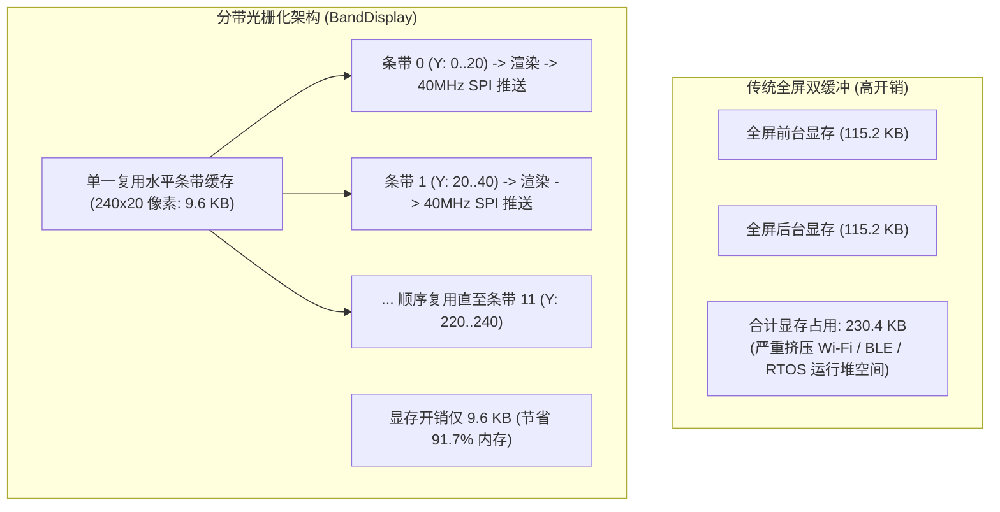
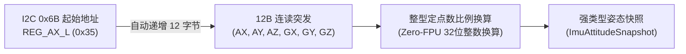
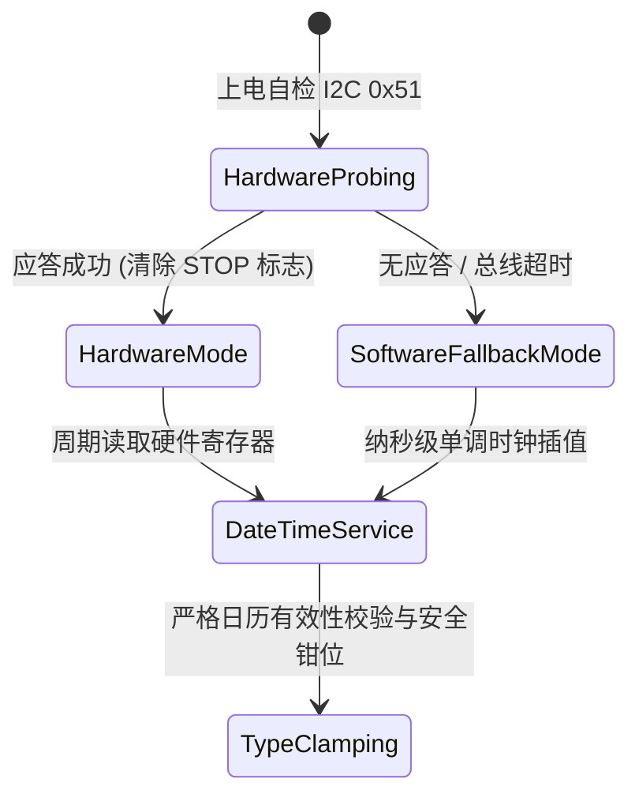
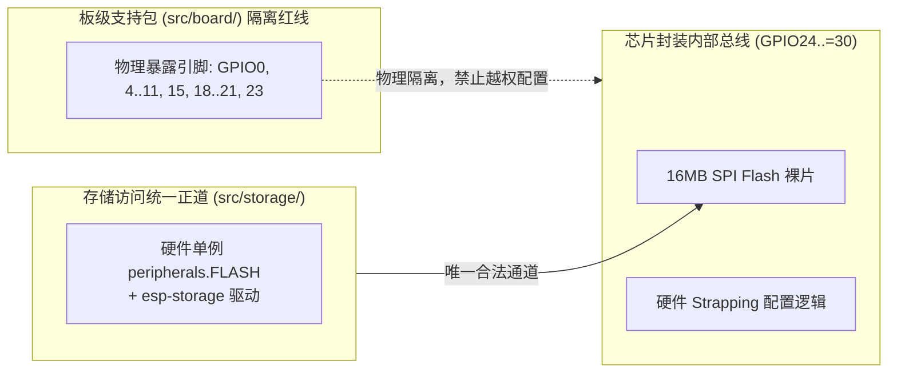

# 01. 硬件外设与板级支持包（BSP）架构

板级支持包（BSP）位于 [`src/board/`](../../src/board/)，负责将开发板的物理引脚与外设驱动封装为高级、类型安全、零冗余的硬件抽象接口。

---

## 1. 硬件外设与管脚约束映射

| 外设模块 | 硬件芯片 / 接口 | 管脚分配 | 通信协议 / 驱动模式 | 架构设计考量 |
| :--- | :--- | :--- | :--- | :--- |
| **圆形液晶屏** | GC9A01 1.28" (240x240) | SCK: `GPIO11` MOSI: `GPIO21` CS: `GPIO10` DC: `GPIO19` RST: `GPIO20` | SPI2 (40MHz Blocking) | 独占硬件 SPI，CS 独立拉低，关闭 TF 卡 CS (`GPIO15`) 杜绝总线竞争 |
| **屏幕背光** | N-MOS 开关电路 | `GPIO7` | LEDC 低速通道 0 (20kHz PWM) | 8位占空比，实现 0..100% 平滑调光与 1.2Hz 正弦脉冲呼吸 |
| **6轴惯性测量** | QMI8658 6-DOF IMU | SCL: `GPIO8` SDA: `GPIO18` INT1: `GPIO4` INT2: `GPIO5` | I2C0 (400kHz Fast Mode) | I2C 地址 `0x6B`，采用 12 字节连续突发读取以降低总线开销 |
| **硬件实时时钟** | PCF85063ATL RTC | SCL: `GPIO8` SDA: `GPIO18` INT: `GPIO6` | I2C0 (400kHz Fast Mode) | I2C 地址 `0x51`，与 IMU 共享 I2C0，支持硬件掉电走时与软件自适应回退 |
| **供电电压检测** | ETA6098 锂电管理 | ADC: `GPIO0` BC_STATUS: `GPIO23` | ADC1 通道 0 (11dB 衰减) + 数字输入 | $R_1=200\text{k}\Omega, R_8=100\text{k}\Omega$ 分压电路，3倍增益换算为轨电压；GPIO23 检测充电状态 |
| **交互按键** | 侧边 BOOT 按键 | `GPIO9` | 数字输入 (上拉电阻) | 物理低电平有效，硬件 Strapping 引脚；已解耦业务交互，仅供自检诊断透传 |
| **主机通信** | 原生 USB-Serial-JTAG | D+: `GPIO13` D-: `GPIO12` | 原生异步 USB CDC 虚拟串口 | 免外部串口芯片，供电、通信、日志、烧录一线双用 |
| **内部保护引脚** | 片内 Flash / Strapping | `GPIO24 ~ GPIO30` | 内部硬件保留 | 内部 Flash 总线物理隔离，不在 BSP 和用户态暴露配置 |

---

## 2. 内存受限下的分带显存架构（`BandDisplay`）

### 2.1 显存容量瓶颈与架构权衡
GC9A01 屏幕为 $240 \times 240$ 分辨率，在 16 位真彩色 RGB565 格式下：
$$\text{全屏双缓冲显存} = 240 \times 240 \times 2 \text{ bytes} \times 2 = 230.4\text{ KB}$$

ESP32-C6 总 SRAM 约 512KB。在 Wi-Fi 6 协议栈、BLE 5 射频控制器与 RTOS 任务并发运行时，连续分配 115KB~230KB 的显存会导致极高的内存碎片化与 OOM 风险。

### 2.2 240x20 水平分带光栅化机制
在 [`src/board/display.rs`](../../src/board/display.rs) 中，BSP 采用分带光栅化管线：
1. **单一静态分带内存借用**：
   - 屏幕在垂直方向划分为 12 个水平条带（每个条带尺寸为 $240 \times 20$ 像素，占用 9.6KB 静态缓冲区）。
   - 通过静态生命周期注入消除栈分配与值拷贝开销，从根源规避深栈帧溢出。
2. **引脚所有权聚合（`DisplayPins`）**：
   - 将 SPI 时钟、数据线、片选、复位、数据/命令选择引脚以及 SD 卡片选聚合为一个强类型结构体。
   - 在初始化阶段主动将 SD 卡片选（`GPIO15`）拉高去使能，物理切断同总线挂载的 TF 卡芯片，消除多从机竞争风险。
3. **窗口化坐标映射与图元裁剪（`BandTarget`）**：
   - 向上提供统一的图形绘制目标接口，绘制图元按全局坐标 $(X, Y \in [0, 240))$ 传入。
   - 光栅化层基于当前条带的垂直偏移量 $Y_{\text{offset}}$ 执行零开销硬件窗口裁剪，仅将落入 $[Y_{\text{offset}}, Y_{\text{offset}} + 20)$ 的像素点投影并着色至紧凑条带缓冲区。
4. **渲染循环与局部脏矩形加速**：
   - **全屏扫描**：顺序遍历 12 个条带，每个条带在完成图形光栅化后，通过 40MHz 高速 SPI 窗口写入驱动直传屏幕。
   - **局部脏矩形加速**：对于仅更新顶部灵动岛胶囊（$Y \in [22, 66]$）等局部界面的场景，管线支持限定渲染条带范围（仅刷新 3 个水平条带），总渲染耗时削减至全屏扫描的 $25\%$。
5. **屏幕物理朝向校准（`DisplayRotation::Rotate180`）**：
   - 微雪 ESP32-C6-LCD-1.28 的 GC9A01 液晶排线设计与板载 Type-C 接口（位于机身下方 6 点钟位置）呈 180 度反向。
   - 驱动初始化与配置阶段锁定 `DisplayRotation::Rotate180`（通过 MADCTL 寄存器设置 MX=1, MY=1），确保画面顶部（灵动岛胶囊）自然朝向 12 点钟远离 Type-C 口的上方正向，彻底消除默认 Rotate0 下画面上下倒挂的问题。

---

## 3. QMI8658 6-DOF 惯性传感器突发采样架构

在 [`src/board/imu.rs`](../../src/board/imu.rs) 中封装 QMI8658 六轴惯性传感器的低延迟采集逻辑：

1. **12 字节连读突发协议优化**：
   - 传感器配置为加速度计 $\pm 4\text{g}$（$8192\text{ LSB/g}$）与陀螺仪 $\pm 512\text{ dps}$（$64\text{ LSB/dps}$），输出速率 250Hz。
   - 充分利用芯片寄存器地址自增特性，以单次 I2C 复合事务（`write_read`）连续读取 12 字节加速度与角速度原始数据。
   - 相较于 6 次独立读取，消除了 5 次多余的 I2C 起始位、从机寻址与停止位开销，大幅降低总线占用时间。
2. **Zero-FPU 定点算术换算与机身屏幕坐标系映射**：
   - 加速度换算为毫重力（$\text{mg}$）：
     $$\text{ax\_mg} = \frac{\text{raw\_ax} \times 125}{1024}$$
     $$\text{ay\_mg} = \frac{\text{raw\_ay} \times 125}{1024}$$
     $$\text{az\_mg} = -\frac{\text{raw\_az} \times 125}{1024}$$
   - 陀螺仪换算为毫度每秒（$\text{mdps}$）：
     $$\text{gx\_mdps} = \frac{\text{raw\_gx} \times 125}{8}$$
     $$\text{gy\_mdps} = \frac{\text{raw\_gy} \times 125}{8}$$
     $$\text{gz\_mdps} = -\frac{\text{raw\_gz} \times 125}{8}$$
   - **硬件贴装坐标校正**：微雪 ESP32-C6-LCD-1.28 将 QMI8658 贴装在 PCB 底面（反面）。为建立以正面圆形 LCD 为基准的统一机体坐标系（屏幕正面上仰指向天空为 $+Z$ 轴，静止平放重力应为 $+1000\text{mg}$），BSP 层对底层芯片反扣朝向的 $Z$ 轴加速度与角速度实施极性反转映射，彻底消除“屏幕朝上放置时被误判为反扣（FaceDown）熄屏”的硬件倒置缺陷。
   - 全程采用 32 位整型乘除法，规避 RV32IMAC 无硬浮点单元导致的软件浮点库性能损耗。
3. **强类型姿态快照与容错降级模型**：
   - 抽象出明确的状态模型：正常就绪（`HardwarePresent`）与故障降级（`Unavailable`）。
   - 将加速度、角速度、解算角度（横滚、俯仰、航向）及健康状态封装为聚合姿态快照，消除裸数据元组传递引发的语义混淆；当总线抖动或器件脱落时系统平滑降级，杜绝直接 Panic。

---

## 4. PCF85063 硬件与软件时钟双轨自适应架构

针对生产批次未贴片硬件 RTC 或纽扣电池电量耗尽的工况，在 [`src/board/rtc.rs`](../../src/board/rtc.rs) 中实现双轨时钟机制：

1. **硬件自检与动态降级**：
   - 开机尝试访问 I2C `0x51` 的控制寄存器。若收到应答则清除停振标志，确立为硬件走时模式；若超时无应答，则无缝切换至软件后备模式，系统对外接口保持完全透明统一。
2. **高精度软件时钟插值**：
   - 软件后备模式以基准纪元秒数配合单调时钟（`Instant`）的高精度流逝时长进行累加，维持纳秒级时钟外推。
3. **类型不变性保护（Type Invariant Protection）**：
   - 日历数据模型引入合法性校验与安全钳位机制，严格处理平闰年、大小月及闰秒范围；
   - 当外界噪点干扰导致 I2C 读出非法时钟值时，通过安全钳位防止构造出非法时间对象；所有时钟操作返回结构化错误类型，禁止裸布尔或空单元错误。

---

## 5. 供电轨与按键监控架构

在 [`src/board/power_key.rs`](../../src/board/power_key.rs) 中集成电源状态与物理按键采集：

1. **电阻分压网络、ADC 转换完成守候与 EMA 平滑滤波**：
   - ETA6098 锂电输入轨经过 $R_1=200\text{k}\Omega$ 与 $R_8=100\text{k}\Omega$ 分压网络（分压比 1/3）接入 ADC1 通道 0（`GPIO0`）。
   - 选用 11dB 衰减档位（ESP32-C6 对应输入上限 2500mV，折合轨电压上限 7500mV）。
   - **非阻塞轮询避免 0V 陷阱**：针对 `nb::read_oneshot` 异步转换进行有界微秒轮询，彻底杜绝因瞬时 `WouldBlock` 返回 0V 导致电压在 0V 与真实电压间交替闪烁的缺陷。
   - **一阶指数平滑滤波（EMA）**：采样引入 $V_{\text{smooth}} = \frac{7 \cdot V_{\text{smooth}} + V_{\text{instant}}}{8}$ 低通滤波与物理边界安全钳位（3000mV ~ 4350mV），配合 UI 端的 20mV 变化滞后死区，彻底消除了电源高频噪声与读数跳动，确保显示稳健平滑。
2. **充电状态感知**：
   - `GPIO23` 采样 ETA6098 的 `BC_STATUS` 开漏状态，明确区分充电中与充满/待机两种工作状态。
3. **强类型电源快照**：
   - 轨电压、充电枚举状态（`StandbyOrDone` / `Charging`）以及按键触发状态统一封装，杜绝多重布尔参数传递造成的布尔盲目（Boolean Blindness）。

---

## 6. 芯片内部 Flash 与 Strapping 引脚物理隔离原则

在 ESP32-C6 芯片中，`GPIO24 ~ GPIO30` 在封装内部用于高速 SPI NOR Flash 与硬件 Strapping 配置。

- **BSP 职责纯化**：[`BoardPeripherals`](../../src/board/mod.rs) 严格遵循最小权限原则，仅暴露并配置外部物理引脚，坚决不向用户态提供内部总线引脚句柄。
- **Flash 访问统一正道**：片上 16MB SPI NOR Flash 的扇区擦写与黑匣子操作，统一通过专用硬件控制器单例与 [`StorageManager`](../../src/storage/mod.rs) 执行，杜绝任何软件手动翻转内部总线引脚的操作。
