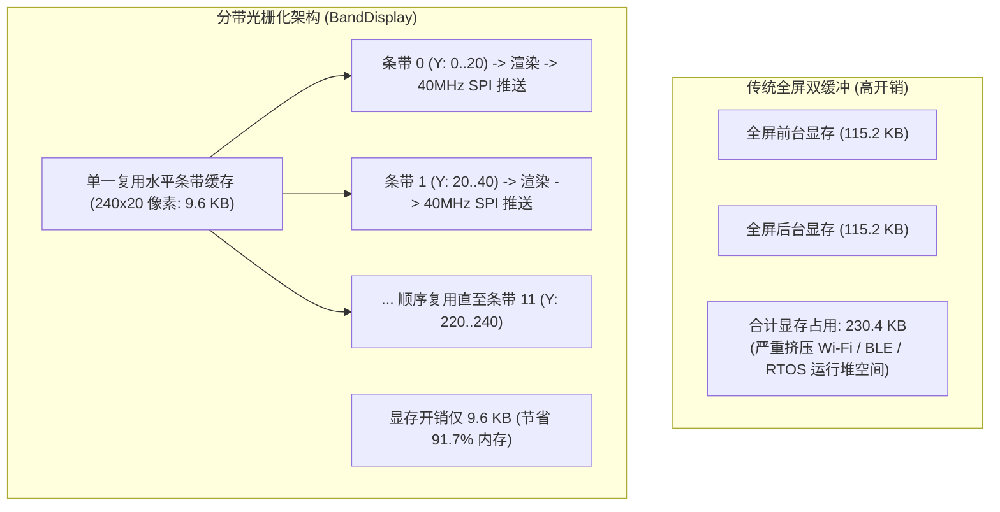
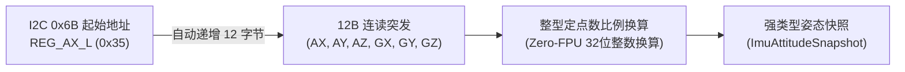
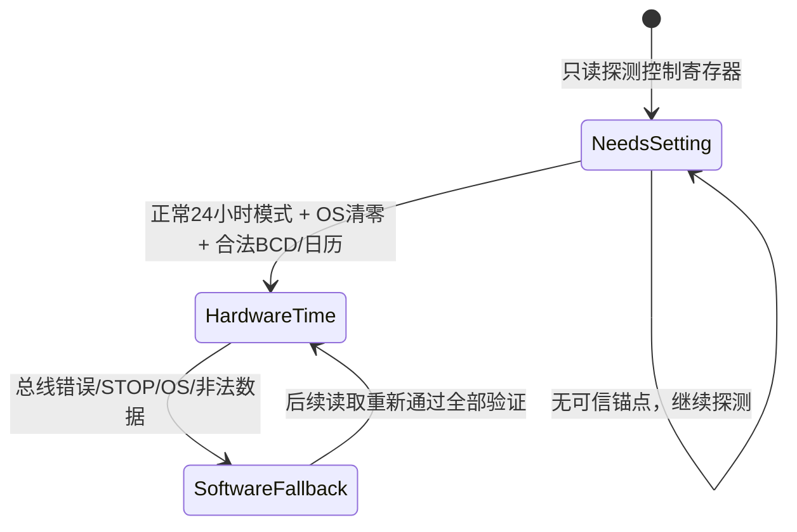
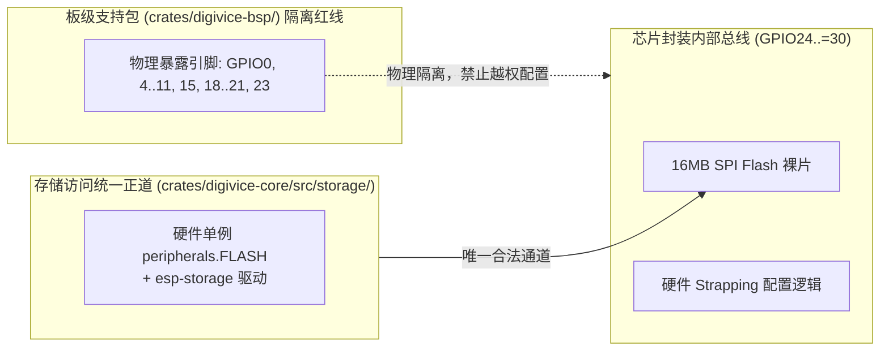

# 01. 硬件外设与板级支持包（BSP）架构

板级支持包（BSP）位于 [`crates/digivice-bsp/`](../../crates/digivice-bsp/)，负责将开发板的物理引脚与外设驱动封装为高级、类型安全、零冗余的硬件抽象接口。

---

## 1. 硬件外设与管脚约束映射

| 外设模块 | 硬件芯片 / 接口 | 管脚分配 | 通信协议 / 驱动模式 | 架构设计考量 |
| :--- | :--- | :--- | :--- | :--- |
| **圆形液晶屏** | GC9A01 1.28" (240x240) | SCK: `GPIO11` MOSI: `GPIO21` CS: `GPIO10` DC: `GPIO19` RST: `GPIO20` | SPI2 (40MHz Blocking) | 独占硬件 SPI，CS 独立拉低，关闭 TF 卡 CS (`GPIO15`) 杜绝总线竞争；复位后发送 Waveshare 完整厂商解锁/电源/伽马初始化序列，再发送 MADCTL/GRAM 窗口数据 |
| **屏幕背光** | N-MOS 开关电路 | `GPIO7` | LEDC 低速通道 0 (20kHz PWM) | 8位占空比，实现 0..100% 平滑调光与 1.2Hz 正弦脉冲呼吸 |
| **6轴惯性测量** | QMI8658 6-DOF IMU | SCL: `GPIO8` SDA: `GPIO18` INT1: `GPIO5` INT2: `GPIO4` | I2C0 (400kHz Fast Mode) | I2C 地址 `0x6B`，采用 12 字节连续突发读取以降低总线开销 |
| **硬件实时时钟** | PCF85063ATL RTC | SCL: `GPIO8` SDA: `GPIO18` INT: `GPIO6` | I2C0 (400kHz Fast Mode) | I2C 地址 `0x51`，与 IMU 共享 I2C0，支持硬件掉电走时与软件自适应回退 |
| **供电电压检测** | ETA6098 锂电管理 | ADC: `GPIO0` BC_STATUS: `GPIO23` | ADC1 通道 0 (11dB 衰减) + 数字输入 | $R_1=200\text{k}\Omega, R_8=100\text{k}\Omega$ 分压电路，3倍增益换算为轨电压；GPIO23 检测充电状态 |
| **交互按键** | 侧边 BOOT 按键 | `GPIO9` | 数字输入 (上拉电阻) | 物理低电平有效，硬件 Strapping 引脚；运行时切换 Pet/Status，自检透传按下状态 |
| **开发/供电接口** | 原生 USB-Serial-JTAG | D+: `GPIO13` D-: `GPIO12` | JTAG、日志、烧录与供电 | 不承载产品业务协议；电脑操作统一走 BLE HID |
| **内部保护引脚** | 片内 Flash / Strapping | `GPIO24 ~ GPIO30` | 内部硬件保留 | 内部 Flash 总线物理隔离，不在 BSP 和用户态暴露配置 |

---

## 2. 内存受限下的分带显存架构（`BandDisplay`）

### 2.1 显存容量瓶颈与架构权衡
GC9A01 屏幕为 $240 \times 240$ 分辨率，在 16 位真彩色 RGB565 格式下：
$$\text{全屏双缓冲显存} = 240 \times 240 \times 2 \text{ bytes} \times 2 = 230.4\text{ KB}$$

ESP32-C6 总 SRAM 约 512KB。在 Wi-Fi 6 协议栈、BLE 5 射频控制器与 RTOS 任务并发运行时，连续分配 115KB~230KB 的显存会导致极高的内存碎片化与 OOM 风险。

### 2.2 240x20 水平分带光栅化机制
在 [`crates/digivice-bsp/display.rs`](../../crates/digivice-bsp/src/display.rs) 中，BSP 采用分带光栅化管线：
1. **单一静态分带内存借用**：
   - 屏幕在垂直方向划分为 12 个水平条带（每个条带尺寸为 $240 \times 20$ 像素，占用 9.6KB 静态缓冲区）。
   - 通过静态生命周期注入消除栈分配与值拷贝开销，从根源规避深栈帧溢出。
2. **引脚所有权聚合（`DisplayPins`）**：
   - 将 SPI 时钟、数据线、片选、复位、数据/命令选择引脚以及 SD 卡片选聚合为一个强类型结构体。
   - 在初始化阶段主动将 SD 卡片选（`GPIO15`）拉高去使能，物理切断同总线挂载的 TF 卡芯片，消除多从机竞争风险。
3. **窗口化坐标映射与图元裁剪（`BandTarget`）**：
   - 向上提供统一的图形绘制目标接口，绘制图元按全局坐标 $(X, Y \in [0, 240))$ 传入。
   - 光栅化层基于当前条带的垂直偏移量 $Y_{\text{offset}}$ 执行零开销硬件窗口裁剪，仅将落入 $[Y_{\text{offset}}, Y_{\text{offset}} + 20)$ 的像素点投影并着色至紧凑条带缓冲区。
4. **渲染循环与局部脏矩形加速**：
   - **全屏扫描**：顺序遍历 12 个条带，每个条带在完成图形光栅化后，通过 40MHz 高速 SPI 窗口写入驱动直传屏幕。
   - **局部脏矩形加速**：对于仅更新局部界面或数码兽动画脏矩形的场景，管线支持限定渲染条带范围，显著削减总渲染耗时。

`flush_band` 和 `render_partial` 是带边界的公共入口：拒绝零高度、越过 240 行、超过
20 行带宽、反向或溢出的窗口，并返回 `DisplayError::OutOfBoundsError`；不会再因
`y_start + height - 1` 下溢或切片长度错误 panic。内部合法调用仍使用 240x20 条带，
实际 SPI 带宽收益仍需测量。
5. **屏幕物理朝向校准（`DisplayRotation::Rotate180`）**：
   - 微雪 ESP32-C6-LCD-1.28 的 GC9A01 液晶排线设计与板载 Type-C 接口（位于机身下方 6 点钟位置）呈 180 度反向。
   - 驱动初始化与配置阶段锁定 `DisplayRotation::Rotate180`（通过 MADCTL 寄存器设置 MX=1, MY=1），确保画面顶部自然朝向 12 点钟远离 Type-C 口的上方正向，彻底消除默认 Rotate0 下画面上下倒挂的问题。

### 2.3 面板启动诊断

生产 `BandDisplay::new` 在完成硬件复位和 Waveshare 厂商初始化后直接返回黑色缓冲，不再
固定阻塞 800ms 红屏；`digivice` 启动随后进入本地任务。红色握手仅由 `selftest` binary
显式执行并清屏，用于工厂区分 SPI/GC9A01/背光故障和深色 UI；串口仍打印 `LCD init complete`、
首帧渲染及条带传输错误。这样诊断能力保留，生产上电到可交互路径不承诺额外红屏延迟。

---

## 3. QMI8658 6-DOF 惯性传感器突发采样架构

在 [`crates/digivice-bsp/imu.rs`](../../crates/digivice-core/src/drivers/imu.rs) 中封装 QMI8658 六轴惯性传感器的低延迟采集逻辑：

1. **12 字节连读突发协议优化**：
   - 传感器配置为加速度计 $\pm 4\text{g}$（$8192\text{ LSB/g}$）与陀螺仪 $\pm 512\text{ dps}$（$64\text{ LSB/dps}$）。CTRL2=`0x15`、CTRL3=`0x55` 使用 ODR 码 `0x5`，在 6DOF 的标称输出速率为 **224.2Hz**，高于软件 5ms/200Hz 目标轮询；由驱动层结合连续流 data-ready 标志过滤重复读取，确保每次获取均为有效新鲜数据。
   - 充分利用芯片寄存器地址自增特性，以单次 I2C 复合事务（`write_read`）连续读取 12 字节加速度与角速度原始数据。
   - 相较于 6 次独立读取，消除了 5 次多余的 I2C 起始位、从机寻址与停止位开销，大幅降低总线占用时间。
2. **Zero-FPU 定点算术换算与机身屏幕坐标系映射**：
   - 加速度换算为毫重力（$\text{mg}$）：
     $$\text{ax\_mg} = \frac{\text{raw\_ax} \times 125}{1024}$$
     $$\text{ay\_mg} = \frac{\text{raw\_ay} \times 125}{1024}$$
     $$\text{az\_mg} = -\frac{\text{raw\_az} \times 125}{1024}$$
   - 陀螺仪换算为毫度每秒（$\text{mdps}$）：
     $$\text{gx\_mdps} = \frac{\text{raw\_gx} \times 125}{8}$$
     $$\text{gy\_mdps} = \frac{\text{raw\_gy} \times 125}{8}$$
     $$\text{gz\_mdps} = -\frac{\text{raw\_gz} \times 125}{8}$$
   - **硬件贴装坐标校正**：微雪 ESP32-C6-LCD-1.28 将 QMI8658 贴装在 PCB 底面（反面）。为建立以正面圆形 LCD 为基准的统一机体坐标系（屏幕正面上仰指向天空为 $+Z$ 轴，静止平放重力应为 $+1000\text{mg}$），BSP 层对底层芯片反扣朝向的 $Z$ 轴加速度与角速度实施极性反转映射，彻底消除“屏幕朝上放置时被误判为反扣（FaceDown）熄屏”的硬件倒置缺陷。
   - 全程采用 32 位整型乘除法，规避 RV32IMAC 无硬浮点单元导致的软件浮点库性能损耗。
3. **强类型姿态快照与容错降级模型**：
   - 抽象出明确的状态模型：正常就绪（`HardwarePresent`）与故障降级（`Unavailable`）。
   - 将加速度、角速度、解算角度（横滚、俯仰、航向）及健康状态封装为聚合姿态快照，消除裸数据元组传递引发的语义混淆；当总线抖动或器件脱落时系统平滑降级，杜绝直接 Panic。

### 3.1 六轴与温度分离

连续采样阶段的 `Qmi8658::read_sample` 只做一次从 `REG_AX_L=0x35` 开始的 12 字节数据读取；
初始化/重初始化后的首份数据另有 §3.2 的 STATUS0 检查。
`domain::ImuSample` 只含六个惯性轴，不再附带未被 UI 使用的温度或伪造的默认温度。
生产任务以 5ms 为目标采样周期，不读取温度。独立 `read_temperature` 仅在自检的约 1 秒
诊断日志周期读取 `0x33..0x34`，返回 `Result<ImuTemperature, ImuError>`；错误直接显示为
错误，不沿用旧值冒充本次测量。温度读取失败不改变六轴健康状态，也不丢弃已经成功的惯性样本。

依据 [QMI8658A 数据手册 Rev A](https://files.waveshare.com/upload/5/5f/QMI8658A_Datasheet_Rev_A.pdf)
（2022-06-20，§3.9、§5.6），输出是二补码、每 LSB 为 1/256°C，
`T = TEMP_H + TEMP_L/256`，**不额外加 25°C**。`ImuTemperature` 保留有符号原始值，
`centi_celsius()` 用拓宽整数返回百分之一摄氏度并向零截断；自检日志单位为 `cC`。
未从寄存器数值范围推断 -40～85°C 之外的测量精度或器件物理有效性。

驱动层将六轴惯性数据与温度读取彻底解耦：连续惯性采样仅执行 12 字节连读事务，避免低频温度读取干扰高频姿态采样；独立温度读取仅在自检或诊断时按需调用，并在驱动层实现了轴缩放、屏幕 Z 轴映射以及温度故障与六轴健康的相互隔离。

### 3.2 IMU 错误、重探测与首份数据

实际 I2C 六轴/状态读错立即将驱动健康改为 `Unavailable(BusError)`；身份错误和任一配置
写入失败分别报告 `DeviceNotFound` / `ConfigurationFailed`。`new_at` / `read_sample_at`
接收单调时间，生产兼容入口使用 `Instant::now()`。故障后至少 1 秒才重新读取 WHO_AM_I；
退避期间不访问 I2C，不在 200Hz 轮询中洪泛重探测。重探测身份匹配后先关闭两个传感器，
再依次恢复 CTRL1/2/3/5，最后 CTRL7=3 使能；任一步失败立即停止并重新退避。

初始化后的首份惯性数据要求 STATUS0 的 `aDA`/`gDA` 均为 1（数据手册 §5.5/Table 24）。
未就绪返回 `DataNotReady`，不读取/发布零数据；1 秒仍未取得首份数据时进入 1 秒退避后重配。
检查状态寄存器本身失败也进入总线故障路径。截止点溢出不退化成无间隔探测。
首份数据及连续流均检查 STATUS0 的两个 ready 位；未就绪时只返回 `DataNotReady`，
不读取 AX/GX 数据，防止 200Hz 轮询把同一份数据再次送入滤波器。

`ImuStatus::default` / 默认姿态快照为 `Unavailable(NotValidated)`，不默认冒充已验证硬件。
快照同时提供 `ImuAttitudeSnapshot::valid_sample` 与 `valid_filtered_gravity`：应用只在硬件健康时取得正常样本和低通滤波重力向量（$G_x, G_y, G_z$），错误载荷不会驱动宠物，也不覆盖
应用最后的样本/航向；自检同样保留最后数值并显示错误健康。`HardwarePresent` 在驱动完成
配置后表示可尝试采样，不等于 UI 已有一次有效测量；应用只消费实际采样结果产生的快照。

驱动层实现了完备的硬件异常状态机：覆盖指数退避期间零总线访问、错误身份防护、配置写入边界校验、运行期断连与恢复、首份数据就绪等待、连续流重复样本过滤及故障快照隔离，确保在 I2C 故障时系统平稳降级。

### 3.3 ODR 码与轮询速率

数据手册 Rev A §5.3/Table 22 的陀螺仪/6DOF ODR 表：`0x7=56.05Hz`、
`0x6=112.1Hz`、`0x5=224.2Hz`；加速度单独工作时的频率表不同，不能套用到双轴模式。
固件选择 `0x5`，让传感器 ODR 略高于 200Hz 协调器轮询，再由后续 data-ready 与实际时间步
避免把重复读取当成新样本。

---

## 4. PCF85063 硬件与软件时钟双轨自适应架构

针对生产批次未贴片硬件 RTC 或纽扣电池电量耗尽的工况，在 [`crates/digivice-bsp/rtc.rs`](../../crates/digivice-core/src/drivers/rtc.rs) 中实现双轨时钟机制：

日历值、验证错误、时钟健康与 epoch 转换属于 `domain/clock.rs`，可脱离 BSP 测试；`board/rtc.rs` 保持兼容重导出，仅实现 PCF85063 I2C 事务与单调外推锚点。

1. **器件应答不等于时间可信**：
   - 探测不再隐式修改控制寄存器或清除 STOP。STOP 为 bit 5，置位说明分频链停止；仅清位无法补回停走期间的时间，必须显式校时。12 小时模式（bit 1）与外部测试模式（bit 7）暂不支持，返回 `UnsupportedMode`，不把 AM/PM 当成 24 小时值。
   - 每次读取先检查控制模式，再检查秒寄存器 OS（bit 7）、BCD 每个半字节、星期范围和严格日历构造（2020～2099、真实月天数、时分秒范围）。失败不钳位成可信日期，也不刷新软件锚点。普通读取不会清除 OS；设置时间时才写入新日历。
   - `RtcStatus` 区分 `HardwarePresent`（已验证硬件日历）、`FallbackSoftware(error)`（可信锚点外推）和 `NeedsSetting(error)`（只有占位日期）；后两者携带结构化原因。`is_hardware_present` 独立表示最近控制寄存器探测结果，不是时钟有效性的替代判断。
2. **最近可信日历锚点的软件外推**：
   - 每次成功读取刷新软件纪元与 `Instant`。失败时从最近可信锚点加完整秒数外推；连续失败不重新锚定。恢复时明确接受硬件校时，硬件被外部重设可能造成日期跳变，不保证对这种变化保持单调。
   - 没有可信锚点时使用 `DateTime::default()` 加启动经过秒数作为占位，`NeedsSetting` 明确声明它不是真实日期。软件外推没有跨断电走时能力，也不宣称纳秒级日期精度。
   - 每轮都尝试硬件读取，包括开机缺失后恢复；状态退化不会关闭重试。`new_at` / `get_datetime_at` 注入时间供 host 的真实 I2C 驱动故障脚本使用。
3. **健康状态传播与验证边界**：
   - 时钟模块覆盖跨午夜/闰日、OS 停振检测、STOP 分频停止、12 小时/测试模式防护、非法 BCD 过滤、零初始化检测及开机缺失后自适应重探测。
   - 生产任务通过 `snapshot` / `snapshot_at` 发布 `ClockSnapshot`，原子携带日历与健康；应用隔离不可信昼夜，自检分别显示硬件时间、已锚定外推、需要校时。当前 setter 对停止/不支持模式返回错误，不静默改变模式。

寄存器依据：[NXP PCF85063A 数据手册](https://www.nxp.com/docs/en/data-sheet/PCF85063A.pdf)，Rev. 7.3（2026-07-14），§7.2.1（STOP/12_24/EXT_TEST）、§7.3.1（OS）、§7.3.3（时制）。

---

## 5. 供电轨与按键监控架构

在 [`crates/digivice-bsp/power_key.rs`](../../crates/digivice-bsp/src/power_key.rs) 中集成电源状态与物理按键采集：

1. **电阻分压网络、ADC 转换完成守候与 EMA 平滑滤波**：
   - ETA6098 锂电输入轨经过 $R_1=200\text{k}\Omega$ 与 $R_8=100\text{k}\Omega$ 分压网络（分压比 1/3）接入 ADC1 通道 0（`GPIO0`）。
   - 选用 11dB 衰减档位（ESP32-C6 对应输入上限 2500mV，折合轨电压上限 7500mV）。
   - **非阻塞轮询避免 0V 陷阱**：针对 `nb::read_oneshot` 异步转换进行有界微秒轮询，彻底杜绝因瞬时 `WouldBlock` 返回 0V 导致电压在 0V 与真实电压间交替闪烁的缺陷。
   - **一阶指数平滑滤波（EMA）**：采样引入 $V_{\text{smooth}} = \frac{7 \cdot V_{\text{smooth}} + V_{\text{instant}}}{8}$ 低通滤波与物理边界安全钳位（3000mV ~ 4350mV），配合 UI 端的 20mV 变化滞后死区，彻底消除了电源高频噪声与读数跳动，确保显示稳健平滑。
2. **充电状态感知**：
   - `GPIO23` 采样 ETA6098 的 `BC_STATUS` 开漏状态，明确区分充电中与充满/待机两种工作状态。
3. **强类型电源快照**：
   - 轨电压、充电枚举状态（`StandbyOrDone` / `Charging`）以及按键触发状态统一封装，杜绝多重布尔参数传递造成的布尔盲目（Boolean Blindness）。

ADC 转换同时保留滤波显示值、最新物理换算值和 `VoltageValidity`（Valid、ConversionFailed、
BelowRange、AboveRange）。无效值不再被钳成 3000mV/4350mV 后伪装成健康电压；滤波显示值
保持上一份有效值，但诊断和应用可见性携带本次故障/越界状态。`VoltageMeasurement::from_adc`
使用当前分压公式计算原始毫伏，未声称该公式已由万用表校准。

### 5.1 BOOT 短按采样与去抖

ADC/充电遥测仍每 200ms 读取一次，但 GPIO9 按键现在独立以约 20ms 轮询；按键变化进入
领域层 `ButtonDebouncer`，需连续稳定 30ms 才产生 `Pressed`/`Released` 边沿。电源快照
沿用最近一次有效电压/充电值，仅在按键边沿或低频遥测更新时发布，避免 ADC 频率决定最短
可见按压。去抖时间由注入的 `Instant` 驱动，复位下载模式仍由硬件 strapping 决定。

---

## 6. 芯片内部 Flash 与 Strapping 引脚物理隔离原则

在 ESP32-C6 芯片中，`GPIO24 ~ GPIO30` 在封装内部用于高速 SPI NOR Flash 与硬件 Strapping 配置。

- **BSP 职责纯化**：[`BoardPeripherals`](../../crates/digivice-bsp/src/lib.rs) 严格遵循最小权限原则，仅暴露并配置外部物理引脚，坚决不向用户态提供内部总线引脚句柄。
- **Flash 访问统一正道**：片上 16MB SPI NOR Flash 的扇区擦写与黑匣子操作，统一通过专用硬件控制器单例与 [`StorageManager`](../../crates/digivice-core/crates/digivice-core/src/storage/mod.rs) 执行，杜绝任何软件手动翻转内部总线引脚的操作。
