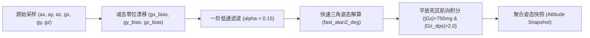
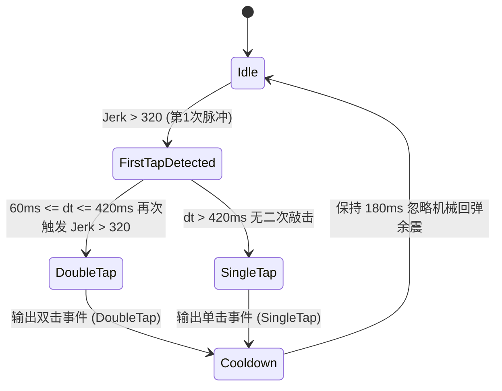

# 02. 物理姿态解算与手势识别引擎

手势识别与物理姿态处理模块位于 [`src/gesture/`](../../src/gesture/)，包含姿态解算滤波器 [`filter.rs`](../../src/gesture/filter.rs) 与事件检测状态机 [`detector.rs`](../../src/gesture/detector.rs)。

---

## 1. 姿态解算与滤波管线（`ImuFilter`）

`ImuFilter` 运行在 250Hz 的采样频率下（采样周期 $dt = 0.004\text{s}$），负责将带噪声的 6 轴原始加速度与角速度转换为干净的重力向量、姿态角与低漂移航向角。

### 1.1 一阶低通重力分离
当设备处于运动或桌面敲击状态时，原始加速度包含高频动态惯性力。为了准确得到设备相对于重力场的倾角，采用一阶数字低通滤波器（LPF）：
$$G_{k} = G_{k-1} + \alpha \cdot (A_k - G_{k-1})$$
其中滤波系数 $\alpha = 0.28$。在 200Hz 采样率下，该参数既能平滑滤除敲击产生的微高频杂波，又赋予了姿态解算灵敏敏捷的动态跟手性。

### 1.2 俯仰角与横滚角解算（Zero-FPU 快速有理逼近）
ESP32-C6 (RV32IMAC) 无硬件浮点单元。为避免在 250Hz 高频采样循环中调用高开销的 `libm::atan2f` 软件仿真库，姿态解算器采用了 Hastings 极值有理逼近算法（`fast_atan2_deg`）：
$$\theta(r) \approx \frac{57.29578 \cdot r}{1.0 + 0.28086 \cdot r^2} \quad (r \in [0, 1])$$
通过八分圆折叠映射，在全域 $360^\circ$ 范围内典型角度逼近误差低于 $0.3^\circ$，单次姿态角求解仅需 1 次浮点乘法与 1 次除法，显著降低单核 CPU 中断周期占用：
$$\text{Roll} = \text{fast\_atan2\_deg}(G_x, G_z)$$
$$\text{Pitch} = \text{fast\_atan2\_deg}(G_y, G_z)$$

### 1.3 消除漂移的死区航向梯形积分
传统仅依赖陀螺仪的航向角积分在静止时会因微小零漂不断自发旋转。`ImuFilter` 引入了**双重死区门限约束**：
1. **平放约束**：仅当屏幕正面向上且接近水平（$G_z > 750\text{mg}$）时才允许航向积分，翻转或悬空时不累加错误航向。
2. **旋转速度死区**：仅当角速度绝对值 $|\omega_z| > 2.0\text{ dps}$ 时才进行积分：
   $$\text{Heading}_{k} = \text{Heading}_{k-1} - \omega_z \cdot dt$$
   当旋转停止（$|\omega_z| \le 2.0\text{ dps}$）时完全冻结积分，彻底消除静止漂移。

---

## 2. 物理敲击（Tap）与急动度检测（Jerk Engine）

传统的敲击检测通常设置一个简单的加速度峰值阈值，但在日常使用中，用户拿起设备、移动设备或桌面轻微震动都会导致峰值误判。

### 2.1 急动度（Jerk）微分指标
为了精确识别“桌面对设备的硬质冲击波”，检测器计算**加速度变化率（急动度 Jerk）**：
$$\text{Jerk} = |A_{z, k} - A_{z, k-1}| + \frac{|A_{x, k} - A_{x, k-1}| + |A_{y, k} - A_{y, k-1}|}{2}$$
- 平滑拿起设备时：加速度绝对值很大，但 $\Delta A$ 很小，Jerk 极低。
- 手指正常敲击设备边缘或桌面时：产生陡峭的高频冲击应力波，$\text{Jerk} > 320$ 灵敏捕捉。

### 2.2 单击 / 双击识别状态机

- **消抖死区（$< 60\text{ms}$）**：首次敲击引发的壳体机械振铃谐振通常在此时间窗内衰减，在此时间窗内忽略，防止单次敲击被误判为双击。
- **自然双击窗（$60\text{ms} \le \Delta t \le 420\text{ms}$）**：大幅放宽符合人类手指自然敲击节奏的时间窗口。
- **超时触发单击（$> 420\text{ms}$）**：窗口结束后确认为单次轻敲。
- **冷却窗口（$180\text{ms}$）**：输出事件后进入极短冷却期，兼顾高频连击响应与防余震抖动。

---

## 3. 倾斜与反扣状态机（Tilt & FaceDown）

### 3.1 左右倾斜滞后锁定（Tilt Hysteresis）
当用户左右偏转设备（如左右摇摆切换灵动岛与桌宠视图）时，采用带滞后回差的双门限比较器：
- **人体工学轻触门限**：横滚角 $|\text{Roll}| > 18^\circ$（俯仰角放宽至 $< 50^\circ$），且仅需保持 $\ge 60\text{ms}$：
  - $\text{Roll} < -18^\circ \rightarrow$ 触发左倾斜并进入 `LockedLeft`。
  - $\text{Roll} > +18^\circ \rightarrow$ 触发右倾斜并进入 `LockedRight`。
- **恢复居中门限**：回正至 $|\text{Roll}| < 8^\circ$ 解除锁定，保持防抖回差的同时消除手势顿挫。

### 3.2 屏幕朝下扣放（FaceDown DND）
- **进入免打扰**：当过滤后的重力分量 $G_z < -650\text{mg}$（屏幕朝下反扣在桌面），并稳定保持 $\ge 200\text{ms}$ 时，触发进入反扣状态。UI 立即关闭屏幕背光（0% 亮度），电脑守护端激活系统勿扰模式。
- **退出免打扰**：当设备被翻转拾起至 $G_z > 400\text{mg}$，并稳定 $\ge 100\text{ms}$ 时，触发退出反扣状态，屏幕与主机恢复正常提醒。

---

## 4. 硬件引脚隔离与纯手势交互原则（GPIO9 Strapping Pin）

板载侧边按键为 ESP32-C6 的 **BOOT / Strapping 引脚（GPIO9）**：

- **硬件职责隔离**：
  根据硬件规格书说明，GPIO9 在芯片复位期间决定芯片是否进入 ROM 串口下载模式。若在运行期间将其作为交互功能键使用，不仅存在电气竞争风险，且桌面圆形硬件形态下按键不易触达。
- **免按键纯手势驱动交互（Touchless Physical Gestures）**：
  固件将 GPIO9 完全从业务交互与手势事件通道（`GESTURE_CHANNEL`）中解耦，禁止将 BOOT 键作为功能键使用：
  - **视图导航**：完全由机身左右倾斜手势（`TiltLeft` / `TiltRight`）驱动，在自检页、桌面灵动岛与桌面电子宠物之间丝滑巡航；
  - **任务审批与交互**：完全由机身双击轻敲（`DoubleTap`）驱动；
  - **免打扰控制**：完全由屏幕反扣（`FaceDown` / `FaceUp`）驱动。
- **硬件诊断透传**：
  `PowerKeyMonitor` 仅在低频采样中被动读取 GPIO9 电气电平，仅供工程自检页面（`SelfTestView`）显示引脚通断诊断状态（`BOOT:PRSD / REL`），不参与任何业务逻辑判定。
