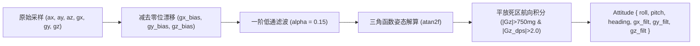
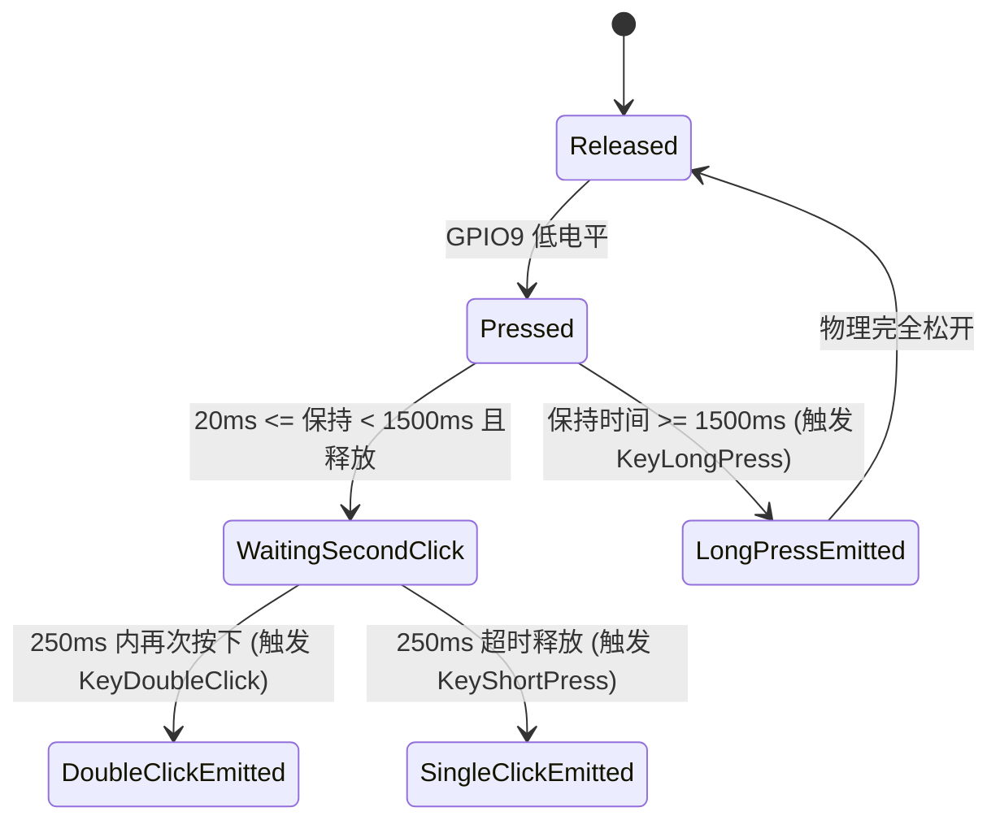

# 02. 物理姿态解算与手势识别引擎

手势识别与物理姿态处理模块位于 [`src/gesture/`](file:///Volumes/HIKSEMI/code/island/src/gesture/)，包含姿态解算滤波器 [`filter.rs`](file:///Volumes/HIKSEMI/code/island/src/gesture/filter.rs) 与事件检测状态机 [`detector.rs`](file:///Volumes/HIKSEMI/code/island/src/gesture/detector.rs)。

---

## 1. 姿态解算与滤波管线（`ImuFilter`）

`ImuFilter` 运行在 250Hz 的采样频率下（采样周期 $dt = 0.004\text{s}$），负责将带噪声的 6 轴原始加速度与角速度转换为干净的重力向量、姿态角与低漂移航向角。



### 1.1 一阶低通重力分离
当设备处于运动或桌面敲击状态时，原始加速度包含高频动态惯性力。为了准确得到设备相对于重力场的倾角，采用一阶数字低通滤波器（LPF）：
$$G_{k} = G_{k-1} + \alpha \cdot (A_k - G_{k-1})$$
其中滤波系数 $\alpha = 0.15$。在 250Hz 采样率下，该滤波器的截止频率约为 $6.5\text{Hz}$，既能平滑滤除敲击产生的剧烈抖动，又能实时跟踪设备倾斜。

### 1.2 俯仰角与横滚角解算
通过分离出的重力分量计算横滚角（Roll）与俯仰角（Pitch）：
$$\text{Roll} = \text{atan2}(G_x, G_z) \times \frac{180}{\pi}$$
$$\text{Pitch} = \text{atan2}(G_y, G_z) \times \frac{180}{\pi}$$

### 1.3 消除漂移的死区航向梯形积分
传统仅依赖陀螺仪的航向角积分在静止时会因微小零漂不断自发旋转。`ImuFilter` 引入了**双重死区门限约束**：
1. **平放约束**：仅当屏幕正面向上且接近水平（$G_z > 750\text{mg}$）时才允许航向积分，翻转或悬空时不累加错误航向。
2. **旋转速度死区**：仅当角速度绝对值 $|\omega_z| > 2.0\text{ dps}$ 时才进行积分：
   $$\text{Heading}_{k} = \text{Heading}_{k-1} - \omega_z \cdot dt$$
   当旋转停止（$|\omega_z| \le 2.0\text{ dps}$）时完全冻结积分，彻底消除静止漂移。

---

## 2. 物理敲击（Tap）与急动度检测（Jerk Engine）

传统的敲击检测通常设置一个简单的加速度峰值阈值，但在日常使用中，用户拿起设备、移动设备或桌面轻微震动都会导致峰值误判。

### 2.1 急动度（Jerk）微分指标
为了精确识别“桌面对设备的硬质冲击波”，检测器计算**加速度变化率（急动度 Jerk）**：
$$\text{Jerk} = |A_{z, k} - A_{z, k-1}| + \frac{|A_{x, k} - A_{x, k-1}| + |A_{y, k} - A_{y, k-1}|}{2}$$
- 平滑拿起设备时：加速度绝对值很大，但 $\Delta A$ 很小，Jerk 极低。
- 手指硬质敲击设备边缘时：产生陡峭的高频冲击应力波，$\text{Jerk} > 650$ 瞬时爆发。

### 2.2 单击 / 双击识别状态机
```mermaid
stateDiagram-v2
    [*] --> Idle
    Idle --> FirstTapDetected: Jerk > 650 (第1次脉冲)
    FirstTapDetected --> DoubleTap: 70ms <= dt <= 280ms 再次触发 Jerk > 650
    FirstTapDetected --> SingleTap: dt > 280ms 无二次敲击
    DoubleTap --> Cooldown: 发送 GestureEvent::DoubleTap
    SingleTap --> Cooldown: 发送 GestureEvent::SingleTap
    Cooldown --> Idle: 保持 300ms 忽略机械回弹余震
```
- **消抖死区（$< 70\text{ms}$）**：首次敲击引发的壳体机械振铃谐振通常在 50ms 内衰减，在此时间窗内忽略，防止单次敲击被误判为双击。
- **有效双击窗（$70\text{ms} \le \Delta t \le 280\text{ms}$）**：符合人类敲击交互节奏的时间窗口。
- **超时触发单击（$> 280\text{ms}$）**：窗口结束后若无后续敲击，确认为单次轻敲。
- **冷却窗口（$300\text{ms}$）**：输出事件后进入冷却期，屏蔽后续余震。

---

## 3. 倾斜与反扣状态机（Tilt & FaceDown）

### 3.1 左右倾斜滞后锁定（Tilt Hysteresis）
当用户左右偏转设备（如左右摇摆切换灵动岛与态势雷达视图）时，采用带滞后回差的双门限比较器：
- **倾斜触发门限**：横滚角 $|\text{Roll}| > 28^\circ$，且持续保持超过 $120\text{ms}$：
  - $\text{Roll} < -28^\circ \rightarrow$ 触发 `GestureEvent::TiltLeft` 并进入 `LockedLeft`。
  - $\text{Roll} > +28^\circ \rightarrow$ 触发 `GestureEvent::TiltRight` 并进入 `LockedRight`。
- **恢复居中门限**：必须回正至 $|\text{Roll}| < 12^\circ$ 才能解除锁定状态，彻底防止临界角度处的频繁抖动震荡。

### 3.2 屏幕朝下扣放（FaceDown DND）
- **进入免打扰**：当过滤后的重力分量 $G_z < -750\text{mg}$（屏幕朝下反扣在桌面），并持续稳定保持 $\ge 500\text{ms}$ 时，触发 `GestureEvent::FaceDownEnter`。UI 立即关闭屏幕背光（0% 亮度），电脑守护端激活系统勿扰模式。
- **退出免打扰**：当设备被翻转拾起至 $G_z > 500\text{mg}$，并持续 $\ge 300\text{ms}$ 时，触发 `GestureEvent::FaceDownExit`，屏幕与主机恢复正常提醒。

---

## 4. 按键防重入与消抖状态机（`ButtonDetector`）

板载侧边 BOOT 按键（GPIO9）支持短按单击、双击与长按操作，采用抗重入设计：



- **长按单次闭锁（`LongPressEmitted`）**：
  长按达到 1500ms 时立即触发 `GestureEvent::KeyLongPress`，随后状态机切换至 `LongPressEmitted` 闭锁状态。用户继续按住不放时不会重复触发长按，松开时也不会误触发短按，从根本上杜绝了按键长按状态机的经典重发缺陷。
