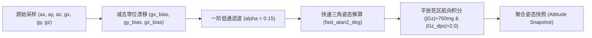
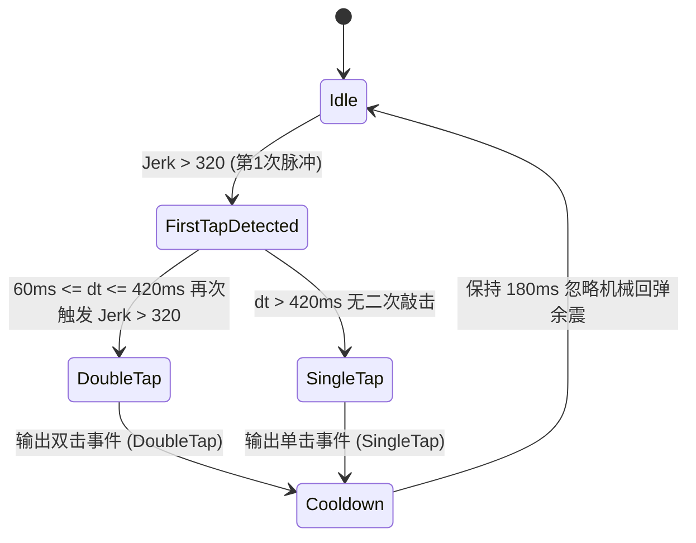
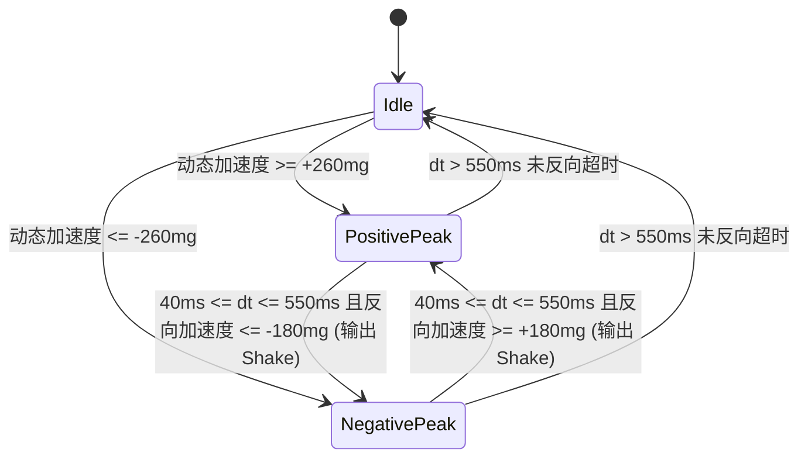

# 02. 物理姿态解算与手势识别引擎

手势识别与物理姿态处理模块位于 [`src/gesture/`](../../src/gesture/)，包含姿态解算滤波器 [`filter.rs`](../../src/gesture/filter.rs) 与事件检测状态机 [`detector.rs`](../../src/gesture/detector.rs)。

---

## 1. 姿态解算与滤波管线（`ImuFilter`）

`ImuFilter` 运行在 250Hz 的采样频率下（采样周期 $dt = 0.004\text{s}$），负责将带噪声的 6 轴原始加速度与角速度转换为干净的重力向量、姿态角与低漂移航向角。

### 1.1 一阶低通重力分离
当设备处于运动或桌面敲击状态时，原始加速度包含高频动态惯性力。为了准确得到设备相对于重力场的倾角，采用一阶数字低通滤波器（LPF）：
$$G_{k} = G_{k-1} + \alpha \cdot (A_k - G_{k-1})$$
其中滤波系数 $\alpha = 0.28$。在 200Hz 采样率下，该参数既能平滑滤除敲击产生的微高频杂波，又赋予了姿态解算灵敏敏捷的动态跟手性。

### 1.2 俯仰角与横滚角解算（Zero-FPU 快速有理逼近）
ESP32-C6 (RV32IMAC) 无硬件浮点单元。为避免在 250Hz 高频采样循环中调用高开销的 `libm::atan2f` 软件仿真库，姿态解算器采用了 Hastings 极值有理逼近算法（`fast_atan2_deg`）：
$$\theta(r) \approx \frac{57.29578 \cdot r}{1.0 + 0.28086 \cdot r^2} \quad (r \in [0, 1])$$
通过八分圆折叠映射，在全域 $360^\circ$ 范围内典型角度逼近误差低于 $0.3^\circ$，单次姿态角求解仅需 1 次浮点乘法与 1 次除法，显著降低单核 CPU 中断周期占用：
$$\text{Roll} = \text{fast\_atan2\_deg}(G_x, G_z)$$
$$\text{Pitch} = \text{fast\_atan2\_deg}(G_y, G_z)$$

### 1.3 消除漂移的死区航向梯形积分
传统仅依赖陀螺仪的航向角积分在静止时会因微小零漂不断自发旋转。`ImuFilter` 引入了**双重死区门限约束**：
1. **平放约束**：仅当屏幕正面向上且接近水平（$G_z > 750\text{mg}$）时才允许航向积分，翻转或悬空时不累加错误航向。
2. **旋转速度死区**：仅当角速度绝对值 $|\omega_z| > 2.0\text{ dps}$ 时才进行积分：
   $$\text{Heading}_{k} = \text{Heading}_{k-1} - \omega_z \cdot dt$$
   当旋转停止（$|\omega_z| \le 2.0\text{ dps}$）时完全冻结积分，彻底消除静止漂移。

---

## 2. 物理敲击（Tap）与急动度检测（Jerk Engine）

传统的敲击检测通常设置一个简单的加速度峰值阈值，但在日常使用中，用户拿起设备、移动设备或桌面轻微震动都会导致峰值误判。

### 2.1 急动度（Jerk）微分指标
为了精确识别“桌面对设备的硬质冲击波”，检测器计算**加速度变化率（急动度 Jerk）**：
$$\text{Jerk} = |A_{z, k} - A_{z, k-1}| + \frac{|A_{x, k} - A_{x, k-1}| + |A_{y, k} - A_{y, k-1}|}{2}$$
- 平滑拿起设备时：加速度绝对值很大，但 $\Delta A$ 很小，Jerk 极低。
- 手指正常敲击设备边缘或桌面时：产生陡峭的高频冲击应力波，$\text{Jerk} > 320$ 灵敏捕捉。

### 2.2 单击 / 双击识别状态机

- **消抖死区（$< 60\text{ms}$）**：首次敲击引发的壳体机械振铃谐振通常在此时间窗内衰减，在此时间窗内忽略，防止单次敲击被误判为双击。
- **自然双击窗（$60\text{ms} \le \Delta t \le 420\text{ms}$）**：大幅放宽符合人类手指自然敲击节奏的时间窗口。
- **超时触发单击（$> 420\text{ms}$）**：窗口结束后确认为单次轻敲。
- **冷却窗口（$180\text{ms}$）**：输出事件后进入极短冷却期，兼顾高频连击响应与防余震抖动。

---

## 3. 倾斜与反扣状态机（Tilt & FaceDown）

### 3.1 左右倾斜滞后锁定（Tilt Hysteresis）
当用户左右偏转设备（触发 BLE 媒体切歌与宠物侧倾回避反应）时，采用带滞后回差的双门限比较器：
- **人体工学轻触门限**：横滚角 $|\text{Roll}| > 18^\circ$（俯仰角放宽至 $< 50^\circ$），且仅需保持 $\ge 60\text{ms}$：
  - $\text{Roll} < -18^\circ \rightarrow$ 触发左倾斜并进入 `LockedLeft`。
  - $\text{Roll} > +18^\circ \rightarrow$ 触发右倾斜并进入 `LockedRight`。
- **恢复居中门限**：回正至 $|\text{Roll}| < 8^\circ$ 解除锁定，保持防抖回差的同时消除手势顿挫。

### 3.2 屏幕朝下扣放（FaceDown DND）
- **进入免打扰**：当过滤后的重力分量 $G_z < -650\text{mg}$（屏幕朝下反扣在桌面），并稳定保持 $\ge 200\text{ms}$ 时，触发进入反扣状态。UI 立即关闭屏幕背光（0% 亮度），宠物进入深度睡眠 `SleepingZzz`。
- **退出免打扰**：当设备被翻转拾起至 $G_z > 400\text{mg}$，并稳定 $\ge 100\text{ms}$ 时，触发退出反扣状态，恢复背光，宠物触发 `StretchAndYawn` 苏醒。

### 3.3 侧向倾斜直接跟随与抬起姿态恒正原则（Lateral Tilt & Pitch-Invariance）
为了实现“抬起不改变，同时往哪一侧倾斜就向那一侧”的人机工学物理交互，`DefaultPet` 与 `InertialTransform` 确立了如下姿态解算规则：
- **抬起不改变原则（Pitch-Invariance on Lift）**：
  将下方向有效重力基准定义为 Y-Z 平面合成重力分量 $G_{\text{down}} = \sqrt{a_y^2 + a_z^2}$。当用户将圆盘从桌面拿起、抬起或立姿斜放面向自己时（仅发生俯仰 Pitch 变化，侧向加速度 $a_x \approx 0$），数码兽始终坚守正向站立姿态（$0^\circ$），彻底消除手持立姿时意外倒置或乱偏的缺陷；
- **侧向倾斜直接跟随（Lateral Side-Tilt Responsiveness）**：
  倾角由侧向重力分量与垂向基准的反正切 $\theta_{\text{tilt}} = \operatorname{fast\_atan2\_deg}(a_x, G_{\text{down}})$ 唯一决定：
  - **向左侧倾斜（$a_x < -60\text{mg}$）**：倾角负向平滑偏转，数码兽向左侧倾斜并自动转身面向左方；
  - **向右侧倾斜（$a_x > +60\text{mg}$）**：倾角正向平滑偏转，数码兽向右侧倾斜并自动转身面向右方；
  - **水平/立姿中位死区（$|a_x| \le 60\text{mg}$）**：消除微小手抖与桌面微平误差，姿态保持 $0^\circ$ 正立。
- **最短圆弧平滑插值（Shortest-Path Circular EMA）**：
  在角度 cross $180^\circ$ 边界时，通过取模 `(target - curr).rem_euclid(360)` 自动选择最短旋转路径，消除跨越对顶角时产生 $360^\circ$ 倒转的视觉突变。
- **倾斜状态自主踱步抑制**：当检测到明显机身侧倾（$|\text{tilt\_deg}| > 8^\circ$）时，主动暂停自主左右踱步（`wander_x`），数码兽集中呈现平衡对抗与侧倾身姿。

---

## 4. 真实物理摇晃与钟摆特训引擎（Shake Engine）

为了完美还原初代数码暴龙机（Digital Monster Pendulum）的物理交互体验，`GestureDetector` 内置了纯定点数（Zero-FPU）的动态摇晃检测状态机：

### 4.1 Zero-FPU 8位定点数动态加速度高通提取
在 RV32IMAC 无硬件 FPU 的架构下，重力基准采用 8 位定点数（Q24.8）一阶数字低通滤波追踪：
$$\text{Base}_{k} = \text{Base}_{k-1} + \frac{A_k \ll 8 - \text{Base}_{k-1}}{128}$$
滤波时间常数 $\tau \approx 640\text{ms}$，在准确追踪静态重力倾斜的同时，完全不衰减人类 $2 \sim 5\text{Hz}$ 的自然摇晃动态。动态加速度 $A_{\text{dyn}} = (A_k \ll 8 - \text{Base}_k) \gg 8$。

### 4.2 双向滞后反转门限（Dual-Threshold Peak & Reversal）
- **触发启动门限**：主导轴（X/Y/Z 中动态幅值最大者）绝对值超过 $260\text{mg}$ 进入半波峰值态（`PositivePeak` / `NegativePeak`）。
- **极性反转识别门限**：加速度越过零点反向达到 $180\text{mg}$ 且周期窗满足 $40\text{ms} \le \Delta t \le 550\text{ms}$（对应人类手持晃动频率 $1.8 \sim 12.5\text{Hz}$），确认为一次有效半波摆动，输出 `GestureEvent::Shake` 并切换到对侧波峰等待下次反转。
- **高频滤除与超时重置**：$< 40\text{ms}$ 判定为机械碰撞冲击或高频杂波予以忽略；$> 550\text{ms}$ 无反向动作则判定为单次位移并平滑回退至 `Idle`。

### 4.3 互斥抑制与防误触保障
- **敲击与翻页抑制**：当动态加速度超过 $160\text{mg}$、摇晃进行中及摇晃停止后 $500\text{ms}$ 内，主动将 `tap_state` 强制复位为 `TapState::Idle`，`tilt_state` 强制复位为 `TiltState::Centered`。彻底避免起手晃动时的高急动度冲击被误判为桌面单击/双击（误触发切歌或投喂）或侧倾（误切换视图）。
- **桌宠视图自动聚焦**：当检测到 `GestureEvent::Shake` 时，应用层自动将当前视图切回 `ViewMode::Pet`，确保用户能即时观察到数码兽蓄力冲刺与数码矩阵粒子升格进化特效。

---

## 5. 硬件引脚隔离与辅助按键交互（GPIO9 Strapping Pin）

板载侧边按键为 ESP32-C6 的 **BOOT / Strapping 引脚（GPIO9）**：

- **硬件职责隔离**：
  根据硬件规格书说明，GPIO9 在芯片复位期间决定芯片是否进入 ROM 串口下载模式。在桌面圆形硬件形态下，设备日常以手势交互为主（敲击、摇晃、倾斜、反扣）。
- **辅助硬件按键与视图轮播**：
  `PowerKeyMonitor` 在 200ms 低频安全采样中监测 GPIO9 电平，并在 `AppStateMachine` 中响应按键触发：
  - **按下（Pressed）**：在 `ViewMode::Pet`、`ViewMode::Status` 与 `ViewMode::SelfTest` 三者间循环轮播视图；
  - **硬件自检透传**：在工程自检界面（`SelfTestView`）实时呈现通断状态（`BOOT:PRSD / REL`）。
