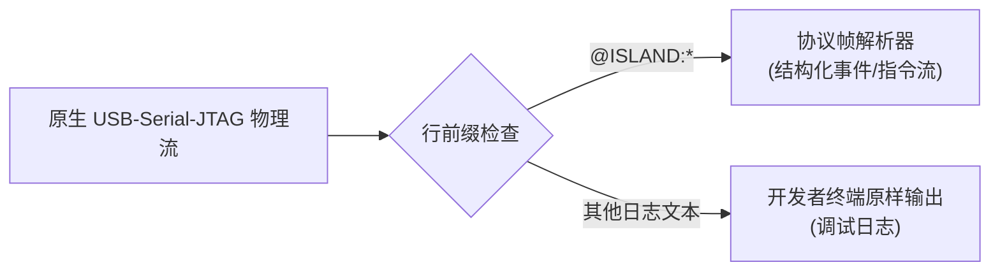
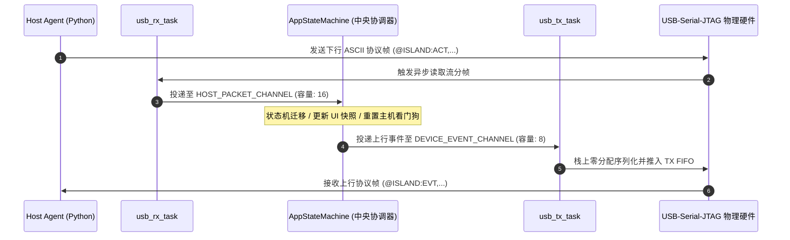

# 03. USB 双向协议栈与电脑守护服务

通信子系统位于板端的 [`src/proto/`](../../src/proto/) 与电脑端的 [`tools/host_agent.py`](../../tools/host_agent.py)，负责在微控制器与开发机之间建立全双工、零延迟、结构化的双向通信桥梁。

---

## 1. 信道复用与协议设计规约

### 1.1 一线双用与日志共存原理
微雪开发板使用原生 **USB-Serial-JTAG (`GPIO12`/`GPIO13`)**，同时承担三项职责：
1. **系统电源供电**；
2. **`esp-println` 文本调试日志输出**；
3. **结构化机器协议双向通信**。

为了在无外部专用通信串口芯片的前提下，使开发者在串口终端中直观阅读调试日志，同时让守护进程准确捕获结构化机器帧，系统采用了 **行前缀 ASCII 协议（Line-Delimited Frame Protocol）**：
- **普通日志行**：凡不以 `@ISLAND:` 开头的文本行，电脑守护端一律作为调试日志原样透传输出，便于开发诊断。
- **协议数据行**：以 `@ISLAND:` 开头、以 `\n` 结尾的文本行，守护进程立即拦截并解析。



---

## 2. 帧格式与协议语法

### 2.1 下行协议帧（Host PC $\rightarrow$ Device）

| 指令类型 | 语法格式 | 字段定义 | 触发周期 / 条件 |
| :--- | :--- | :--- | :--- |
| **系统遥测 (`SYS`)** | `@ISLAND:SYS,cpu=42,ram=68,rx_kbps=1240,tx_kbps=320,temp=56\n` | `cpu`: CPU 使用率 ($0..100$)%<br>`ram`: 内存使用率 ($0..100$)%<br>`rx_kbps`/`tx_kbps`: 网络上下行带宽<br>`temp`: CPU 核心温度 (°C) | 周期性下发 (2Hz) |
| **灵动岛任务 (`ACT`)** | `@ISLAND:ACT,state=WAIT_CONFIRM,source=Cargo,title=Run test?,progress=100\n` | `state`: 任务状态 (`IDLE`, `THINKING`, `WAIT_CONFIRM`, `SUCCESS`, `ERROR`)<br>`source`: 来源标识 (如 `Cargo`, `GitLab`)<br>`title`: 任务简要说明<br>`progress`: 进度 ($0..100$) | 事件驱动推送 |
| **时钟同步 (`SYNC`)** | `@ISLAND:SYNC,epoch=1792488000,tz=480,media=Active\n` | `epoch`: Unix 秒级时间戳<br>`tz`: 本地时区偏移 (分钟，东八区为 $+480$)<br>`media`: 当前媒体播放状态 | 开机及每分钟定期校准 |
| **黑匣子导出 (`DUMP_LOGS`)** | `@ISLAND:DUMP_LOGS\n` | 无附加字段，请求导出最近历史态势快照 | 开发者按需触发 |
| **BLE目标绑定 (`BLE_BIND`)** | `@ISLAND:BLE_BIND,hash=43981\n` | `hash`: 16位目标 MAC 折叠哈希 ($1..65535$)，传 0 为清除绑定 | 守护进程目标配置 |

### 2.2 上行协议帧（Device $\rightarrow$ Host PC）

| 事件类型 | 语法格式 | 语义说明 |
| :--- | :--- | :--- |
| **双击审批 (`DOUBLE_TAP`)** | `@ISLAND:EVT,type=DOUBLE_TAP,mode=ISLAND,context=WAIT_CONFIRM\n` | 用户双击设备边缘，批准当前的 AI 指令执行或发布任务 |
| **单击消除 (`SINGLE_TAP`)** | `@ISLAND:EVT,type=SINGLE_TAP,mode=ISLAND,context=NOTIFY_CLEAR\n` | 用户轻敲设备，确认并消除已完成的任务提醒卡片 |
| **反扣免打扰 (`FACE_DOWN`)** | `@ISLAND:EVT,type=FACE_DOWN,state=ENTER\n`<br>`@ISLAND:EVT,type=FACE_DOWN,state=EXIT\n` | 屏幕朝下扣放进入免打扰，或翻转拾起退出免打扰 |
| **在席感应 (`PRESENCE`)** | `@ISLAND:EVT,type=PRESENCE,state=AWAY,rssi=-82\n`<br>`@ISLAND:EVT,type=PRESENCE,state=NEAR,rssi=-54\n` | 基于目标蓝牙信号平滑判定离席 (触发锁屏) 或返岗亮屏 |
| **健康心跳 (`HEARTBEAT`)** | `@ISLAND:EVT,type=HEARTBEAT,v_rail=4185,uptime=3600\n` | 周期性上报硬件供电轨采样电压 (mV) 与系统连续运行秒数 (5s 周期) |
| **快照导出响应 (`LOGS_DUMP_START`)** | `@ISLAND:LOGS_DUMP_START\n` | 设备成功记录并就绪黑匣子日志后的响应回执 |

---

## 3. 固件端通信架构与模型设计



### 3.1 零堆分配栈序列化架构
为满足 `#![no_std]` 嵌入式高可靠环境，固件端严禁在协议序列化阶段进行堆内存分配与动态扩容：
- **栈上固定缓冲区格式化**：所有上行事件在栈上预分配的定长缓冲区（96 字节）内完成高效格式化。
- **协议语义与线缆分包解耦**：事件格式化器只生成纯净文本，由传输驱动统一注入 `\n` 行分界符，确保单条完整帧原子写入物理 USB TX FIFO，根除多任务交错打印引发的帧截断问题。

### 3.2 全双工无死锁任务解耦
- **收发链路物理分离**：原生 USB 驱动在初始化后拆分为接收半部与发送半部，分别由独立的 Embassy 协程托管。当主机无下发指令导致接收端挂起时，完全不影响发送端向主机上报物理事件与心跳，彻底杜绝队头阻塞（Head-of-Line Blocking）。
- **背压防御与有界队列**：接收通道配置充足的缓冲深度（16 槽位），防止主机突发高频发送指令时导致固件事件丢失。

### 3.3 类型驱动正确性（Type-Driven Correctness）
- **让非法状态不可表达**：通知模型采用具名变体建模，空闲态绝不允许附带脏标题或残留进度；各种状态变体自带强类型载荷，根除无效参数组合。
- **上下文强类型消除字符串偏执**：交互上下文（如审批确认、通知消除）完全使用强类型枚举封装，而非弱类型字符串。
- **统一超时看门狗所有权**：主机 10 秒离线看门狗完全收敛于中央协调器单点调度，避免底层传输任务与应用层各自维护分布式定时器引发的状态竞争。

---

## 4. 电脑端全功能守护服务（`tools/host_agent.py`）

电脑端 Python 守护进程充当桌面终端的主机侧调度引擎：

```mermaid
flowchart TD
    subgraph Host["Host Agent (跨平台守护进程)"]
        Scanner["自动发现 USB 设备\n(VID: 0x303A, PID: 0x1001)"]
        Telem["系统指标采集 (psutil)\n(CPU, RAM, Net RX/TX, Temp)"]
        TimeSync["时钟对齐服务\n(Unix Epoch + 本地时区偏移)"]
        Dispatcher["事件路由中枢\n(handle_device_event)"]
        OS_Lock["操作系统原生锁屏执行器\n(macOS / Linux / Windows)"]
    end

    subgraph Hardware["ESP32-C6 Device"]
        USB_Serial["USB-Serial-JTAG 物理串口"]
    end

    Scanner -->|建立串口通信| USB_Serial
    Telem -->|2Hz @ISLAND:SYS| USB_Serial
    TimeSync -->|开机/@60s @ISLAND:SYNC| USB_Serial
    USB_Serial -->|@ISLAND:EVT,type=PRESENCE,state=AWAY| Dispatcher
    Dispatcher -->|触发锁屏| OS_Lock
```

### 4.1 跨平台原生锁屏机制
当用户离开工位触发 `state=AWAY` 时，守护服务根据运行操作系统调用底层接口立即锁屏：
- **macOS**：执行 `pmset displaysleepnow`，瞬间关闭屏幕进入睡眠锁定；
- **Linux**：调用 systemd 接口 `loginctl lock-session`；
- **Windows**：调用系统底层动态链接库 `ctypes.windll.user32.LockWorkStation()`。

### 4.2 CLI 快速调试与状态注入
守护脚本支持单次快速注入指令，极大加速了开发者调试：
- 模拟编译等待批准通知：
  `python3 tools/host_agent.py --notify "Approve git push?" --source "GitLab" --state "WAIT_CONFIRM"`
- 模拟构建成功 / 报错：
  `python3 tools/host_agent.py --notify "All tests passed" --source "Cargo" --state "SUCCESS"`
- 绑定 BLE 目标设备（0 为清除绑定）：
  `python3 tools/host_agent.py --ble-hash 0xABCD --duration 30`
- 触发黑匣子态势导出：
  `python3 tools/host_agent.py --dump-logs`
