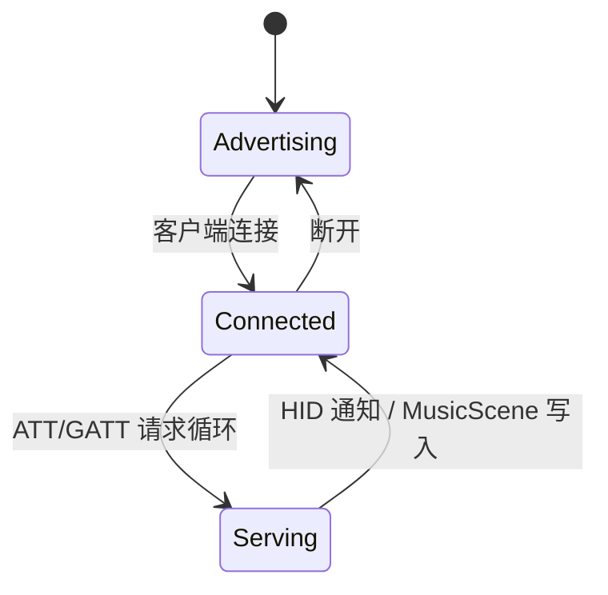

# 03. BLE 外设与 USB 调试边界

设备没有宿主业务协议。当前 ESP32-C6 的 USB-Serial-JTAG 只负责供电、烧录、JTAG 和 `esp-println` 日志；所有电脑操作和音乐输入均通过固件内置 BLE 服务完成。

## 1. 连接边界

| 链路 | 实现位置 | 产品职责 | 是否必需 |
| --- | --- | --- | --- |
| USB-Serial-JTAG | 芯片固定控制器 | 供电、刷写、JTAG、日志 | 否 |
| BLE HID over GATT | `src/radio/gatt.rs` + `src/radio/hid.rs` + `src/domain/action.rs` | Consumer Control 媒体控制 | 否 |
| MusicScene GATT | `src/radio/gatt.rs` + `src/domain/music.rs` | 接收节拍/能量/情绪特征 | 否 |
| BLE 扫描 | `src/radio/presence.rs` + `src/tasks/radio.rs` | 在席感知和本地安静/欢迎行为 | 否 |

USB 不会进入 `AppStateMachine`，也不可能覆盖 RTC、专注或宠物状态。

## 2. BLE HID Consumer Control

HID 服务使用标准 HID Service (`0x1812`)：

- HID Information (`0x2A4A`);
- Report Map (`0x2A4B`)，声明 Consumer Control 16 位 usage;
- Control Point (`0x2A4C`);
- Report (`0x2A4D`) 和 Report Reference (`0x2908`);
- Protocol Mode (`0x2A4E`)。

`src/domain/action.rs` 定义可复用的领域动作和标准 usage 映射：

```text
PlayPause      0x00CD
PreviousTrack  0x00B6
NextTrack      0x00B5
VolumeUp       0x00E9
VolumeDown     0x00EA
Mute           0x00E2
```

报告映射声明 Report ID `1` 和 16 位 usage，因此通知载荷固定为
`[0x01, usage_lo, usage_hi]`；每个按键报告随后发送 `[0x01, 0x00, 0x00]`
释放按键，避免主机把媒体控制误判为持续按下。

`HID_ACTION_CHANNEL` 由应用产生动作，BLE GATT 连接任务消费并发送通知。连接断开时，未发送的瞬时动作不会被重放；没有 HID 客户端时，动作只会被丢弃，不阻塞本地状态机。

## 3. MusicScene GATT

音乐服务使用自有 128 位 UUID，并提供 10 字节写入特征：

```text
version: u8          // 当前为 1
sequence: u16 LE
bpm: u16 LE          // 0 或 40..240
beat_phase: u8
energy: u8           // 0..100
mood: u8
section: u8
flags: u8
```

固件执行：

- 版本、长度、BPM 范围和序号校验；
- 序号回绕比较，旧帧不会覆盖新帧；
- 3 秒没有新帧时将场景变为 `Inactive`；
- `bpm=0` 仍可表示有效的情绪/能量输入，不会被立即丢弃；
- 原始音频、歌曲标题和账户信息不会进入设备。

写入成功后，场景进入 `MUSIC_SCENE_CHANNEL`，由 `AppStateMachine` 交给当前 `PetBehavior` 实现。GATT 断开不改变本地宠物和 FocusSession。

## 4. BLE 连接生命周期



BLE HCI runner、扫描任务和外设 GATT 任务共享 Trouble Host，但每条业务路径使用固定容量通道；ATT 请求处理不能阻塞传感器、专注和渲染任务。

## 5. 开发诊断边界

固件日志仍从 USB-Serial-JTAG 输出。仓库不再包含 `tools/`、`host_agent.py`、`@ISLAND:` 文本业务协议或电脑锁屏/遥测代码。任何新的诊断功能必须是一次性调试路径，不得重新成为宠物运行时依赖。
