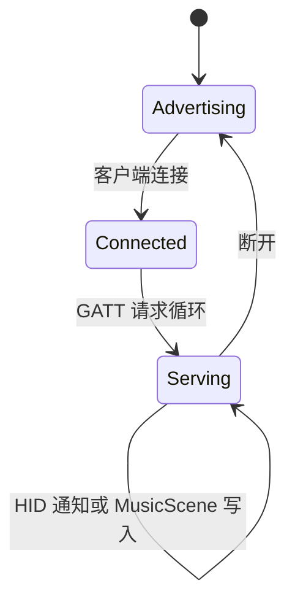

# 03. BLE 外设与 USB 调试边界

本章描述当前固件已经实现的无线业务和 USB 端口边界。设备的业务状态在本地运行；USB-C
不承载产品协议，BLE 连接也只是可选增强，断开后不会停止专注、宠物或显示任务。

## 1. 链路职责

| 链路 | 实现位置 | 产品职责 | 断开后的行为 |
| --- | --- | --- | --- |
| USB-Serial-JTAG | 芯片固定控制器 | 供电、刷写、JTAG、`esp-println` 日志 | 本地固件继续运行 |
| BLE 外设 GATT | `src/tasks/radio.rs`、`src/radio/gatt.rs` | HID Consumer Control 和 `MusicScene` 写入 | 丢弃瞬时 HID 事件，音乐回到本地行为 |
| BLE 扫描 | `src/radio/gatt.rs`、`src/radio/presence.rs`、`src/tasks/radio.rs` | 在席感知和目标 RSSI 统计 | 按看门狗策略保持 `Away` |

当前 GATT 属性表只有 HID Service 和 Music Service。配置写入、统计导出以及文件传输不属于
本版本的无线协议，不能在文档或实现中假定存在这些服务。

USB 不进入 `AppStateMachine`，也不会覆盖 RTC、专注、宠物或显示状态。USB 拔出、日志端口
关闭和 BLE 断开都不应成为本地状态机的停止条件。

## 2. BLE HID Consumer Control

`DigiviceGattServer::hid` 实现标准 HID Service (`0x1812`) 的最小 Consumer Control 外设：

- HID Information (`0x2A4A`)、Report Map (`0x2A4B`)、Control Point (`0x2A4C`)；
- Report (`0x2A4D`) 和 Report Reference (`0x2908`)；
- Protocol Mode (`0x2A4E`)。

`src/domain/action.rs` 中的领域动作映射到标准 16 位 Consumer usage：

```text
PlayPause      0x00CD
PreviousTrack  0x00B6
NextTrack      0x00B5
VolumeUp       0x00E9
VolumeDown     0x00EA
Mute           0x00E2
```

Report Map 使用 Report ID `1`，所以通知载荷固定为 `[0x01, usage_lo, usage_hi]`；发送动作后
立即发送 `[0x01, 0x00, 0x00]` 释放报告。`HID_ACTION_CHANNEL` 容量为 8，连接任务在断开、
无客户端或通知失败时丢弃过期瞬时动作，不能阻塞应用协调器。

## 3. MusicScene GATT

音乐输入使用自有 128 位 UUID 的写入特征（10 字节）：

```text
version: u8          // 当前为 1
sequence: u16 LE
bpm: u16 LE          // 0 或 40..=240
beat_phase: u8
energy: u8           // 0..=100，超出范围会被截断
mood: u8             // 1 Calm, 2 Happy, 3 Focused, 4 Excited, 5 Sad
section: u8          // 1 Intro, 2 Verse, 3 Chorus, 4 Bridge, 5 Outro
flags: u8             // 当前保留
```

`MusicScene::from_frame` 会检查长度、版本和 BPM；无效写入返回 ATT 错误，不进入应用通道。
应用协调器使用带回绕比较的 `sequence` 丢弃旧帧，且在 `3s` 没有新帧时生成 `Inactive` 场景。
音乐只改变宠物的低优先级情绪反应，不能覆盖 FaceDown、专注暂停或用户手势。

## 4. 在席扫描与事件边界

BLE HCI 回调把广播报告写入容量为 32 的 `BLE_ADVERTISEMENT_CHANNEL`。`BlePresenceTracker`
使用目标地址的 16 位折叠哈希和整数 EMA：

- EMA RSSI `>= -68 dBm` 进入 `Near`；
- EMA RSSI `< -78 dBm` 进入 `Away`，中间区间保持当前状态；
- 目标超过 15 秒未出现时进入 `Away`；
- 没有绑定目标时不伪造在席事件。

`radio_presence_task` 以 1 秒 ticker 为基线发布 `RadioReport`，收到广播或绑定命令后也会立即
刷新；报告进入容量为 4 的通道。目标绑定通过 `RADIO_TARGET_SIGNAL` 传给扫描任务，并通过
`TARGET_APPLIED_SIGNAL` 回传应用协调器；这些事件只影响本地背光和安静策略，不触发外部电脑操作。

## 5. BLE 连接生命周期



`ble_runner_task` 独占 HCI runner；`ble_scan_task` 管理扫描会话；`ble_peripheral_task` 负责
广告、GATT 请求和 HID 通知。所有业务队列均为固定容量，MusicScene 通道满时向客户端返回
资源错误，不能让 BLE 等待占用传感器、专注或渲染任务。
