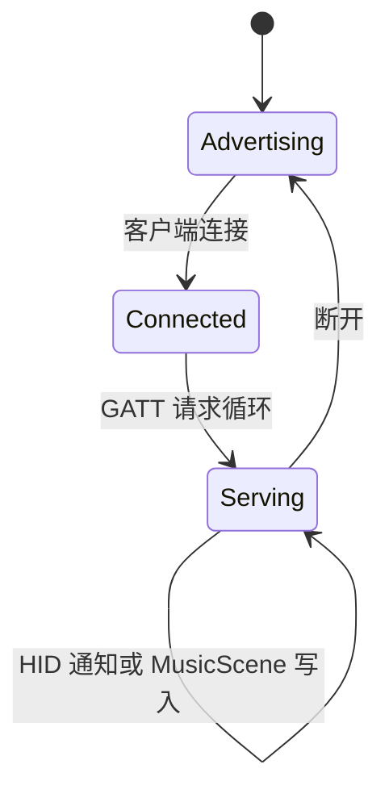

# 03. BLE 外设与 USB 调试边界

本章描述当前固件已经实现的无线业务和 USB 端口边界。设备的业务状态在本地运行；USB-C
不承载产品协议，BLE 连接也只是可选增强，断开后不会停止宠物或显示任务。

## 1. 链路职责

| 链路 | 实现位置 | 产品职责 | 断开后的行为 |
| --- | --- | --- | --- |
| USB-Serial-JTAG | 芯片固定控制器 | 供电、刷写、JTAG、`esp-println` 日志 | 本地固件继续运行 |
| BLE 外设 GATT | `crates/digivice-firmware/crates/digivice-firmware/src/tasks/radio.rs`、`crates/digivice-firmware/src/radio/gatt.rs` | HID Consumer Control 和 `MusicScene` 写入 | 丢弃瞬时 HID 事件，音乐回到本地行为 |
| BLE 扫描 | `crates/digivice-firmware/src/radio/gatt.rs`、`crates/digivice-core/src/protocol/presence.rs`、`crates/digivice-firmware/crates/digivice-firmware/src/tasks/radio.rs` | 在席感知和目标 RSSI 统计 | 按看门狗策略保持 `Away` |

当前 GATT 属性表只有 HID Service 和 Music Service。配置写入、统计导出以及文件传输不属于
本版本的无线协议，不能在文档或实现中假定存在这些服务。

USB 不进入 `AppStateMachine`，也不会覆盖 RTC、宠物或显示状态。USB 拔出、日志端口
关闭和 BLE 断开都不应成为本地状态机的停止条件。

## 2. BLE HID Consumer Control

`DigiviceGattServer::hid` 实现标准 HID Service (`0x1812`) 的最小 Consumer Control 外设：

- HID Information (`0x2A4A`)、Report Map (`0x2A4B`)、Control Point (`0x2A4C`)；
- Report (`0x2A4D`) 和 Report Reference (`0x2908`)；
- 仅支持 Report Protocol，不提供可写为未实现 Boot 模式的 Protocol Mode (`0x2A4E`) 特征。

`crates/digivice-core/src/domain/action.rs` 中的领域动作映射到标准 16 位 Consumer usage：

```text
PlayPause      0x00CD
PreviousTrack  0x00B6
NextTrack      0x00B5
VolumeUp       0x00E9
VolumeDown     0x00EA
Mute           0x00E2
```

Report Map 使用 Report ID `1`，Report Reference 为 `[0x01, 0x01]`（ID、Input 类型），
但 **GATT Report 值不包含 Report ID**：特征初值/释放为 `[0x00, 0x00]`，按下通知为
`[usage_lo, usage_hi]`。例如 PlayPause 为 `[0xCD, 0x00]`，不是 USB HID 风格的
`[0x01, 0xCD, 0x00]`。Map 的唯一输入字段为 `Report Size=16`、`Report Count=1`，
对应两字节特征；Map、Reference 和空闲值均引用 `radio/hid.rs` 的共同定义。

规范依据：[HIDS 1.0](https://www.bluetooth.com/specifications/specs/html/?src=hids_v1-0_1765320236/HIDS_v1.0/out/en/index-en.html)
§2.5.2/§2.5.3.2 定义 Report 数据及承载 ID/类型的 Reference；
[HOGP 1.1](https://www.bluetooth.com/specifications/specs/html/?src=hogp-v1-1_1755558551/HOGP_v1.1/out/en/index-en.html)
§4.8.1 明确由主机 translation layer 在交给 USB HID class driver **之前**添加 ID，反向发送前去掉 ID。
此处引用 1.1 的 GATT/USB 转换规则，不代表 ESP32-C6 实现了其 ISO 功能或完整 profile 合规。

host 回归直接编译实际编码器，覆盖六种媒体 usage、两字节释放，并解析真实共用 Map 校验
ID/输入类型/位数，严格保证 Report Map 与特征负载一致。

`HID_ACTION_CHANNEL` 容量为 8，无客户端/断开时丢弃瞬时动作，不阻塞应用协调器。
当前每次按下尝试后均优先归零，释放失败按下一节策略恢复；不能因发送 future 返回就保证
主机已经消费或已释放按键。旧版属性表/载荷已变化，主机若缓存旧 GATT 数据需清理缓存并重新发现；
当前没有 Service Changed/完整 bond 生命周期保证，不能假设已配对主机自动更新缓存。

### 2.1 HID 会话恢复与通知预算

`radio/hid_session.rs` 的 `HidSession` 不访问 GATT 或全局时钟，以注入的 `Instant` 管理
每个连接独立的订阅、Active/Suspended 和待释放状态。初次订阅、重新订阅及退出 Suspend
都先排队零 usage，再允许新的按下；不订阅或暂停时拒绝新按下且不发送报告。
调用 `begin_press` **在轮询发送 future 之前**标记待释放，即使按下失败、超时或 future
被取消，也不能以“没收到成功”推断主机一定没收到按下。待释放时所有新动作均拒绝。

恢复成功只指报告进入本地发送队列，不是主机确认；无订阅时的成功空操作不能清除待释放。
失败重试间隔 50ms，最多 3 次，截止点溢出或耗尽次数要求断开，不无限重试。订阅切换、
Suspend/Exit Suspend 不重置已使用的失败预算；重连创建新会话，只建立中立状态，不重放旧动作。
Control Point 仅解码单字节 `0` Suspend / `1` Exit Suspend；保留值或长度错误拒绝，不改变会话。

`ble_peripheral_task` 已采用这份策略：每次通知经真实 `queue_report_with_timeout` 最多等待
250ms，到期释放在主循环顶部先执行，不受普通 HID 或持续 GATT 事件抢占；重试间隔内仍服务
GATT。按下结果只报告 `press queued`、`queue failed` 或 `timed out`，不再统一打印 completed；
释放结果单独记录，失败耗尽后请求断开并清空瞬时队列。无订阅时 Trouble 的 `notify` 可能返回
成功空操作，所以适配层先检查实际 `should_notify`，不让空操作伪装成已送达。

Control Point 使用 HIDS 1.0 §2.11.1 指定的 Write Without Response，Suspend/Exit Suspend
会清理过期动作；暂停期间暂存的是“需归零”，不是待重放媒体动作。HID Information 清除
RemoteWake 标志（Flags=`0x02`），本版本不宣称暂停时能唤醒主机。Report-only Consumer
设备不支持 Boot，按 HIDS §2.2 的 C.4 规则省略可选 Protocol Mode，避免接受 Boot 写入却继续
发送 Report 数据。断开后同时将本地可读 Report 值重置为 `[0,0]`。

服务循环的 ATT 回复使用 `try_send`，发送队列满即记录错误并请求断开，不无限等待回复排队；
这是一项保守降级策略，不是拥塞下仍能交付全部回复的承诺。通知超时会取消当前 future，
但待释放保留在 future 之外；零 usage 重试幂等。核对 Trouble 0.8 的发送路径：排队成功与
future 完成在同次 poll，取消时不保留共享总线锁，已经开始的链路加密仍由 BLE 栈管理。

host 回归覆盖纯策略及实际超时适配器，使用 mock-driver/独立 generic timer queue 测试
249ms 未超时、250ms 超时、发送 future 被释放、错误与成功区分，以及外层取消后仍需归零。
这些是策略和时间边界证据，不是实际控制器/主机发送确认；250ms 是软件预算而非实测最大
链路时延。无订阅/Suspend 时恢复需等待重新订阅/Exit，持续链路或控制器故障也无法保证主机何时清除按键。

## 3. MusicScene GATT

音乐输入使用自有 128 位 UUID 的写入特征（10 字节）：

```text
version: u8          // 当前为 1
sequence: u16 LE
bpm: u16 LE          // 0 或 40..=240
beat_phase: u8
energy: u8           // 0..=100，超出范围会被截断
mood: u8             // 1 Calm, 2 Happy, 3 Focused, 4 Excited, 5 Sad
section: u8          // 1 Intro, 2 Verse, 3 Chorus, 4 Bridge, 5 Outro
flags: u8             // 当前保留
```

`MusicScene::from_frame` 会检查长度、版本和 BPM；无效写入返回 ATT 错误，不进入应用通道。
领域构造 `MusicScene::new` 使用相同 BPM 边界（0 或 40..=240），返回 `InvalidBpm` 而不
生成解码器无法接受的 1..39 或大于 240 值；energy 仍按领域规则限制在 0..=100。
应用协调器使用带回绕比较的 `sequence` 丢弃旧帧，且在 `3s` 没有新帧时生成 `Inactive` 场景。
音乐只改变宠物的低优先级情绪反应，不能覆盖 FaceDown 或用户手势。

## 4. 在席扫描与事件边界

BLE HCI 回调把广播报告写入容量为 32 的 `BLE_ADVERTISEMENT_CHANNEL`。`BlePresenceTracker`
使用目标地址的 16 位折叠哈希和整数 EMA：

- EMA RSSI `>= -68 dBm` 进入 `Near`；
- EMA RSSI `< -78 dBm` 进入 `Away`，中间区间保持当前状态；
- 目标超过 15 秒未出现时进入 `Away`；
- watchdog 同时清除目标可见性、RSSI 和当前候选 blip 表，不让历史广播继续作为绑定候选；
- 没有绑定目标时不伪造在席事件。

`radio_presence_task` 以 1 秒 ticker 为基线发布 `RadioReport`，收到广播或绑定命令后也会立即
刷新；报告进入容量为 4 的通道。目标绑定通过 `RADIO_TARGET_SIGNAL` 传给扫描任务，并通过
`TARGET_APPLIED_SIGNAL` 回传应用协调器；这些事件只影响本地背光和安静策略，不触发外部电脑操作。

## 5. BLE 连接生命周期



`ble_runner_task` 独占 HCI runner；`ble_scan_task` 管理扫描会话；`ble_peripheral_task` 负责
广告、GATT 请求和 HID 通知。所有业务队列均为固定容量，MusicScene 通道满时向客户端返回
资源错误，不能让 BLE 等待占用传感器或渲染任务。
