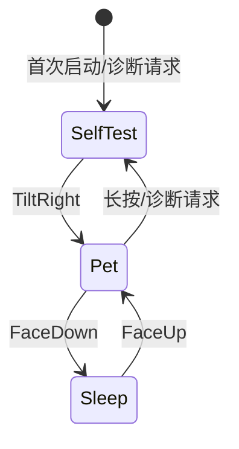

# 04. 软萌宠物视觉与混合渲染系统

UI 的主任务是让宠物看起来像一个有生命的软萌玩偶，而不是把电脑仪表盘缩小到圆屏上。240x240 圆屏仍保留硬件自检视图，但日常主视图改由 `PetFrame` 驱动。

---

## 1. 视觉方向

### 1.1 软萌玩偶规范

- 圆润轮廓、柔和渐变、腮红、双高光和少量装饰，避免赛博单眼和持续旋转 HUD 成为视觉主体；
- 颜色以奶油底、糖果色和低饱和阴影为主，情绪变化使用有限的强调色；
- 所有表情在圆屏安全视域内完成，主体不贴近 240px 外缘；
- 运动以呼吸、眨眼、轻摆、弹跳、注视和短剧情为主，避免高频全屏闪烁；
- 音乐、专注和在席状态通过宠物行为表达，只有诊断模式显示原始数值。

### 1.2 情绪集合

| `PetMood` | 触发 | 动作表现 |
| --- | --- | --- |
| `Normal` | 无事件 | 呼吸、偶尔眨眼、轻微注视 |
| `Happy` | 抚摸、音乐高潮、专注完成 | 弹跳、腮红、笑眼、短暂庆祝 |
| `Focused` | 专注阶段 | 眼神稳定、节律呼吸、轻微点头 |
| `Dizzy` | 摇晃或快速转动 | 交叉瞳孔、身体轻摆、短暂恢复 |
| `Sleepy` | 长时间无活动、低电量 | 眼睑下沉、动作变慢、打哈欠 |
| `Shocked` | 突发敲击或异常事件 | 睁大眼、身体回弹、短暂停顿 |
| `Sleeping` | FaceDown 或休息锁定 | 闭眼、低背光、停止高频动画 |

状态优先级固定为：安全/睡眠 > 用户手势 > 专注节律 > 音乐场景 > 空闲动画。

---

## 2. 场景与动画接口

### 2.1 `PetAnimationState` 与 `PetFrame`

`PetBehavior` 只维护一个权威的 `PetAnimationState`，避免情绪、眨眼、注视和时间轴
状态散落在应用层与渲染层；每次 tick 将它转换成不可变的 `PetFrame` 快照：

```text
PetFrame {
    mood: PetMood,
    pupil_shape: PupilShape,
    gaze_x: i8,
    gaze_y: i8,
    tilt_deg: i16,
    blink_pct: u8,
    happy_lift_pct: u8,
    anim_tick: u16,
    energy: u8,
    affinity: u16,
}
```

- `gaze_x/gaze_y/tilt_deg` 来自 IMU 的整数与短圆弧 EMA，不调用软件浮点三角函数；
- `mood/pupil_shape` 定义眼睛、嘴、腮红和高光组合；
- `blink_pct/happy_lift_pct/anim_tick` 为渲染器提供固定时间轴输入；
- `energy/affinity` 只用于宠物表现，不覆盖安全状态或设备配置。
- `PetFrame` 只读，渲染器不得反向修改动画状态。

### 2.2 动画时间轴

动画使用固定容量的关键帧时间轴：

- 关键帧包含姿态、表情、透明度和局部偏移；
- 使用预计算整数缓动表完成呼吸、弹跳和眨眼；
- 普通动画目标 20~33 FPS，睡眠和静止状态降到低刷新率；
- 新事件可以中断可中断动作，但不会跳过必须完成的安全收尾帧；
- 音乐拍点只同步动作起始或重音，不强制每一帧跟随节拍。

---

## 3. 混合资产渲染

当前 `render_pet` 的整屏几何重绘方式难以承载高质量可爱美术，目标实现改为“Flash 精灵 + 少量程序化图元”的混合渲染。

### 3.1 资产分层

1. **背景层**：纯色、渐变或低频装饰；
2. **玩偶主体层**：身体、耳朵、手和轮廓精灵；
3. **表情层**：眼睛、嘴、腮红、高光和情绪装饰；
4. **动作层**：弹跳、闪光、音乐节奏和庆祝粒子；
5. **状态层**：专注/充电/连接等小型徽章；
6. **诊断层**：只在自检视图显示硬件数据。

### 3.2 全彩 4bpp 精灵资产格式与 Blit 引擎 (`src/pet/assets/`)

系统采用专为片上 Flash 与 240x20 分带缓冲区设计的高性能 4bpp 像素精灵引擎：

- **正统万代调色板体系 (物种专属 Palette 与 `DIGIMON_16_PALETTE`)**：RGB565 格式固定 16 色常量数组，色值 0 为透明穿透色（Transparent Key）。全部 6 个物种（滚球兽、亚古兽、暴龙兽、机械暴龙兽、战斗暴龙兽与奥米加兽）均直接提取自万代官方 Digital Monster Color (DMC) / Pendulum Color (DPC) 官方点阵 ROM，具备 100% 官方还原的 16 色调色板；
- **紧凑打包 (`ColorSprite`)**：每字节打包两个 4 位像素（高 4 位为左像素，低 4 位为右像素），相比 16bpp 节省 75% Flash 空间。通过 `ColorSprite::with_palette` 允许每个精灵绑定专属调色板；
- **强类型翻转 (`SpriteFlip`)**：`SpriteFlip::Normal` 与 `SpriteFlip::Flipped` 消除布尔盲区，支持零成本水平转向（宠物根据注视、倾斜与漫游朝向实时面向左右转身）；
- **2D AABB 快速分带裁剪**：`blit_to_band_scaled` 在 2 周期内判定精灵是否相交，非相交带立即以 0 纳秒退出；
- **Zero-FPU 任意角度旋转光栅化 (`blit_to_band_rotated`)**：
  - 内置 91 项 Q12 定点数三角函数查找表（`SIN_LUT_Q12`，仅占 182 字节 ROM），在 RV32IMAC 无浮点核上以常数级指令完成 `(sin, cos)` 变换；
  - 采用逆向映射（Screen-to-Sprite Inverse Mapping），扫描线内层循环仅包含两次整数加法（`u_fixed += du; v_fixed += dv;`），将旋转开销压缩在 0.2ms 以内；
  - 在 `pet.tilt_deg == 0` 时自动回退至高速直接缩放（`blit_to_band_scaled`），兼顾极端性能与全向物理旋转；
  - 动态脏矩形扩展：在数码兽发生物理倾斜旋转时，`pet_dirty_y_bounds` 自动拓宽至全屏（`0..239`），防止旋转带间产生残留撕裂伪影。
- **全阶段物种正统万代像素穷举渲染 (Exhaustive Bandai Species Blitting)**：
  - `render_pet` 对 `PetSpecies` 6 个阶段（`Koromon`, `Agumon`, `Greymon`, `MetalGreymon`, `WarGreymon`, `Omegamon`）进行强类型穷举解构，零通配符；
  - 每一个物种均采用统一规范的 2x 细腻度渲染（48x48 官方精灵在 240 圆屏上以 2x 缩放呈现为 96x96 经典点阵比例，杜绝 3x 粗苯马赛克）；
  - **双帧正统动态漫步与招式管线 (2-Frame Bandai Walk & Action Pipeline)**：
    - 拥有官方 Frame 0 (Neutral / Standing) 与 Frame 1 (Action / Dynamic) 双帧资产，在自主巡游踱步时与 `anim_tick` 深度联动，呈现万代拓麻歌子/数码兽正统 2 帧摇摆踱步；
    - 滚球兽：官方 DMC 正统 48x48 双帧姿态（`Koromon_vpet_dmc.gif`），饱满圆润粉色软萌躯体与红宝石双眼，待机微笑与欢跳张嘴双帧；
    - 亚古兽：官方 DMC 正统 48x48 姿态，经典大头恐龙体态与鲜绿双目，配小型火焰弹特效；
    - 暴龙兽：官方 DMC 正统三叉角深褐骨盔、橘红躯干与深蓝虎纹，配超级火焰火球；
    - 机械暴龙兽：官方 DPC 正统金属改造 Chrome 三叉戟爪、深蓝龙翼与胸口双重核弹舱，配千兆导弹特效；
    - 战斗暴龙兽：官方 DPC 正统金色时之数码合金、背后勇气之盾与恐龙克星，配盖亚能量炮；
    - 奥米加兽：**完全重塑为正统万代 Pendulum Color 官方姿态**（彻底根除人字架井架畸变腿），纯白神圣战甲、左臂战斗暴龙兽剑、右臂钢铁加鲁鲁炮与飘逸披风，配绝对零度冷气炮。
  - 全套资产 Flash `.rodata` 消耗仅约 14 KB，以极低开销实现 100% 正统万代点阵还原度。
- **数码矩阵粒子升格渲染 (Digital Matrix Evolution VFX)**：
  - 在进化序列期间，利用零浮点整型周期公式在足底接地板基准（`floor_y: 164`）向上喷射 6 道科技色粒子流；
  - 严格适配 `BAND_HEIGHT` (20px) 进行按带视口裁剪并包含边界防护，杜绝跨带空隙与显存溢出。

### 3.3 `PetRenderer`、等时调度节拍与脏区域局部刷新

```text
ui_render_task (30ms 等时定频节拍 ~33.3 FPS)
    -> pet_dirty_y_bounds(ui_state) -> [cur_min, cur_max]
    -> dirty_region_expansion -> [flush_min, flush_max]
    -> display.render_partial(flush_min, flush_max, bg_color, render_pet)
```

1. **等时截止时间定频调度 (Target Deadline Pacing)**：
   - 采用严格等时增量推进：`Timer::after(next_frame_deadline - now).await; next_frame_deadline += FRAME_INTERVAL;`；
   - 彻底消除相对睡眠导致的累计时间漂移（Sleep Drift）与 12~14 FPS 卡顿；
   - 超时自愈保护：当单帧耗时超过 30ms 时，自动重锚定 `next_frame_deadline = now + FRAME_INTERVAL` 并短暂让渡 1ms，杜绝追帧卡顿风暴并防止单核 RV32IMAC 执行器饥饿。
2. **分带局部脏刷新与 25%~33% SPI 带宽优化**：
   - **日常视图脏范围 (`Y: 18..=180`)**：覆盖顶部状态 HUD (Y: 18..34)、2x 放大正统滚球兽躯干与耳朵 (Y: 47..164) 及扩展赛博底座 (Y: 160..178)，映射至 GC9A01 第 0~8 带（共 9 带，全屏为 12 带），每帧跳过 60 行像素的 SPI DMA 传输，节省 25%~33% 刷屏耗时；
   - **音乐律动全屏范围 (`Y: 0..=239`)**：当音乐激活（`bpm > 0` 或 `music_beat_pulse > 0`）时，自动扩展至全屏以绘制外圈霓虹环形音频 EQ 浪潮。
3. **跨帧脏包围盒并集扩展 (Dirty Bounds Expansion)**：
   - 为避免音乐停止或特效消失时屏幕残留旧像素，采用并集刷新算法：
     `flush_bounds = (cur_min.min(prev_dirty_y.0), cur_max.max(prev_dirty_y.1))`；
   - 在音乐停止后的首帧，刷新范围瞬时展开为 `(0, 239)`，干净擦除外圈音浪残留点，次帧平滑回落至局部 `(18, 180)`。
4. **低功耗扣放 (FaceDown) 暂停与全量苏醒恢复**：
   - 屏幕 FaceDown 时，立即关闭背光（`set_brightness(0)`）并挂起 33.3Hz 高频刷新，转入等待 `UI_STATE_SIGNAL` 或 500ms 心跳的低功耗响应模式；
   - 翻转回 FaceUp 时触发 `just_woke_up` 全屏强制刷新，清除休眠期间可能产生的显存状态差异；
   - 若遇到 SPI 总线瞬态故障，立即回退并在 1 秒后自动触发全屏 VRAM 修复刷新。

---

## 4. 视图模式



- **Pet**：默认且唯一的日常主视图，展示软萌宠物、专注阶段和音乐反应；
- **SelfTest**：显示 IMU、RTC、电量、充电、BLE 和显示链路诊断；
- **Sleep**：低功耗和低刷新，不显示外部连接状态；
