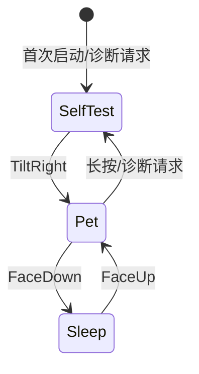

# 04. 软萌宠物视觉与混合渲染系统

UI 的主任务是让宠物看起来像一个有生命的软萌玩偶，而不是把电脑仪表盘缩小到圆屏上。240x240 圆屏仍保留硬件自检视图，但日常主视图改由 `PetFrame` 驱动。

---

## 1. 视觉方向

### 1.1 软萌玩偶规范

- 圆润轮廓、柔和渐变、腮红、双高光和少量装饰，避免赛博单眼和持续旋转 HUD 成为视觉主体；
- 颜色以奶油底、糖果色和低饱和阴影为主，情绪变化使用有限的强调色；
- 所有表情在圆屏安全视域内完成，主体不贴近 240px 外缘；
- 运动以呼吸、眨眼、轻摆、弹跳、注视和短剧情为主，避免高频全屏闪烁；
- 音乐、专注和在席状态通过宠物行为表达，只有诊断模式显示原始数值。

### 1.2 情绪集合

| `PetMood` | 触发 | 动作表现 |
| --- | --- | --- |
| `Normal` | 无事件 | 呼吸、偶尔眨眼、轻微注视 |
| `Happy` | 抚摸、音乐高潮、专注完成 | 弹跳、腮红、笑眼、短暂庆祝 |
| `Focused` | 专注阶段 | 眼神稳定、节律呼吸、轻微点头 |
| `Dizzy` | 摇晃或快速转动 | 交叉瞳孔、身体轻摆、短暂恢复 |
| `Sleepy` | 长时间无活动、低电量 | 眼睑下沉、动作变慢、打哈欠 |
| `Shocked` | 突发敲击或异常事件 | 睁大眼、身体回弹、短暂停顿 |
| `Sleeping` | FaceDown 或休息锁定 | 闭眼、低背光、停止高频动画 |

状态优先级固定为：安全/睡眠 > 用户手势 > 专注节律 > 音乐场景 > 空闲动画。

---

## 2. 场景与动画接口

### 2.1 `PetAnimationState` 与 `PetFrame`

`PetBehavior` 只维护一个权威的 `PetAnimationState`，避免情绪、眨眼、注视和时间轴
状态散落在应用层与渲染层；每次 tick 将它转换成不可变的 `PetFrame` 快照：

```text
PetFrame {
    mood: PetMood,
    pupil_shape: PupilShape,
    gaze_x: i8,
    gaze_y: i8,
    blink_pct: u8,
    happy_lift_pct: u8,
    anim_tick: u16,
    energy: u8,
    affinity: u16,
}
```

- `gaze_x/gaze_y` 来自 IMU 的整数 EMA，不调用高频三角函数；
- `mood/pupil_shape` 定义眼睛、嘴、腮红和高光组合；
- `blink_pct/happy_lift_pct/anim_tick` 为渲染器提供固定时间轴输入；
- `energy/affinity` 只用于宠物表现，不覆盖安全状态或设备配置。
- `PetFrame` 只读，渲染器不得反向修改动画状态。

### 2.2 动画时间轴

动画使用固定容量的关键帧时间轴：

- 关键帧包含姿态、表情、透明度和局部偏移；
- 使用预计算整数缓动表完成呼吸、弹跳和眨眼；
- 普通动画目标 20~33 FPS，睡眠和静止状态降到低刷新率；
- 新事件可以中断可中断动作，但不会跳过必须完成的安全收尾帧；
- 音乐拍点只同步动作起始或重音，不强制每一帧跟随节拍。

---

## 3. 混合资产渲染

当前 `render_pet` 的整屏几何重绘方式难以承载高质量可爱美术，目标实现改为“Flash 精灵 + 少量程序化图元”的混合渲染。

### 3.1 资产分层

1. **背景层**：纯色、渐变或低频装饰；
2. **玩偶主体层**：身体、耳朵、手和轮廓精灵；
3. **表情层**：眼睛、嘴、腮红、高光和情绪装饰；
4. **动作层**：弹跳、闪光、音乐节奏和庆祝粒子；
5. **状态层**：专注/充电/连接等小型徽章；
6. **诊断层**：只在自检视图显示硬件数据。

### 3.2 资产格式

首版采用适合片上 Flash 和分带缓冲的固定格式：

- 小精灵使用调色板索引或 RGB565，禁止运行时堆分配；
- 每个资产包含宽高、原点、透明色/透明位、调色板版本和 CRC；
- 精灵按带解码到现有 `BandDisplay` 缓冲区，不创建完整 240x240 帧；
- 资产表固定上限，超过容量在构建阶段失败；
- 动画帧可共享相同图层，避免重复存储静态部分。

### 3.3 `PetRenderer` 与脏区域

```text
PetRenderer::render(scene, target)
    -> calculate_dirty_regions(previous_scene, scene)
    -> decode_sprite_layers(asset_table, regions)
    -> draw_programmatic_details(scene, regions)
    -> flush_intersecting_bands(regions)
```

- 首版可保留整带刷新作为安全回退；
- 脏区域必须按带对齐，防止 GC9A01 刷新产生撕裂；
- 任何资产解码错误只跳过该层并使用安全占位色，不阻塞状态机；
- 屏幕 FaceDown 或背光关闭时暂停动画推进和 SPI 刷新。

---

## 4. 视图模式



- **Pet**：默认且唯一的日常主视图，展示软萌宠物、专注阶段和音乐反应；
- **SelfTest**：显示 IMU、RTC、电量、充电、BLE 和显示链路诊断；
- **Sleep**：低功耗和低刷新，不显示电脑遥测或主机状态；
- 旧的 Island 仪表盘已从 UI 模块删除；历史配置标签 `0/1` 在读取时迁移到 Pet，不再恢复旧页面。

---

## 5. 验收指标

- 常见动画在 240x240 圆屏上无明显闪烁、撕裂、透明边缘脏像素或带边界错位；
- `Calm` 状态下不持续全屏刷新，FaceDown 后停止高频渲染；
- 关键表情切换在规定关键帧内完成，音乐断连后 3 秒内回到本地动作；
- 资产 CRC 错误、Flash 读取失败和渲染队列拥塞均可降级，不导致 CPU 停机；
- 渲染路径不使用高频 `libm` 三角函数，不引入大栈帧和无界容器。
