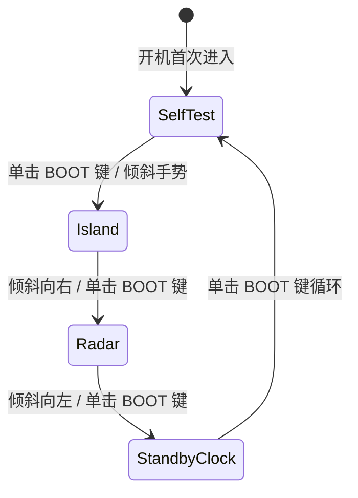

# 04. 圆屏 UI 引擎与多视图渲染系统

UI 渲染子系统位于 [`src/ui/`](file:///Volumes/HIKSEMI/code/island/src/ui/)，专为 Waveshare 1.28寸 240x240 圆形 LCD 定制，实现了四种核心视图模式的平滑切换与沉浸式动态图形表现。

---

## 1. 圆形屏幕几何学与调色板定义

### 1.1 圆形拓扑约束
圆屏直径为 $240\text{px}$，中心位于 $(120, 120)$，有效视觉半径 $R = 118\text{px}$。
在四角（$x < 35$ 或 $x > 205$，$y < 35$ 或 $y > 205$）的像素属于圆形边框盲区。所有文本与交互组件均严格在同心圆的安全视觉区域内进行自适应布局。

### 1.2 极客暗黑 RGB565 调色体系（`src/ui/mod.rs`）

| 颜色常量 | 16位 RGB565 原始值 | 对应 24位 视觉色彩 | 语义用途 |
| :--- | :--- | :--- | :--- |
| `COLOR_BG` | `0x0842` | `#080C14` 深邃暗空 | 全局背景基底，降低功耗并凸显高对比度发光体 |
| `COLOR_CAPSULE_BG` | `0x1106` | `#162032` 墨青胶囊底 | 灵动岛胶囊收起/展开内部填充底色 |
| `COLOR_CAPSULE_BORDER` | `0x3DFE` | `#38BDF8` 天空亮蓝 | 默认空闲态胶囊边框 |
| `COLOR_CYAN` | `0x05BA` | `#06B6D4` 青光电荷 | AI 思考（Thinking）、CPU 遥测读数与实时航向 |
| `COLOR_AMBER` | `0xFCE1` | `#F59E0B` 警示琥珀 | 等待用户审批（WaitConfirm）、RTC 降级告警 |
| `COLOR_GREEN` | `0x15D0` | `#10B981` 翠绿荧光 | 任务执行成功（Success）、BLE 在席、硬件自检通过 |
| `COLOR_RED` | `0xEA28` | `#EF4444` 珊瑚绯红 | 任务执行失败（Error）、Wi-Fi 信道高拥堵告警 |
| `COLOR_DARK_GRAY` | `0x3186` | `#334155` 暗灰刻度 | 雷达距离环、罗盘十字参考轴、暗刻度标记 |

---

## 2. 核心视图模式设计与交互

系统通过 `ViewMode` 枚举定义 4 大视图模式，支持通过按压侧边 BOOT 键或左右倾斜手势无缝切换：



---

### 2.1 Mode A：桌面灵动岛视图（`src/ui/island_view.rs`）

灵动岛是日常办公的主视图，自上而下分为三大视觉层级：

```text
       ┌───────────[ 灵动岛胶囊 (Y: 22..66) ]───────────┐
       │  Codex [THINKING]                              │
       │  Processing cargo check...                     │
       │  ■■■■■■■■■■■■■■■■■■□□□□□□□□□□□□ (进度条)       │
       └────────────────────────────────────────────────┘

           (外弧: CPU%)      14:32:08      (外弧: RAM%)
           CPU 42% (52C)    2026-10-20     RAM 68%
                       RX 1.2M / TX 340K

       └──────[ 底部 Dock: 🟢 NEAR (-54dB) | 4.18V ]──────┘
```

1. **动态自适应胶囊（Dynamic Capsule）**：
   - **收起状态（Idle）**：位于顶部中央的精致椭圆，尺寸仅为 $64 \times 24\text{px}$，内嵌主机连接状态指示绿点与供电电压。
   - **展开状态（Expanded）**：尺寸放大至 $176 \times 44\text{px}$，提供圆角卡片质感，实时展示操作来源徽标（如 `Codex`、`Cargo`）、任务标题与底部进度百分比条。
   - **状态颜色与呼吸灯映射**：
     - `Thinking`：亮青色边框，微弱脉冲；
     - `WaitConfirm`：琥珀色边框，触发 **1.2Hz 正弦波背光呼吸闪烁**（占空比在 $25\% \sim 100\%$ 平滑波动），提示用户双击设备确认；
     - `Success`：翠绿色边框，闪动后自动收拢；
     - `Error`：红边警示，等待用户单击消除。
2. **边缘负载双仪表流光弧（Meter Arcs）**：
   - 沿圆屏左侧外缘绘制 CPU 使用率流光仪表弧（从 8 点钟延展至 10 点钟方向）；
   - 沿圆屏右侧外缘绘制 RAM 占用率流光仪表弧（从 4 点钟延展至 2 点钟方向）；
   - 超负荷（$> 80\%$）时弧线自动变红告警。
3. **中央时空与网络指示区**：
   - 大字号白字时间 `HH:MM:SS`；
   - 细灰色小字日期 `YYYY-MM-DD`；
   - 电脑上下行网速流量指示器（自动适配 K/M 单位换算）。
4. **底部近场 Dock**：
   - 展示 BLE 标签的信号状态与在席判定（`🟢 NEAR (-58dB)` 或 `⚪ AWAY`）。

---

### 2.2 Mode B：2.4GHz 空间态势极坐标雷达（`src/ui/radar_view.rs`）

将空间不可见的 2.4GHz 电磁环境转化为极坐标科幻雷达：
1. **同心信号衰减环**：
   分别在 $-40\text{dBm}$（半径 24px）、$-65\text{dBm}$（半径 60px）和 $-85\text{dBm}$（半径 96px）绘制同心距离参考圆环。
2. **极坐标目标光点（Blips）映射**：
   - Wi-Fi AP 发现点（青色光斑）：信道 $1 \sim 13$ 均匀分布在 $0^\circ \sim 360^\circ$ 极角周围，距离中心的半径根据信号 RSSI 对数衰减映射。
   - BLE 蓝牙广播信标（琥珀/翠绿光斑）：以设备朝向与 Hash 分散排布。
3. **旋转扫描光束（Sweep Ray）**：
   每帧递增 $6^\circ$，以荧光绿绘制从圆心发散的动态扫描射线，营造态势雷达扫描感。
4. **底部 13 信道拥堵热度柱状图（Y: 188..212）**：
   在屏幕下半部整齐排布 13 根垂直频谱柱状图，实时反映 2.4GHz 频段各信道的频谱占用率，并使用绿（低拥堵）、黄（中度占用）、红（严重拥塞）区分。

---

### 2.3 待机机械表盘时钟视图（`src/ui/clock_view.rs`）

当设备静置或用户需要专注工作时，切换为低功耗复古机械表盘：
1. **12 点时钟立体刻度**：
   利用浮点数三角函数计算 12 个方向的时钟刻度线端点坐标：
   $$x = X_0 + \cos(\theta) \cdot R, \quad y = Y_0 + \sin(\theta) \cdot R$$
   其中 12、3、6、9 四个基数主时标以加长亮白线条突出。
2. **高精度秒/分/时针光栅化**：
   时针长 54px（宽粗针），分针长 82px（细针），秒针长 96px（琥珀细长红针），中心带有双层机械同心轴衬套。
3. **6 点钟位置日期与电压子表盘**：
   在 $Y=162$ 处展示日历与供电轨读数。

---

### 2.4 Stage 1 硬件自检仪表盘（`src/ui/selftest_view.rs`）

出厂或固件烧录初始进入的自检仪表盘，全面验证板载关键传感器健康度：
- **实时重力平衡滚珠**：根据 IMU 加速度计计算重力偏角并在圆周边缘实时滚动机载重力光标；
- **自检明细条目**：
  - LCD 背光百分比；
  - QMI8658 0x6B 通信状态与 WHO_AM_I 校验值；
  - 实时三轴加速度计读数（mg）；
  - 实时陀螺仪读数（dps）与航向角；
  - PCF85063 硬件走时状态（或软件回退标识）；
  - 供电轨真实采样电压与 ETA6098 充电引脚电平；
  - 当前按键状态与最新触发手势名称。
