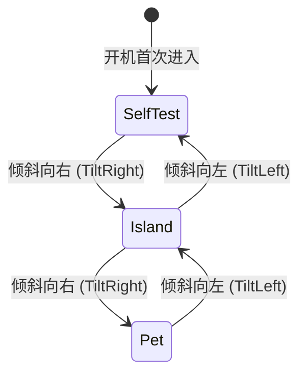

# 04. 圆屏 UI 引擎与多视图渲染系统

UI 渲染子系统位于 [`src/ui/`](../../src/ui/)，专为 Waveshare 1.28寸 240x240 圆形 LCD 定制，实现了四种核心视图模式的平滑切换与沉浸式动态图形表现。

---

## 1. 圆形屏幕几何学与调色板定义

### 1.1 圆形拓扑约束与安全视域
圆屏直径为 $240\text{px}$，中心坐标位于 $(120, 120)$，有效视觉半径 $R = 118\text{px}$。
在四角（$x < 35$ 或 $x > 205$，$y < 35$ 或 $y > 205$）的像素属于物理外框遮蔽盲区。所有核心文本、状态图标与交互组件均严格在同心圆的安全视域内进行自适应排版。

### 1.2 极客暗黑 RGB565 调色体系（`src/ui/mod.rs`）

| 颜色常量 | 16位 RGB565 原始值 | 对应 24位 视觉色彩 | 语义用途 |
| :--- | :--- | :--- | :--- |
| `COLOR_BG` | `0x0842` | `#080C14` 深邃暗空 | 全局背景基底，降低背光透光度并凸显发光图元 |
| `COLOR_CAPSULE_BG` | `0x1106` | `#162032` 墨青胶囊底 | 灵动岛胶囊收起/展开内部填充底色 |
| `COLOR_CAPSULE_BORDER` | `0x3DFE` | `#38BDF8` 天空亮蓝 | 默认空闲态胶囊边框 |
| `COLOR_CYAN` | `0x05BA` | `#06B6D4` 青光电荷 | AI 思考（Thinking）、CPU 遥测读数与实时航向 |
| `COLOR_AMBER` | `0xFCE1` | `#F59E0B` 警示琥珀 | 等待用户审批（WaitConfirm）、RTC 降级告警 |
| `COLOR_GREEN` | `0x15D0` | `#10B981` 翠绿荧光 | 任务执行成功（Success）、BLE 在席、硬件自检通过 |
| `COLOR_RED` | `0xEA28` | `#EF4444` 珊瑚绯红 | 任务执行失败（Error）、电量过低告警 |
| `COLOR_DARK_GRAY` | `0x3186` | `#334155` 暗灰刻度 | 罗盘十字参考轴、暗刻度标记 |

---

## 2. 核心视图模式设计与交互

系统通过 `ViewMode` 枚举定义 3 大核心视图模式，遵循极简无按键哲学，完全通过机身左右倾斜物理手势无缝巡航：



---

### 2.1 Mode A：桌面灵动岛视图（`src/ui/island_view.rs`）

灵动岛是日常办公的主视图，自上而下分为三大视觉层级：

```text
       ┌───────────[ 灵动岛胶囊 (Y: 22..66) ]───────────┐
       │  Codex [THINKING]                              │
       │  Processing cargo check...                     │
       │  ■■■■■■■■■■■■■■■■■■□□□□□□□□□□□□ (进度条)       │
       └────────────────────────────────────────────────┘

           (外弧: CPU%)      14:32:08      (外弧: RAM%)
           CPU 42% (52C)    2026-10-20     RAM 68%
                       RX 1.2M / TX 340K

       └──────[ 底部 Dock: 🟢 NEAR (-54dB) | 4.18V ]──────┘
```

1. **动态自适应胶囊（Dynamic Capsule）**：
   - **收起状态（Idle）**：位于顶部中央的精致椭圆，尺寸为 $64 \times 24\text{px}$，内嵌主机连接指示与供电电压。
   - **展开状态（Expanded）**：尺寸放大至 $176 \times 44\text{px}$，提供圆角卡片质感，展示任务来源徽标（如 `Codex`、`Cargo`）、任务标题与底部进度百分比条。
   - **状态颜色与呼吸灯联动**：
     - `Thinking`：亮青色边框，微弱脉冲；
     - `WaitConfirm`：琥珀色边框，触发 **1.2Hz 正弦波背光呼吸闪烁**（占空比在 $25\% \sim 100\%$ 平滑波动，基于 28 步预计算整数查找表实现 Zero-FPU 运行），提示用户双击确认；
     - `Success`：翠绿色边框，闪动后自动收拢；
     - `Error`：红边警示，等待用户单击消除。
2. **边缘负载双仪表流光弧（Zero-FPU 静态查表）**：
   - 针对 ESP32-C6 RISC-V 无硬件浮点单元特性，左右各 90 度的圆周仪表刻度线段（共 180 条）全部由编译期静态表固化，彻底避免了分带循环光栅化中数千次昂贵的软件浮点 `sinf`/`cosf` 运算；
   - 沿圆屏左侧外缘绘制 CPU 使用率流光仪表弧（8 点钟至 10 点钟方向）；
   - 沿圆屏右侧外缘绘制 RAM 占用率流光仪表弧（4 点钟至 2 点钟方向）；
   - 超负荷（$> 80\%$）时弧线自动变红告警。
3. **中央时空与网络指示区**：
   - 大字号时间 `HH:MM:SS`；
   - 细灰色小字日期 `YYYY-MM-DD`；
   - 电脑上下行网速流量指示器（自动适配 K/M 单位换算）。
4. **底部近场 Dock**：
   - 展示 BLE 标签的信号状态与在席判定（`🟢 NEAR (-58dB)` 或 `⚪ AWAY`）。

---

### 2.2 Mode B：赛博单眼灵动桌宠视图（`src/ui/pet_view.rs`）

针对 1.28寸 240x240 圆形屏幕定制的具身智能单眼桌宠（Cyber Cyclops Pet），具备极高的情绪张力与低开销动态形变：

#### 1. 具身情绪与瞳孔行为矩阵

| 情绪状态 (`PetMood`) | 瞳孔形态 (`PupilShape`) | 触发条件 | 视觉表现与眼睑动力学 | 亲密度/能量收益 |
| :--- | :--- | :--- | :--- | :--- |
| **`Normal`**（空闲巡航） | `Round`（水灵大圆） | 默认状态 / 交互超时恢复 | 翠绿/青色外环慢速自旋，双高光水润眼眸，每 3.5 秒自然生理眨眼 | 维持能量消耗基线 |
| **`Happy`**（喜悦被抚） | `Heart` / `Star`（爱心/星芒） | 单击摸头（爱心）或双击喂食（星芒） | 下眼睑大幅上挑呈月牙笑弧（$44\text{px}$ 剪裁），外环 24 刻度全亮翠绿闪耀，持续 3 秒 | 摸头亲密度 $+5$；喂食能量 $+20$ 且亲密度 $+10$ |
| **`Focused`**（工作专注） | `CatSlit`（猫眼竖瞳） | 电脑 CPU 负载 $> 75\%$ | 瞳孔横向收缩为锐利猫眼竖瞳，外环青光流转，与主机高负载工作共鸣 | 专注状态保持 |
| **`Dizzy`**（剧烈晕眩） | `Dizzy`（蚊香螺旋） | 设备被拿起剧烈晃动（角速度骤增） | 琥珀金光脉冲，双螺旋蚊香瞳孔失衡震荡，眼睑半阖，持续 3 秒自愈 | 警示物理剧烈晃动 |
| **`Sleeping`**（深度安睡） | `Round`（重置中心） | 屏幕朝下反扣（`FaceDown`） | 背光切为 $0\%$，上下一体闭合为平滑睡眠弧线（`Line`），冻结重力眼球跟随 | 翻转拾起自动睁眼唤醒 |

#### 2. 图元几何与动力学渲染分层
1. **外环科技刻度（`ORBITAL_TICKS` 预计算常量表）**：
   沿圆周边缘均布 24 个科技刻度端点（外径 $114\text{px}$，内径 $107\text{px}$），随动画步进旋转并映射情绪色彩（青/绿/金/红）；
2. **重力注视与多态瞳孔（Pixar 级双高光水润眼眸）**：
   - 虹膜中心由 QMI8658 加速度计实时进行一阶滞后积分（$X_c, Y_c \in [-18, 18]$），使视线随设备物理倾斜产生自然的重力注视感；
   - 瞳孔内置一颗主高光与一颗次级反光点，赋予眼神水润灵动质感；
   - 瞳孔支持多态变形（正常水灵眼、满载猫眼竖瞳、摸头爱心、喂食星星、晃动眩晕、充电雷电、报错交叉）；
3. **动力学眼睑遮罩（Squash & Stretch 纯整数 Zero-FPU 剪裁）**：
   - 上下眼睑基于单周期整数比较进行行遮蔽，眨眼动效采用 16 步预计算缓动表，睁眼末期带有 $105\%$ 皮克斯弹簧回弹动效；
   - 摸头或开心时下眼睑上挑为月牙微笑弧；
4. **轻量极客状态 HUD**：
   - 顶部居中（$Y=32$）呈现当前情绪标签（如 `PET: HAPPY ^_^`、`WORK: CPU 82%`、`PET: SLEEPING zZ`）；
   - 底部 Dock（$Y=216$）实时呈现硬件供电轨电压与累积交互亲密度（`4.18V  AFFINITY: 45`）；
5. **具身行为引擎联动（`src/app/pet_engine.rs`）**：
   - **交互激励与亲密度（Tap / DoubleTap）**：单击摸头触发开心大眼、爱心瞳孔与下眼睑上挑，亲密度 +5；双击喂食恢复能量至满格并展现星星瞳孔，亲密度 +10；交互反馈保持 3 秒后平滑恢复常态；
   - **物理震荡反应（Shake Dizzy）**：剧烈晃动（角速度激增）触发晕眩蚊香眼（`Dizzy`）与失衡表情；
   - **主机负载情感共鸣（Host Telemetry Focused）**：当电脑 CPU 使用率 $> 75\%$ 且无主动交互时，自动转入专注工作态，瞳孔收缩为锐利猫眼竖瞳（`CatSlit`）；
   - **自然生理眨眼机理（Natural Blink Engine）**：常态下每隔约 3.5 秒周期性触发一次自然眨眼，基于 16 步预计算缓动表驱动，睁眼末期携带 $105\%$ 弹性回弹，杜绝机械死板感；
   - **重力注视眼球跟随（Zero-FPU Gaze EMA）**：将 IMU 加速度计 $\pm 1000\text{mg}$ 线性映射至 $\pm 18\text{px}$ 虹膜偏移量，并通过全整数 EMA 滤波（`new = (old * 3 + target) / 4`）实时平滑驱动眼眸注视方向；
   - **重力反扣安睡（FaceDown Sleep）**：屏幕朝下扣放立即熄屏并转入深度睡眠线（`Sleeping`），重置注视中心；翻起时自动睁眼唤醒。

---

### 2.3 Mode C：硬件自检仪表盘（`src/ui/selftest_view.rs`）

出厂或固件烧录初始进入的自检仪表盘，全面验证板载关键传感器健康度：
- **实时重力平衡滚珠**：根据 IMU 加速度计计算重力偏角并在圆周边缘实时滚动机载重力光标；
- **自检明细条目**：
  - LCD 背光百分比；
  - QMI8658 通信状态与设备 ID 校验；
  - 实时三轴加速度计读数（mg）；
  - 实时陀螺仪读数（dps）与航向角；
  - PCF85063 硬件走时状态（或软件回退标识）；
  - 供电轨真实采样电压与充电引脚电平；
  - 当前按键状态与最新触发手势名称。
