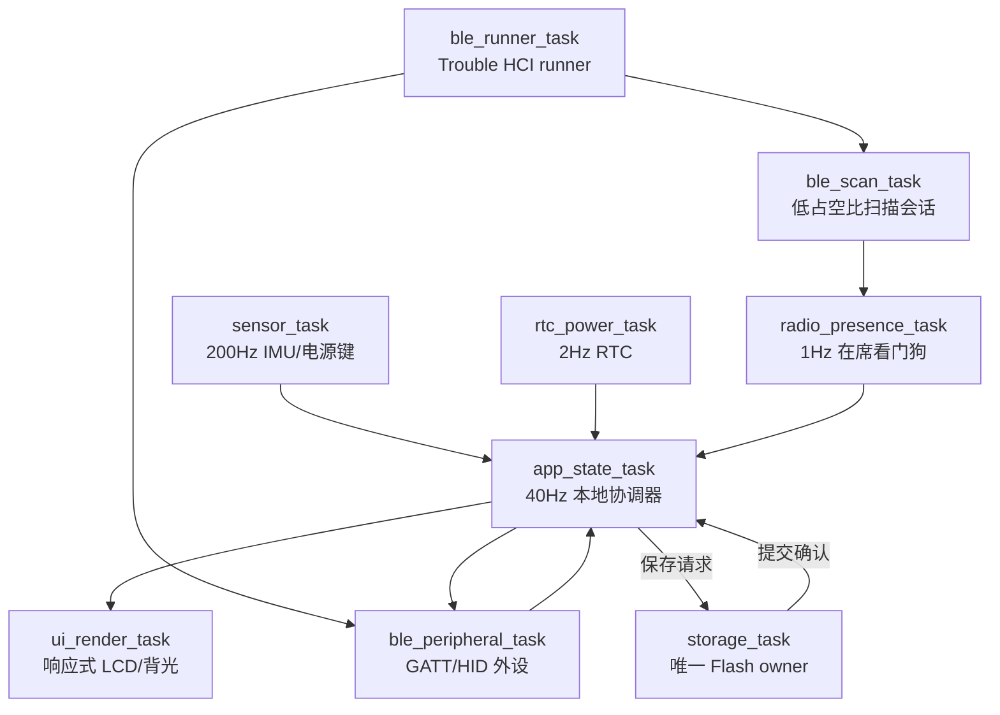

# 06. 本地状态、异步并发与可靠存储

固件使用 Embassy 任务、固定容量通道和单一 Flash owner，让设备在没有外部连接时继续运行。
`Board::storage` 在组合根启动加载配置后移交 `storage_task`，此后只有该任务持有 Flash。应用通过单在途请求/确认驱动限频自动保存，不直接调用 Flash；黑匣子尚未接入运行期记录。Flash 原语仍为同步调用，独立任务不代表并行或无阻塞。

## 1. 实际任务拓扑



### 1.1 任务职责

| 任务 | 实现职责 | 运行约束 |
| --- | --- | --- |
| `ble_runner_task` | 独占 Trouble HCI runner | 只负责 HCI 生命周期，不承载业务状态 |
| `ble_scan_task` | 创建、回收 BLE 扫描会话 | 扫描失败等待 1 秒后重试，不能忙轮询 |
| `ble_peripheral_task` | 广告、HID 通知、MusicScene 写入和 ATT 回复 | 每次通知最多等 250ms，释放优先；ATT 回复无等待排队，拥塞请求断开；断开/订阅切换/Suspend 清理瞬时 HID |
| `sensor_task` | IMU 校准/滤波、手势、姿态和电源状态采样 | 每 5ms 采样一次；仅普通交互边沿可丢，反扣方向单独发布最新值 |
| `rtc_power_task` | 读取 PCF85063 并发布 `ClockSnapshot`（日历 + 健康） | 每 500ms 更新一次，不接受外部时钟作为真源 |
| `app_state_task` | `AppStateMachine`、`PetBehavior` 和 UI 快照 | 方向状态最先处理，到期的 25ms 维护优先于普通事件；每批手势最多 16、在席报告 4、音乐帧 8 |
| `radio_presence_task` | 目标绑定、RSSI EMA、在席看门狗和广播统计 | 启动时接收并应用 `DeviceConfig.rssi_away_threshold`（Near=Away+10dB）；以 1 秒 ticker 为基线发布 `RadioReport`，单次唤醒最多额外处理 7 条广播，目标未绑定时保持 `Away` |
| `storage_task` | 独占启动加载后的 `StorageManager<FlashStorage>`，验证提交后返回原请求 ID 和结果 | 等待单在途请求，不主动按 tick 写入；同步擦写延迟仍需实测 |
| `ui_render_task` | 消费 `UiState`、管理背光并刷新 GC9A01 | Pet 视图约 30ms 一次，否则等待快照或 500ms 安全唤醒 |

`PetBehavior` 没有独立任务，它在 `app_state_task` 中以同步、固定大小的
状态机推进。类似地，音乐事件由 `ble_peripheral_task` 写入通道，再由应用维护 tick 消费；不
存在单独的音乐或动画任务。

## 2. 静态通道与信号（`crates/digivice-firmware/src/ipc.rs`）

### 2.1 有界事件通道

```text
GESTURE_CHANNEL             GestureEvent       容量 16
RADIO_REPORT_CHANNEL        RadioReport        容量 4
BLE_ADVERTISEMENT_CHANNEL   BleAdvertisement   容量 32
HID_ACTION_CHANNEL          HidAction          容量 8
MUSIC_SCENE_CHANNEL         MusicScene         容量 8
```

普通手势、广播、在席、音乐和 HID 都是可丢弃或可重建的边沿事件。FaceDownEnter/Exit 不进入事件队列，而由 `publish_gesture` 转为权威方向最新值。普通边沿发送方使用 `try_send`，队列
拥塞时记录诊断并降级，不在传感器或应用任务中等待无线链路。

### 2.2 最新值信号

```text
UI_STATE_SIGNAL       UiState             app_state_task -> ui_render_task
ORIENTATION_SIGNAL    DeviceOrientation   sensor_task -> app_state_task
TIME_SIGNAL           ClockSnapshot       rtc_power_task -> app_state_task
POWER_SIGNAL          PowerStatus         sensor_task -> app_state_task
IMU_SIGNAL            ImuAttitudeSnapshot sensor_task -> app_state_task
RADIO_TARGET_SIGNAL   BleTargetCommand    绑定命令 -> radio_presence_task
RADIO_STATUS_SIGNAL   RadioStatus         ble_runner/peripheral -> radio_presence_task
TARGET_APPLIED_SIGNAL BleTargetCommand    radio_presence_task -> app_state_task
SAVE_REQUEST_SIGNAL   SaveRequest         app_state_task -> storage_task（唯一在途）
SAVE_COMPLETION_SIGNAL SaveCompletion     storage_task -> app_state_task（同 ID 确认）
```

`Signal` 只保留最新值；UI 不会排队历史帧。`app_state_task` 使用 `select4`，按方向、到期维护、手势、在席报告的顺序等待。唤醒后先采用所选方向与后续到达的最新方向中的较新值，再处理普通事件；重复方向在应用层幂等，不会重复睡眠或唤醒宠物。维护分支有界消费音乐和各类最新值信号，不用无上限排空循环抢占到期维护。

方向与姿态采用无锁 Signal 与有界 Channel 分流：权威反扣/拾起方向经专用最新值通道传输，确保普通手势队列拥塞时关键方向事件绝不丢失，短时间多次翻转收敛为最终物理方向。

通道只由 `ipc` 层提供；纯 `gesture` 模块不再重新导出全局通道，因此可以脱离板卡和任务运行时进行 host 回放。当前测试入口为 `sh scripts/test-host.sh --locked`，并由 CI 单独执行。

## 3. 本地状态与取消边界

状态优先级保持为：

```text
FaceDown/Sleep > 用户手势 > MusicScene > IdleAnimation
```

- FaceDown 让 `AppStateMachine` 让宠物进入深度睡眠并将背光设为 0；UI 跳过 SPI 刷新；
- 翻回 FaceUp 后移除物理反扣原因，白天唤醒，夜间仍服从昼夜睡眠及临时唤醒策略；
- 3 秒没有新音乐帧时由应用生成 `Inactive` 场景；
- BLE、扫描和 UI 的等待分支都使用 Embassy future，可取消且不会持有共享 I2C/SPI 总线；
- 连接断开只清理 HID 瞬时队列，不清理 RTC、宠物或 UI 快照。

BLE HID 的待释放状态位于每连接 `HidSession`，不属于可丢普通事件通道。按下 future 开始前
已登记待释放，250ms 超时取消不丢失恢复义务；到期归零在主循环顶部优先处理，50ms 重试间隔
仍服务连接事件。释放最多失败三次后请求断开；暂停/无订阅需先恢复条件才继续，不能把局部
预算当作端到端主机清键时限。空闲等待的 `select3` 只有连接事件、可取消的 Timer/永久 pending
和 Channel 接收，不在竞争分支里开始不可回滚的按下。ATT 回复 `try_send` 失败即降级断开，
具体通知/控制语义及 host 回归见 03 章。

昼夜睡眠是独立的策略来源，不能直接冒充物理 FaceDown/FaceUp。应用根据宠物最终 `SleepState` 导出夜间 dim 亮度；物理反扣仍强制 0%，临时夜间敲击唤醒由单调截止时间限制为 30 秒；睡眠状态下限制 UI 绘制上限为 2Hz。

`TIME_SIGNAL` 的日历与 `RtcStatus` 是同一次读取的原子快照。应用同步更新 UI 健康状态；只有 `HardwarePresent` / `FallbackSoftware(error)` 可以产生昼夜小时边沿，首次可信读数即使与占位小时相同也必须送达。`NeedsSetting(error)` 不触发假的昼夜/午夜或日历增龄；若从可信转为不可信，则发送 `CircadianUnavailable` 清除昼夜睡眠来源，不影响物理反扣。日历日由 `trusted_calendar_day` 过滤并单独传给宠物，缺失小时边沿不漏算跨日，回退也不重复计日。软件外推只在本次上电保留可信锚点，断电后没有自动真实时间保证。产品可操作校时入口仍待实现，不以驱动 setter 代替产品验收。

40Hz 是协调器维护频率，不是养成的时间单位。宠物使用注入的 `Instant` 结算清醒时长：消化 30 秒、饥饿致病 60 秒、便便堆积致病 40 秒、照料失误 180 秒；睡眠暂停但保留已累计进度，RTC 只提供昼夜/日历边沿。长停顿以固定次数状态边界加批量周期计数追赶，不补跑无限 tick；具体规则与 host 回归见 07 章。

## 4. Flash 布局与 Schema V3 存储结构

通过 `partitions.csv` 与 `espflash.toml` 在固件构建与烧录期建立机器可检查的 4MB 物理分界线：

```text
0x0000_9000..0x0000_F000  NVS 分区 (24 KiB)
0x0000_F000..0x0001_0000  PHY 初始化参数 (4 KiB)
0x0001_0000..0x0040_0000  factory App 固件分区 (4032 KiB)
------------------------- [4MB 机器校验物理分界线 (0x0040_0000)] -------------------------
0x0040_0000..0x0100_0000  storage 自定义存储分区 (12288 KiB)
  - 0x0040_0000           DeviceConfig Sector A (4 KiB, CONFIG_FLASH_PRIMARY_OFFSET)
  - 0x0040_1000           DeviceConfig Sector B (4 KiB, CONFIG_FLASH_SECONDARY_OFFSET)
  - 0x0041_0000           BlackboxSnapshot 环形区 (1000 x 64 B = 64000 B, 0x0041_0000..0x0041_FA00)
```

- **机器检查边界**：`scripts/check-flash-layout.py` 与 host 回归 `tests/host/tests/flash_layout.rs` 持续检验分区对齐（4KB 整数倍）、无重叠、4MB 分界线及 ELF 二进制实际加载段（当前 digivice release 仅占 689 KB / 17.1%），彻底杜绝固件镜像增长或分区错位覆写用户存档。

### 4.1 Schema V3 序列化排布（84 字节定长记录）

所有字段显式按小端读写，不使用内存布局、指针重解释或 `unsafe`。原 A/B 扇区地址不变；V2 的 52 字节记录和 V1 的 44 字节记录仅在内存迁移，下一次成功提交才实际写回 V3。

| 偏移 | 字段 | 类型 / 语义 |
| --- | --- | --- |
| `0..4` | magic | `u32`，`0x4953_4C44` |
| `4..6` | version | `u16`，`CONFIG_VERSION = 3` |
| `6..8` | payload_len | `u16`，`CONFIG_PAYLOAD_SIZE = 68` |
| `8..12` | crc32 | `u32`，覆盖 `12..80` |
| `12..16` | seq | `u32`，回绕安全序号 |
| `16..28` | gyro_bias_mdps | `[i32; 3]` |
| `28..34` | accel_bias_mg | `[i16; 3]` |
| `34..38` | ble_target_hash | `u32`，当前仍限非零 16 位绑定或 0 |
| `38` | rssi_away_threshold | `i8` |
| `39` | brightness_normal | `u8`，0～100 |
| `40` | default_mode | `u8`，`ViewMode` |
| `41 / 42` | pet_hunger / pet_strength | `u8`，0～4 |
| `43 / 45` | reserved | 固定写 0；停用未实现的 discipline 和旧 8 位训练槽 |
| `44` | pet_care_mistakes | `u8` |
| `46 / 47` | pet_evolution_stage / pet_weight_g | `u8`，阶段 0～5、体重非零 |
| `48..50` | pet_training_count | `u16`，不再在 255 截断 |
| `50..52` | pet_age_days | `u16`，至少 1 |
| `52` | pet_health | `HealthStatus` 编码，0 Healthy / 1 Sick；其他值拒绝 |
| `53 / 54` | pet_poop_count / pet_energy | `u8`，0～4 / 0～100 |
| `55 / 58..60` | reserved | 固定写 0 |
| `56..58` | pet_affinity | `u16` |
| `60..64` | digestion_ms | `u32`，0～29999 |
| `64..68` | starvation_ms | `u32`，0～60000 |
| `68..72` | uncleaned_ms | `u32`，0～40000 |
| `72..76` | unattended_ms | `u32`，0～179999 |
| `76..80` | pet_calendar_day | `u32`，可信设备日历日计数；`u32::MAX` 表示未知，其他越界值拒绝 |
| `80..84` | commit_marker | `u32`，`0x434F_4D4D` |

代谢进度使用 `domain::NurtureProgress`，私有字段经 clamped 构造保证周期余数与疾病上限；`CalendarDay` 只能表示 2020～2099 的合法日历日，不能把占位时间自动变成可信年龄锚点。健康枚举归领域层，`pet::HealthStatus` 保留兼容重导出。保存前检查公开配置的数值不变量，非法值不擦除；最终回读必须与完整待提交配置相等，而不只比较 seq。

`StorageManager::load_config_report`（兼容包装 `load_config`）启动时仅读取 A/B 两个配置记录，验证 Magic、版本、长度、CRC 和提交标记，选择回绕安全的最大 `seq`。若遇旧版 V1/V2 记录则在内存解码为 V3，只有后续保存才真正写回新版，加载本身不是落盘迁移。V1 记录长 44 字节；只有其后读到的尾部全部擦除（`0xFF`）且不匹配 V2/V3 标头时才尝试兼容解码，防止 V2/V3 版本/长度损坏后绕过 CRC/提交校验。V1 本身没有可靠校验，不能据此声称旧格式抗任意位损坏。若两个扇区都无效，则回退至 `DeviceConfig::default()`；`ConfigLoadReport` 分别返回 Defaults/Primary/Secondary 来源及每区 Empty/Valid(schema, seq)/Invalid(error)/ReadFailed，不把首次空白和损坏或总线故障混为一谈。V1/V2 分别标记 LegacyV1/Version2，表明只是内存兼容；串口同时记录加载经过微秒数，实际板上耗时待测。

`StorageManager<F>` 以 `embedded_storage::nor_flash::NorFlash` 为硬件边界；BSP 的 `StorageManager<FlashStorage>` 是真实 Flash 适配。泛型调用使用 NOR 原语，避免 `FlashStorage::write` 高层 API 的整扇区读-擦-重写；载荷和提交标记分别编程已擦除且不重叠的 4 字节单元，一次保存只有一次显式扇区擦除。

`StorageManager::save_config` 的顺序固定为：

1. 选择非活动扇区并擦除整个 4 KiB 扇区；
2. 写入前 80 字节配置记录与载荷（不含提交标记，递增 `seq`）；
3. 回读并验证长度、CRC32 和 `seq`；
4. 单独写入最后 4 字节 `CONFIG_COMMIT_MARKER`，再完整回读验证；
5. 只有验证完全成功才切换活动扇区。

任何擦除、写入、读取或校验错误都返回 `StorageError`，旧扇区保持绝对完好可恢复。黑匣子以 64 字节定长记录追加（含单调递增 `seq: u32` 与 CRC32/提交标记）。启动时通过 RFC 1982 模代数（`is_seq_newer`）全盘扫描 1000 个槽位定位最新序号记录，即使环形区写满回绕也不会发生游标退化或从 0 错位覆盖。扇区擦除严格限制在跨入扇区首个槽位时执行；若遇局部槽位损坏或回读校验失败，系统安全将游标步进至下一槽位进行故障隔离，严禁擦除整个扇区，确保同扇区内其余历史快照 100% 留存。写入前检查目标槽位干净状态（全 0xFF），遇非空脏槽同样跳过隔离而不整扇区抹除。游标以紧凑 `u16` 槽位索引结合 `u32` 序号存储，严格确保驱动初始化与反序列化栈帧维持在 1024 字节红线以内。

### 4.2 掉电恢复边界与原子性保证

独立测试套件直接编译完整 `storage` 源码，注入实现真实 `NorFlash` trait 的内存设备；模拟 4 字节访问对齐、NOR 只能把 1 写成 0、按 4KiB 擦除。测试对载荷和提交标记的每个字节前缀、擦除截断以及两次回读的前缀注入故障点，验证重启仅恢复旧版或新版有效记录，原活动扇区逐字节不变；恢复后重试、再次重启和 `u32::MAX -> 0` 回绕均通过。

旧版判别机制严格校验记录前缀与位翻转：逐位损坏的 V2 记录均拒绝降格为 V1；仅合法完整的旧版及其擦除尾部支持向下兼容解码，杜绝脏数据冒充旧版存档。

### 4.3 限频与提交确认策略

`storage/save.rs` 的纯 `SaveCoordinator` 区分最新 RAM 目标、最近已确认配置及唯一在途请求。它不访问 Flash 或全局通道；`app_state_task` 每次维护先更新宠物快照并观察 `current_config()`，再处理确认、发送到期请求。`storage_task` 调用真实 `execute_save`，只有完整保存/验证成功才返回确认。变更只合并到固定大小的最新值，至少间隔 300 秒才允许一次保存尝试（失败同样限频），启动后的首次尝试也需等待 300 秒；没有变更不写。正常供电且写入/确认及时的条件下，未提交进度窗口最多约 300 秒加维护/Flash 延迟。持续 I/O 失败保留错误与重试状态，杜绝误报 Clean。

每次请求携带强类型 ID，只有当前 ID 且已确认载荷与请求一致的成功结果才更新 `committed_config` / 提交序号；在途期间的新变更留待下一轮，重复或过时确认不影响新请求。保存失败可能发生在提交已写入、最终回读失败之后，因此即使 RAM 又改回旧值，也必须保持不确定并在限频后执行一次已验证修复。时钟截止点加法溢出时停止新尝试，不退化成无间隔循环。

预算上限为持续变化时每 24 小时 288 次尝试、两扇区交替约每扇区 144 次擦除。独立回放覆盖合并、无变更、写入期间更新、过时确认、失败重试、未知提交后的回滚修复、错误载荷确认、整日尝试上界与截止点溢出。

保存请求与完成各有一个固定槽 `Signal`。唯一生产者 `SaveCoordinator` 在上一请求被匹配确认前绝不发出第二个请求，在途期间的额外变更只更新 RAM 目标。UI 的 `save_status` 明确区分 `SYNC`（与最近确认/加载状态一致）、`PENDING`（RAM 已变）、`WRITING`（等待确认）和 `RETRY`（保存失败/提交不确定），显示的序号始终是最近已确认序号，不能随 RAM 更新提前增加。

### 4.4 只读加载与双区隔离保护

配置加载固定为仅读取两个配置扇区记录，绝不扫描黑匣子、绝不擦除或写入任何扇区。黑匣子仅在显式调用快照记录时延迟初始化游标，加载阶段保持只读隔离，整片 Flash 保持逐字节安全不变。

`StorageManager` 在未完成双区读取时拒绝保存，返回 `RecoveryRequired`，不凭部分读数猜测可擦除的非活动区；即使另一区有效也不能确定失败区是否含有更新存档。`SaveCoordinator::from_load` 将这种启动状态立即显示为 RETRY，不等第一次 RAM 变更才承认故障。当前运行期不自动重载并覆盖已交互的 RAM 状态，需重启完成双区读取后才解锁写入。两个区均成功读出但为空白/无效时可用默认配置继续运行并在变更后建档，损坏原因保留在启动报告。

### 4.5 V3 迁移与恢复语义

已落地的编码规则：V2 原有校准、绑定、亮度/模式、饥饿/力量、阶段、体重、失误、训练次数保留；未存过的年龄/健康/排泄/能量/亲密度/进度/日锚点分别明确默认 1/Healthy/0/100/0/零进度/未知。V1 原有配置保留，其缺失的养成字段采用相同默认。未实现 discipline 被停用，V2 旧值不再假装有效属性。读取旧档不立即擦写，迁移提交仍走原有双区协议；降级到不识别 V3 的旧固件不保证恢复新版存档，不能把向前读取兼容写成双向降级兼容。

产品恢复决策：跨重启保留养成属性和代谢已累计进度，不保存绝对 `Instant`；断电期间不补算饥饿、疾病或照料失误。年龄按最后可信设备日历日与下一可信日期的正向日差增加，时间倒退不减龄、不回退日锚点、不重复计算同一天；没有可信锚点时先建立基准。动画、半途特训、物理方向、充电和 30 秒临时唤醒属于实时状态，不写入存档。

V3 的记录/提交边界保持 4 字节对齐。保持固件 1024 字节栈帧阈值，不增加 allow；扩展状态的 Debug 只输出关键摘要，payload 编程/回读与提交/整记录校验拆为固定阶段以避免大栈临时值。

运行期状态对接：`AppStateMachine` 从配置构造验证的 archive，默认宠物以当前 Instant 恢复累计毫秒；维护后从实际宠物 archive 生成保存目标，不存 UI 动画帧。所有属性与进度一起走已有唯一在途/原子提交协议，既不会每个 tick 擦写，也不会重启补跑离线代谢。可信日历日差年龄结算已接入；最后计入日与年龄同一记录原子保存，未知时间不补龄。

### 4.6 静态内存、堆栈预算与大栈安全约束

#### 4.6.1 ESP32-C6 512KB HP SRAM 静态物理分布

ESP32-C6 片上包含 512 KiB HP SRAM（`0x4080_0000..0x4088_0000`）。在生产固件 `digivice` 与诊断固件 `selftest` 中，内存由链接器脚本与 Rust 静态数据结构完全确定性划分，经 `scripts/check-flash-layout.py` 机器核验：

| 内存段 | 虚拟地址区间 | 大小 (digivice) | 职责与归属 | 预算限制 |
| :--- | :---: | :---: | :--- | :--- |
| **`.trap`** | `0x40800000` | 2,028 B | RISC-V 异常向量表与中断入口 | 静态只读 |
| **`.rwtext`** | `0x408007EC` | 31,320 B | 高性能 IRAM 运行代码（包含 Wi-Fi/BLE 基础驱动） | 静态只读 |
| **`.data`** | `0x40808248` | 11,332 B | 已初始化的全局静态变量与常量查找表引用 | 静态读写 |
| **`.bss`** | `0x4080AE90` | 91,632 B | 零初始化全局静态缓冲区、Embassy Channel/Signal 与任务槽 | 静态读写 |
| **`.dram2_uninit`** | `0x4086E610` | 65,536 B | BLE/Wi-Fi 射频收发器 DMA 专用未初始化报文池 | 专用硬件池 |
| **静态占用合计** | - | **201,848 B (197.1 KB)** | 硬件与固件静态分配基线 | **<= 320 KB** |
| **`.stack` 区域** | `0x40821480` | **315,792 B (308.4 KB)** | 供全局堆分配与主任务/中断调用栈共享的连续物理内存 | - |
| **静态堆分配** | - | 131,072 B (128.0 KB) | `esp_alloc::heap_allocator!(size: 128 * 1024)` | 固定 128 KB |
| **调用栈净裕量** | - | **184,720 B (180.4 KB)** | 供主引导、中断、系统调用栈运行的绝对充裕空间 | **>= 64 KB** |

诊断固件 `selftest` 静态 SRAM 仅消耗 149.9 KB，堆预留 32 KB，剩余调用栈净裕量高达 323.6 KB。

#### 4.6.2 `allow(clippy::large_stack_frames)` 审计与收敛

针对 Clippy 配置的 1024 字节栈帧红线（`.clippy.toml` 中 `stack-size-threshold = 1024`），对全仓库进行了系统性清理与栈帧收敛：

1. **已彻底消除的虚假/溢出 Allow（重构降至 1024 字节以内）**：
   - `sin_cos_q12`：原 `const SIN_LUT_Q12` 导致编译器在每个分支展开复制 182 字节数组导致栈膨胀至 1672 字节；改为 `static SIN_LUT_Q12` 常驻 `.rodata`，栈帧消除为 0 字节并移除 allow；
   - `DIGIMON_16_PALETTE`：同样由 `const` 改为 `static` 常驻 `.rodata`，彻底消除调色板多重局部复制；
   - `render_props_and_particles`：解耦为 `render_food_and_poop`、`render_flush_wave`、`render_evolution_particles` 独立子例程，单帧栈消耗消除并移除 allow；
   - `tick_frame`：将 250 行庞大单例状态机拆分为 `update_reaction_and_music_timers`、`advance_action_lifecycle` 与 `advance_wander_cycle`，栈帧由 1084 字节收敛至安全阈值内并移除 allow；
   - `UiState` / `PetAnimationState` / `PetFrame`：因 `derive(Debug)` 宏生成的庞大栈帧导致的编译报错，改为手写紧凑轻量 `Debug` 格式化实现，彻底移除所有结构体层面的虚假 allow。
2. **审计保留的底层必要 Allow（附带严格约束与隔离）**：
   - `crates/digivice-firmware/src/bin/digivice.rs:49` 与 `selftest.rs:40` 之 `main`：仅在冷启动时于系统主引导栈执行一次板级硬件初始化，不参与高频循环；
   - `crates/digivice-firmware/src/tasks/` 下的 5 个 Embassy 任务（`app_state_task`, `ui_render_task`, `sensor_task`, `ble_scan_task`, `ble_peripheral_task`）：Embassy 异步任务状态机结构体经由 `static_cell` 静态放置在 `.bss` 静态存储区，并非在动态调用栈上连续分配，Clippy 静态检查对此类宏展开存在固有判定限制；
   - `crates/digivice-firmware/src/radio/gatt.rs`：Trouble BLE 官方 `#[gatt_server]` 宏展开所必须；
   - `blit_to_band_rotated`：基于 240x20 分带视口的高性能定点数逆向光栅化内联数学变换，经局部限制安全调用。

#### 4.6.3 机器可检查的内存与大小门禁

- **Host 自动化结构体尺寸回归**：`tests/host/tests/memory_budget.rs` 验证 `BlackboxSnapshot` (64B 序列化 / <=80B 内存)、`DeviceConfig` (<=128B)、`PetAnimationState` (<=64B)、`PetFrame` (<=64B)、`MusicScene` (<=64B) 严格维持轻量紧凑；
- **全自动 Flash/SRAM 预算检查**：`scripts/check-flash-layout.py` 步骤 5 自动解析双 binary ELF Section Header，对静态 SRAM <= 320 KB、栈净裕量 >= 64 KB、Flash <= 4032 KB 进行硬性门禁拦截。
