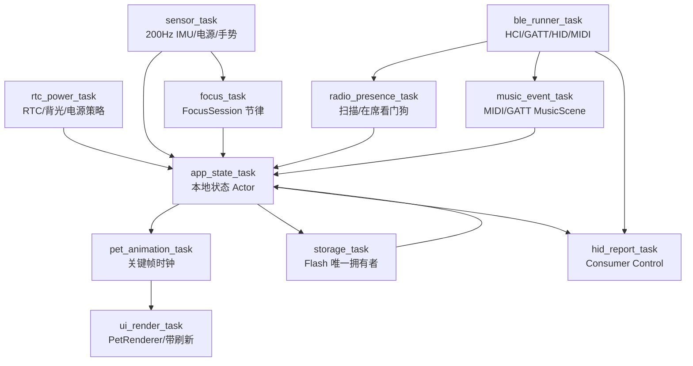

# 06. 本地状态、异步并发与可靠存储

系统以 Embassy 异步运行时、固定容量通道和单 Flash Owner 保证宠物在没有宿主程序时仍可持续运行。连接层（BLE HID、GATT、MIDI、USB 调试）只能产生可选事件，不能反向控制本地时钟和核心生命循环。

---

## 1. 目标任务拓扑



### 1.1 任务职责

| 任务 | 职责 | 约束 |
| --- | --- | --- |
| `sensor_task` | IMU、Jerk、倾斜、FaceDown、电源与充电采样 | 200Hz，固定快照，不能阻塞渲染 |
| `rtc_power_task` | RTC 读取、单调时间、背光和低功耗策略 | 不接受电脑时间作为真源 |
| `ble_runner_task` | HCI、GATT、HID、MIDI 的控制器循环 | 只负责协议和事件分发 |
| `radio_presence_task` | 广播消费、RSSI EMA、在席边沿和扫描看门狗 | Away 只触发本地策略 |
| `music_event_task` | MIDI/GATT 帧验证、去重、超时和 `MusicScene` | 原始音频不进入设备 |
| `focus_task` | FocusSession 节律、暂停、完成和统计 | 使用 RTC/单调时间，固定状态转换 |
| `app_state_task` | 本地唯一业务协调器和 `UiState` 发布 | 不再维护主机心跳看门狗 |
| `pet_animation_task` | 关键帧时间轴、动作优先级和场景快照 | 可取消，不创建大对象 |
| `ui_render_task` | 资产解码、图层合成、带刷新和背光 | FaceDown 时暂停高频刷新 |
| `storage_task` | 配置、统计、资产索引、黑匣子读写 | Flash 唯一拥有者，双缓冲提交 |
| `hid_report_task` | Consumer Control 报告编码和发送 | 断开丢弃过期瞬时事件 |

所有任务实现位于 [`src/tasks/`](../../src/tasks/)，任务之间只使用位于 [`src/ipc.rs`](../../src/ipc.rs) 的静态 `Channel`、`Signal` 或快照引用；不得让 BLE 或 HID 阻塞 `sensor_task`、`focus_task` 和 `ui_render_task`。

---

## 2. 核心通道与数据流（集中于 `src/ipc.rs`）

目标接口名称：

```text
GESTURE_CHANNEL           // GestureEvent，容量 16
IMU_SIGNAL                // ImuAttitudeSnapshot
POWER_SIGNAL              // PowerStatus
PRESENCE_CHANNEL          // PresenceTransition，容量 4
MUSIC_SCENE_CHANNEL       // MusicScene，容量 8
FOCUS_EVENT_CHANNEL       // FocusEvent，容量 8
HID_ACTION_CHANNEL        // HidAction，容量 8
UI_STATE_SIGNAL           // UiState/PetFrame 快照
ANIMATION_TICK_SIGNAL     // 固定时间步
STORAGE_COMMAND_CHANNEL   // 配置/统计/资产索引命令，容量 8
STORAGE_OUTCOME_CHANNEL   // 持久化结果
USB_DIAGNOSTIC_CHANNEL    // 仅调试日志和诊断导出
```

事件语义：

- 手势、在席、音乐和 HID 动作都是边沿或有界事件，队列满时按优先级丢弃可重建事件；
- `UiState` 和 `PetFrame` 是最新值信号，不排队历史帧；
- 音乐帧带 `sequence` 和超时，旧帧不能覆盖新帧；
- HID 瞬时动作必须在断开时清空；
- Flash 命令必须返回成功、校验失败或介质错误，不能静默丢失。

---

## 3. 本地状态优先级与取消安全

`AppStateMachine` 的状态优先级固定为：

```text
FaceDown/Sleep > UserGesture > FocusSession > MusicScene > IdleAnimation
```

- FaceDown 会暂停动画推进、背光和非必要 BLE 活动；
- 用户动作可以中断音乐剧情，但不能破坏安全收尾帧；
- 专注暂停、完成和重启必须是幂等事件；
- BLE、USB 和存储的异步等待分支在取消后不能留下半写配置、半个 HID 报告或锁住 SPI 总线；
- 连接断开后，宠物、RTC、FocusSession 和统计继续运行。

---

## 4. Flash 分区与双扇区原子持久化

继续使用 16MB Flash 的双扇区配置和循环黑匣子方案，并增加本地产品数据：

```text
0x0000_0000  Bootloader / Partition / Firmware
0x0040_0000  DeviceConfig Sector A (4KB)
0x0040_1000  DeviceConfig Sector B (4KB)
0x0041_0000  PetStats + FocusStats (版本化记录)
0x0042_0000  BlackboxSnapshot 环形区
0x0050_0000  PetAssetIndex / 可选压缩精灵资源
```

配置记录包含 Magic、版本、序号 `seq`、长度、Payload、CRC 和提交标记。保存流程：

1. `storage_task` 选择非活动扇区；
2. 擦除并写入新 Payload；
3. 回读 CRC 和长度；
4. 单独写入提交标记；
5. 再次校验后以最大合法 `seq` 作为活动配置。

掉电发生在任一步骤时，启动扫描都必须保留上一份合法配置。统计和黑匣子采用固定长度记录，不能因 BLE 导出或宠物动画而阻塞写入。

---

## 5. 动画与资产的资源约束

- 精灵资产按带解码，禁止在任务栈上创建完整 240x240 RGB565 帧；
- 动画时间轴只保存当前动作和少量关键帧索引，静态图层从 Flash 读取；
- 资产 CRC、版本和索引错误都必须降级为占位层；
- `clippy::large_stack_frames`、`clippy::mem_forget` 和 `#![deny(warnings)]` 继续作为硬门槛；
- 高刷新动画不调用 `libm` 三角函数，使用整数查表、固定点和预计算几何。

---

## 6. 迁移边界

USB 主机业务通道、`HOST_PACKET_CHANNEL`、`DEVICE_EVENT_CHANNEL`、电脑遥测、电脑时间同步和锁屏路径已删除。USB 不再进入应用状态机；所有可选外部输入必须通过 `radio/` 的有界通道进入本地协调器。
