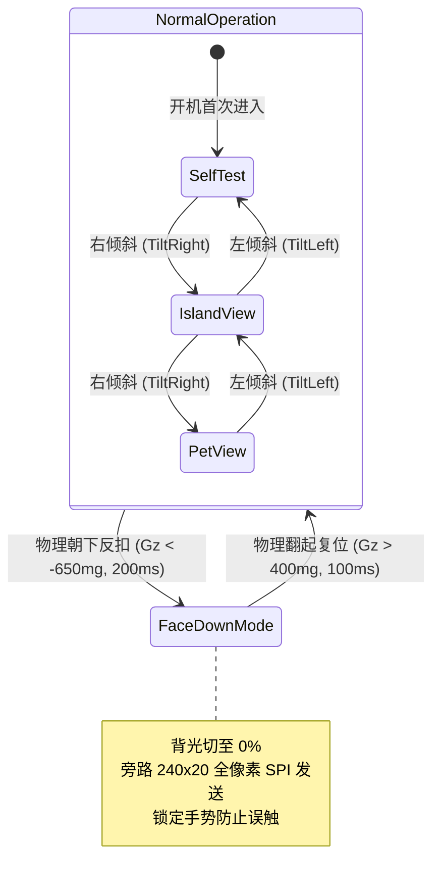
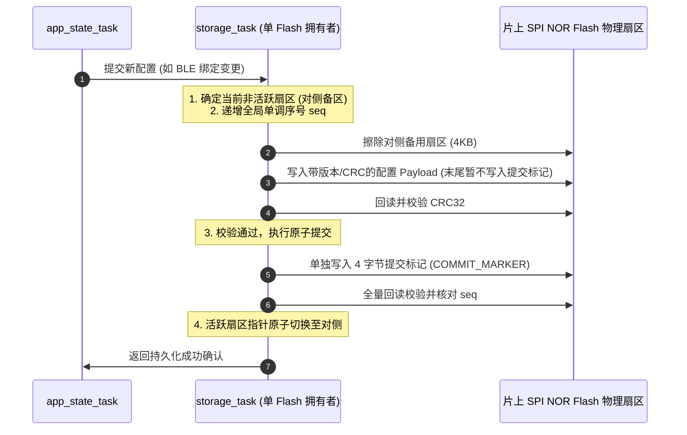

# 06. 异步并发模型与存储可靠性体系

系统底层架构依托 **Embassy 异步并发运行时**（基于 `esp-rtos`）与 **16MB SPI NOR Flash 硬件存储**（基于 `esp-storage`），在 [`src/bin/main.rs`](../../src/bin/main.rs) 与 [`src/storage/`](../../src/storage/) 中构筑了坚固的并发调度与持久化防线。

---

## 1. Embassy 异步协程并发架构

ESP32-C6 采用单核 32 位 RISC-V 架构（最高 160MHz 主频）。为了在单核上实现 200Hz 传感器突发采样、33Hz 屏幕流水线刷新、USB 串口通信与无线电监听互不阻塞，系统基于 Embassy 协程模型划分为 9 大轻量任务：

```mermaid
flowchart TD
    subgraph Senders["数据源与外设协程"]
        T_Sensor["sensor_task (200Hz)\nIMU采样 / Jerk敲击 / 空间姿态 / ADC供电采样"]
        T_USB_RX["usb_rx_task (异步流分帧)\nUSB接收流读取 / 协议行分帧注入 / 挂起让度"]
        T_USB_TX["usb_tx_task (事件独占发送)\n队列驱动原子推送 / 即时响应"]
        T_RTC["rtc_power_task (2Hz)\nRTC时钟周期读取 / 时间同步接收"]
        T_BLE["ble_runner_task + ble_scan_task\nTrouble HCI轮询 / 被动扫描会话续期"]
        T_Radio["radio_presence_task\nBLE目标存在感应 / RSSI平滑 / 看门狗离席判定"]
        T_Storage["storage_task\n单Flash Owner / 持久化确认后发布"]
    end

    subgraph Bus["静态异步通道与信号 (强类型与零堆分配)"]
        GESTURE_CHANNEL["GESTURE_CHANNEL (容量: 16)"]
        HOST_PACKET_CHANNEL["HOST_PACKET_CHANNEL (容量: 16)"]
        DEVICE_EVENT_CHANNEL["DEVICE_EVENT_CHANNEL (容量: 8)"]
        RADIO_REPORT_CHANNEL["RADIO_REPORT_CHANNEL (容量: 4)"]
        BLE_ADVERTISEMENT_CHANNEL["BLE_ADVERTISEMENT_CHANNEL (容量: 32)"]
        RADIO_TARGET_SIGNAL["RADIO_TARGET_SIGNAL (Bind/Clear)"]
        STORAGE_COMMAND_CHANNEL["STORAGE_COMMAND_CHANNEL (容量: 8)"]
        STORAGE_OUTCOME_CHANNEL["STORAGE_OUTCOME_CHANNEL (持久化结果)"]
        TARGET_APPLIED_SIGNAL["TARGET_APPLIED_SIGNAL (Bind/Clear)"]
        TIME_SYNC_SIGNAL["TIME_SYNC_SIGNAL (Signal)"]
        TIME_SIGNAL["TIME_SIGNAL (Signal)"]
        POWER_SIGNAL["POWER_SIGNAL (Signal: PowerStatus)"]
        IMU_SIGNAL["IMU_SIGNAL (Signal: ImuAttitudeSnapshot)"]
        UI_STATE_SIGNAL["UI_STATE_SIGNAL (Signal: UiState)"]
    end

    subgraph Coordinator["中央状态机 (Actor 模式单消费者)"]
        T_App["app_state_task (20Hz)\n全局应用状态流转 / 真实电压心跳 / 事件路由"]
    end

    subgraph Renderer["显示呈现协程"]
        T_UI["ui_render_task (33Hz)\n240x20 分带流水线刷屏 / PWM呼吸调光"]
    end

    T_Sensor -->|产生手势| GESTURE_CHANNEL --> T_App
    T_Sensor -->|发布姿态| IMU_SIGNAL --> T_App
    T_Sensor -->|发布供电| POWER_SIGNAL --> T_App

    T_BLE -->|广播报告| BLE_ADVERTISEMENT_CHANNEL --> T_Radio
    T_Radio -->|BLE在席报告| RADIO_REPORT_CHANNEL --> T_App
    T_App -->|配置/导出命令| STORAGE_COMMAND_CHANNEL --> T_Storage
    T_Storage -->|保存/导出结果| STORAGE_OUTCOME_CHANNEL --> T_App
    T_App -->|持久化成功后发布| RADIO_TARGET_SIGNAL --> T_Radio
    T_Radio -->|目标已应用| TARGET_APPLIED_SIGNAL --> T_App
    T_USB_RX -->|主机帧注入| HOST_PACKET_CHANNEL --> T_App
    T_App -->|时钟帧单向分发| TIME_SYNC_SIGNAL --> T_RTC
    T_RTC -->|回传最新时间| TIME_SIGNAL --> T_App

    T_App -->|发送上行事件/心跳| DEVICE_EVENT_CHANNEL --> T_USB_TX
    T_App -->|广播完整UI快照| UI_STATE_SIGNAL --> T_UI
```



### 1.1 九大核心协程任务职责

| 协程任务 | 触发机制 / 采样率 | 核心职责 | 架构特性与防护 |
| :--- | :--- | :--- | :--- |
| **`sensor_task`** | 周期性 (200Hz / 5ms) | IMU 采样、滤波、Jerk 敲击检测、双向倾斜巡航、供电轨与引脚采样 | 采用快速有理逼近代替软浮点；纯手势驱动交互，状态变化时才向通道推送 |
| **`usb_rx_task`** | 异步流驱动 | 原生 USB 串口流读取、行分帧解析、向主机指令通道注入 | 端口空闲时主动让度微延迟，彻底杜绝单核 100% CPU 忙轮询 |
| **`usb_tx_task`** | 事件驱动队列 | 监听上行事件队列，栈上零分配编码并推入物理 TX FIFO | 独立任务保证发送原子性，收发解耦杜绝队头阻塞 |
| **`rtc_power_task`** | 周期 (2Hz) + 同步信号 | 读取 RTC 硬件/软件时钟，响应主机时间校准信号 | 双路 `select` 竞争架构，主机校准帧到达时零延迟即刻唤醒 |
| **`ui_render_task`** | 快照信号驱动 (~33Hz) | 240x20 水平分带流水线绘制、LEDC 背光呼吸调制 | 脏标记门控渲染；屏幕反扣时自动休眠并旁路 SPI 传输 |
| **`ble_runner_task`** | HCI 异步事件驱动 | 独占运行 Trouble 蓝牙主机循环，投递底层广播报告 | 专职射频底层轮询，与上层业务逻辑隔离 |
| **`ble_scan_task`** | 周期性续期 (100ms) | 管理 BLE 扫描会话生命周期，定期重启会话 | 避免控制器单次扫描超时后静默失效 |
| **`radio_presence_task`**| 周期 (1Hz) + 广播消费 | 维护目标 RSSI 指数平均、更新离席看门狗、发布在席报告 | 全整数运算无浮点开销；带 10dB 迟滞门限 |
| **`storage_task`** | 命令通道驱动 (Actor) | 独占 Flash 硬件控制器，执行双扇区乒乓保存与黑匣子记录 | 作为 Flash 唯一拥有者，杜绝多任务并发擦写竞争 |
| **`app_state_task`** | 响应式多路选择 (20Hz) | 中央协调器，管理业务状态流转、主机失联看门狗与 UI 快照发布 | Actor 模式单消费者；脏标记按需发布，杜绝高频盲目拷贝 |

### 1.2 中央应用状态机（`AppStateMachine`）协调规约

在 [`src/app/mod.rs`](../../src/app/mod.rs) 中实现的 `AppStateMachine` 承担全局业务流转核心中枢职责：



1. **带守卫的视图流转（Guarded FSM）**：
   - 在屏幕朝下扣放（`FaceDown`）期间，锁定所有手势交互，杜绝装包或桌面摩擦误触；
   - 视图流转统一通过守卫校验，严格规范三种模式的单向与回环流转。
2. **多态背光与动态能效管理（Adaptive Backlight Policy）**：
   - **反扣免打扰（FaceDown）**：背光即刻降为 $0\%$，UI 协程跳过 12 个条带的 SPI 直传；
   - **离席节能（BLE Away）**：背光自动降阶至 $12\%$ 微光常亮，大幅削减整机功耗；
   - **在席办公（BLE Near）**：背光恢复至用户配置亮度（如 $100\%$）；处于 `WaitConfirm` 状态时调制 1.2Hz 正弦脉冲呼吸。
3. **动作卡片生命周期闭环（Action Notification Lifecycle）**：
   - 处于 `WaitConfirm` 状态时启动 15 秒确认看门狗，超时无人工敲击自动熔断转为 `Error` 状态；
   - 任务处于 `Success` 或 `Error` 终态后，停留展示 3 秒自动平滑收拢回归折叠胶囊态（`Idle`）。
4. **单调无漂移运行时间（Monotonic Drift-Free Uptime）**：
   - 基于开机单调时间原点 `boot_instant: Instant` 实时解算运行秒数，彻底消除多任务协程调度抖动引发的时钟累积漂移。
5. **主机看门狗单一所有权（Host Watchdog Single Owner）**：
   - 10 秒内未收到主机心跳或指令下发，中央协调器自动清除 `host_connected` 标记并触发 UI 状态更新，杜绝分布式定时器引发的竞争冒险。

---

## 2. 16MB Flash 存储布局与双扇区乒乓原子持久化

ESP32-C6 板载拥有高达 **16MB** 的 SPI NOR Flash 空间，为安全配置与态势追溯提供了充足的硬件冗余：

```text
 0x0000_0000 ┌────────────────────────────────────────┐
             │ Bootloader, Partition Table & Firmware │ (4MB 镜像运行区)
 0x0040_0000 ├────────────────────────────────────────┤
             │ DeviceConfig 乒乓主扇区 A (4KB)         │ (Magic: 0x49534C44 "ISLD", seq)
 0x0040_1000 ├────────────────────────────────────────┤
             │ DeviceConfig 乒乓备扇区 B (4KB)         │ (双区交替更新，掉电原子恢复)
 0x0041_0000 ├────────────────────────────────────────┤
             │ BlackboxSnapshot 循环无损黑匣子区 (64KB) │ (1000 个 64 字节槽位)
             └────────────────────────────────────────┘
```

### 2.1 双扇区乒乓（Ping-Pong）两阶段提交原子防掉电架构

SPI NOR Flash 只能将位从 `1` 写为 `0`，写前必须执行扇区擦除。传统单一扇区方案中，若擦除后发生掉电，整个扇区沦为全 `0xFF`，导致所有配置丢失。

在 [`src/storage/`](../../src/storage/) 中，系统构筑了 **双扇区乒乓持久化体系**：



#### 掉电容灾分析（Power-Loss Resilience）

| 掉电发生时刻 | Flash 物理状态 | 下次开机恢复表现 |
| :--- | :--- | :--- |
| **擦除备用扇区期间掉电** | 备用扇区处于全 `0xFF` 或不完整擦除态 | 原活跃扇区完好无损，系统无缝从原活跃扇区加载最后一次有效配置 |
| **写入 Payload 期间掉电** | 备用扇区包含部分数据，但缺失提交标记且 CRC 不匹配 | 启动校验判定备用扇区非法，安全忽略并自动加载原活跃扇区 |
| **写入提交标记前一刻掉电** | Payload 完整但末尾提交标记缺失 | 两阶段提交生效：因缺少显式提交标记，系统绝不将其误判为就绪态，回退加载原活跃扇区 |
| **写入提交标记并回读成功后掉电** | 备用扇区已具备有效 Magic、版本、CRC 与提交标记，且序号 `seq` 最新 | 启动时探测到备用扇区序号更高且校验完全合法，自动升级备用扇区为新工作配置 |

### 2.2 64 字节紧凑黑匣子环形快照（`BlackboxSnapshot`）

当发生系统断电前夕、用户长按重启或接收到电脑端 `DUMP_LOGS` 指令时，系统通过 `storage_task` 在 `0x0041_0000` 后的环形缓冲区记录当前断面的系统快照。

#### 快照数据模型与对齐布局

| 字段名称 | 字节大小 | 语义用途 |
| :--- | :--- | :--- |
| `timestamp_sec` | 8 字节 | 事件发生时的 Unix 绝对时间戳 |
| `v_rail_mv` | 2 字节 | 断面时的真实供电轨电压采样值 (mV) |
| `wifi_congestion` | 13 字节 | 2.4GHz 频段 1~13 信道拥堵热度快照 |
| `trigger_reason` | 1 字节 | 触发原因强类型枚举 (手动保存 / 主机指令 / 掉电预警) |
| `ap_count` | 1 字节 | 感知到的周围 Wi-Fi AP 数量 |
| `ble_count` | 1 字节 | 感知到的周围 BLE 广播设备数量 |
| `reserved` | 38 字节 | 严格填充保留字节，确保单条快照严格对齐至 64 字节 |

- **存储容量规划**：64KB 的连续 Flash 空间被划分为 1000 个定长 64 字节槽位。
- **扇区边界擦除策略**：系统采用 NOR Flash 字编程特性顺序写入空闲槽位；仅在指针跨越 4KB 扇区边界时，才对下一个扇区执行擦除，坚决杜绝“每次追加都对整块扇区进行读-改-写”所引发的 Flash 擦写寿命损耗。

---

## 3. 代码可靠性保证与零告警规范

固件架构遵循高完整性嵌入式规范，在工程根部固化强制编译约束：
- **`#![no_std]` / `#[forbid(unsafe_code)]`**：除必要的底层外设装配外，核心业务逻辑完全维持零不安全代码，消除指针越界与悬垂引用；
- **全工程零告警（`#![deny(warnings)]`）**：所有潜在隐患与编译器警告直接作为编译错误拦截；
- **栈深度严控（`#![deny(clippy::large_stack_frames)]`）**：严防大结构体值传递与深度递归引发硬件 HardFault；
- **资源防泄漏（`#![deny(clippy::mem_forget)]`）**：禁止丢弃外设句柄与并发同步原语。
