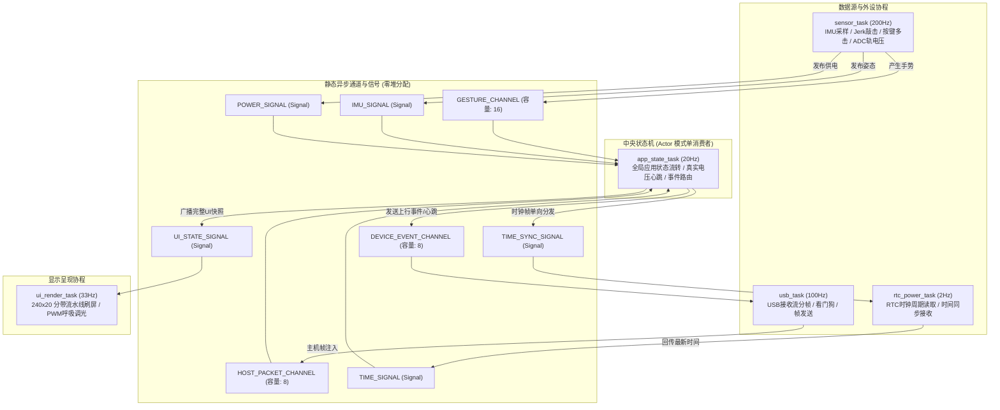

# 06. 异步并发模型与存储可靠性体系

系统底层架构依托 **Embassy 异步并发运行时**（基于 `esp-rtos`）与 **16MB SPI NOR Flash 硬件存储**（基于 `esp-storage`），在 [`src/bin/main.rs`](file:///Volumes/HIKSEMI/code/island/src/bin/main.rs) 与 [`src/storage/`](file:///Volumes/HIKSEMI/code/island/src/storage/) 中构筑了坚固的并发调度与持久化防线。

---

## 1. Embassy 异步协程并发架构

ESP32-C6 采用单核 32 位 RISC-V 架构（最高 160MHz 主频）。为了在单核上实现 250Hz 传感器突发采样、33Hz 屏幕流水线刷新、USB 串口通信与无线电监听互不阻塞，系统基于 Embassy 协程模型划分为 5 大轻量任务：



### 1.1 五大核心协程任务职责

1. **`sensor_task`（高频采样与交互感知）**：
   - 每 5ms（200Hz）触发一次循环；
   - 突发读取 QMI8658 12 字节数据，送入 `ImuFilter` 滤波；
   - 执行 `GestureDetector` 计算急动度 Jerk 与横滚角，产生敲击/倾斜/反扣手势并推入 `GESTURE_CHANNEL`；
   - 轮询 BOOT 按键，驱动 `ButtonDetector` 多击消抖状态机；
   - 每 200ms 执行一次 ADC1 供电轨分压采样，更新 `POWER_SIGNAL`。
2. **`usb_task`（通信协议与看门狗）**：
   - 每 10ms 循环一次；
   - 异步读取原生 USB-Serial-JTAG 缓冲区，完成协议行分帧并推入 `HOST_PACKET_CHANNEL`；
   - 维护 10 秒通信超时看门狗；
   - 独占式清空 `DEVICE_EVENT_CHANNEL`，原子发送上行事件帧。
3. **`rtc_power_task`（时钟与定时）**：
   - 每 500ms 循环一次；
   - 读取 PCF85063 硬件（或软件回退）时间，通过 `TIME_SIGNAL` 广播；
   - 独占监听 `TIME_SYNC_SIGNAL`，收到电脑同步帧后执行真实的年月日解算并写入硬件寄存器。
4. **`ui_render_task`（图形呈现与背光管理）**：
   - 每 30ms 循环一次（约 33FPS 稳定帧率）；
   - 从 `UI_STATE_SIGNAL` 获取全局应用快照；
   - 根据 `WaitConfirm` 状态计算 1.2Hz 正弦脉冲背光占空比，或在 `FaceDown` 时完全切断背光（0%）；
   - 驱动 `BandDisplay` 执行 12 条带顺序光栅化刷屏。
5. **`app_state_task`（中央应用调度中枢）**：
   - 每 50ms 循环一次；
   - 遵循 **Actor 模式** 统一作为 `HOST_PACKET_CHANNEL` 的唯一消费者，避免多任务争夺丢失帧；
   - 协调视图流转，以真实采样的供电电压周期性发送设备心跳帧；
   - 生成完整的不可变 `UiState` 快照，安全广播给 UI 协程。

---

## 2. 16MB Flash 存储布局与黑匣子崩溃保护（`src/storage/`）

微雪 ESP32-C6 板载拥有高达 **16MB** 的巨大 SPI NOR Flash 空间，远超一般开发板的 4MB 规格。

```text
 0x0000_0000 ┌────────────────────────────────────────┐
             │ Bootloader, Partition Table & Firmware │ (4MB 镜像运行区)
 0x0040_0000 ├────────────────────────────────────────┤
             │ DeviceConfig 设备持久化配置区 (4KB)     │ (Magic: 0x49534C44 "ISLD")
 0x0041_0000 ├────────────────────────────────────────┤
             │ BlackboxSnapshot 循环无损黑匣子区 (64KB) │ (1000 个 64 字节槽位)
             └────────────────────────────────────────┘
```

### 2.1 零大栈帧（Zero-Stack-Frame）硬件安全擦写
SPI NOR Flash 的物理特性决定了只能将位从 `1` 写为 `0`，更新数据必须先将对应物理扇区（4096 字节）整块擦除为 `0xFF`。

传统示例常在栈上分配 `[u8; 4096]` 内存块，在栈深度严格受限（一般任务仅配 4KB~8KB 栈）的嵌入式系统中极度危险。

[`StorageManager`](file:///Volumes/HIKSEMI/code/island/src/storage/mod.rs) 采用现代硬件驱动级擦写设计：
```rust
pub fn save_config(&mut self, config: &DeviceConfig) -> Result<(), ()> {
    // 1. 调用硬件级扇区擦除指令，不占用任何任务栈显式内存
    self.flash
        .erase(CONFIG_FLASH_OFFSET, CONFIG_FLASH_OFFSET + 4096)
        .map_err(|_| ())?;

    // 2. 仅将结构体切片直接刷入 Flash 偏移处
    let bytes: &[u8] = unsafe {
        core::slice::from_raw_parts(
            config as *const _ as *const u8,
            core::mem::size_of::<DeviceConfig>(),
        )
    };
    self.flash.write(CONFIG_FLASH_OFFSET, bytes).map_err(|_| ())
}
```
该设计消耗的栈帧开销小于 **64 字节**，完全契合 `#![deny(clippy::large_stack_frames)]` 的严苛检查。

### 2.2 64 字节紧凑黑匣子快照（`BlackboxSnapshot`）
当发生系统断电前夕、用户长按重启或接收到电脑端 `DUMP_LOGS` 指令时，系统通过 `record_snapshot` 在 `0x0041_0000` 后的环形缓冲区记录当前断面的电磁与系统快照：
```rust
#[repr(C)]
#[derive(Debug, Clone, Copy)]
pub struct BlackboxSnapshot {
    pub timestamp_sec: u64,     // 8B: 发生时刻时间戳
    pub v_rail_mv: u16,         // 2B: 崩溃前轨电压
    pub wifi_congestion: [u8; 13], // 13B: 1~13信道拥堵热度
    pub trigger_reason: u8,     // 1B: 0=手动保存, 1=主机错误, 2=掉电预警
    pub ap_count: u8,           // 1B: 发现 AP 数量
    pub ble_count: u8,          // 1B: 发现 BLE 数量
    pub _reserved: [u8; 39],    // 39B: 严格补齐至 64 字节
}
```
每个快照严格对齐至 64 字节，可在 64KB Flash 空间中持久保留最近 **1000 条** 历史态势断面。

---

## 3. 代码可靠性保证与零告警规范

本工程固件遵循高完整性嵌入式 Rust 规范，在源码根部固化强制编译约束：
- `#![no_std]` / `#![no_main]`：严控运行时占用，剔除标准库系统调用依赖；
- `#![deny(warnings)]`：全工程零警告，所有 lint 告警强制转为错误处理；
- `#![deny(clippy::mem_forget)]`：禁止丢失外设缓冲区句柄；
- `#![deny(clippy::large_stack_frames)]`：严防深栈帧引发的硬件 HardFault。
- 经全量静态测试，`cargo clippy --release` 与 `cargo build --release` 保持 **0 errors, 0 warnings**。
