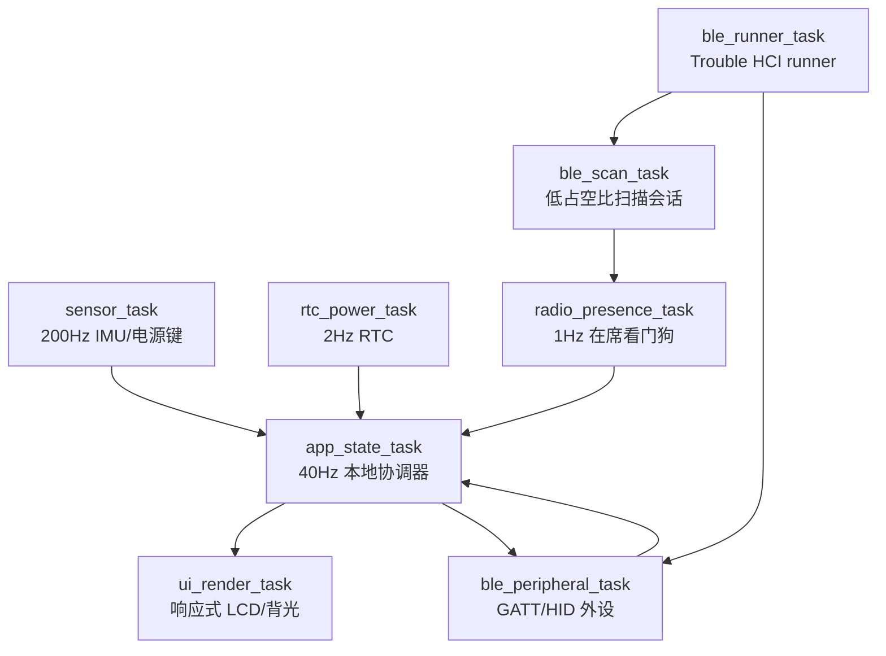

# 06. 本地状态、异步并发与可靠存储

固件使用 Embassy 任务、固定容量通道和单一 Flash owner，让设备在没有外部连接时继续运行。
当前实现没有独立的存储任务：`Board::storage` 在启动时由组合根加载配置，运行期的保存和黑匣子
写入由 `StorageManager` 提供同步 API。文档只描述已经存在的任务、通道和存储布局。

## 1. 实际任务拓扑



### 1.1 任务职责

| 任务 | 实现职责 | 运行约束 |
| --- | --- | --- |
| `ble_runner_task` | 独占 Trouble HCI runner | 只负责 HCI 生命周期，不承载业务状态 |
| `ble_scan_task` | 创建、回收 BLE 扫描会话 | 扫描失败等待 1 秒后重试，不能忙轮询 |
| `ble_peripheral_task` | 广告、HID 通知、MusicScene 写入和 ATT 回复 | 连接断开时清空待发 HID 动作 |
| `sensor_task` | IMU 校准/滤波、手势、姿态和电源状态采样 | 每 5ms 采样一次；通道满时丢弃可重建手势 |
| `rtc_power_task` | 读取 PCF85063 并发布 `DateTime` | 每 500ms 更新一次，不接受外部时钟作为真源 |
| `app_state_task` | `AppStateMachine`、`PetBehavior` 和 UI 快照 | 每 25ms 维护一次；事件先于维护 tick 处理 |
| `radio_presence_task` | 目标绑定、RSSI EMA、在席看门狗和广播统计 | 以 1 秒 ticker 为基线发布 `RadioReport`，目标未绑定时保持 `Away` |
| `ui_render_task` | 消费 `UiState`、管理背光并刷新 GC9A01 | Pet 视图约 30ms 一次，否则等待快照或 500ms 安全唤醒 |

`PetBehavior` 没有独立任务，它在 `app_state_task` 中以同步、固定大小的
状态机推进。类似地，音乐事件由 `ble_peripheral_task` 写入通道，再由应用维护 tick 消费；不
存在单独的音乐或动画任务。

## 2. 静态通道与信号（`src/ipc.rs`）

### 2.1 有界事件通道

```text
GESTURE_CHANNEL             GestureEvent       容量 16
RADIO_REPORT_CHANNEL        RadioReport        容量 4
BLE_ADVERTISEMENT_CHANNEL   BleAdvertisement   容量 32
HID_ACTION_CHANNEL          HidAction          容量 8
MUSIC_SCENE_CHANNEL         MusicScene         容量 8
```

手势、广播、在席、音乐和 HID 都是可丢弃或可重建的边沿事件。发送方使用 `try_send`，队列
拥塞时记录诊断并降级，不在传感器或应用任务中等待无线链路。

### 2.2 最新值信号

```text
UI_STATE_SIGNAL       UiState             app_state_task -> ui_render_task
TIME_SIGNAL           DateTime            rtc_power_task -> app_state_task
POWER_SIGNAL          PowerStatus         sensor_task -> app_state_task
IMU_SIGNAL            ImuAttitudeSnapshot sensor_task -> app_state_task
RADIO_TARGET_SIGNAL   BleTargetCommand    绑定命令 -> radio_presence_task
TARGET_APPLIED_SIGNAL BleTargetCommand    radio_presence_task -> app_state_task
```

`Signal` 只保留最新值；UI 不会排队历史帧。`app_state_task` 使用 `select3` 等待手势、在席
报告或 25ms ticker，然后在维护分支排空音乐和各类最新值信号。

## 3. 本地状态与取消边界

状态优先级保持为：

```text
FaceDown/Sleep > 用户手势 > MusicScene > IdleAnimation
```

- FaceDown 让 `AppStateMachine` 让宠物进入深度睡眠并将背光设为 0；UI 跳过 SPI 刷新；
- 翻回 FaceUp 后恢复背光与宠物唤醒关键帧；
- 3 秒没有新音乐帧时由应用生成 `Inactive` 场景；
- BLE、扫描和 UI 的等待分支都使用 Embassy future，可取消且不会持有共享 I2C/SPI 总线；
- 连接断开只清理 HID 瞬时队列，不清理 RTC、宠物或 UI 快照。

## 4. Flash 布局与 Schema V2 存储结构

当前常量定义的布局为：

```text
0x0000_0000  固件及引导区域（由镜像/分区配置决定）
0x0040_0000  DeviceConfig Sector A（4 KiB）
0x0040_1000  DeviceConfig Sector B（4 KiB）
0x0041_0000  BlackboxSnapshot 环形区（1000 x 64 B）
```

### 4.1 Schema V2 内存与序列化排布 (52 字节定长记录)

| 偏移 (Offset) | 字段 | 类型 | 说明 |
| :--- | :--- | :--- | :--- |
| `0..4` | `magic` | `u32` (LE) | 标头魔数 `0x4953_4C44` ("ISLD") |
| `4..6` | `version` | `u16` (LE) | 架构版本 `CONFIG_VERSION = 2` |
| `6..8` | `payload_len` | `u16` (LE) | 有效载荷长度 `CONFIG_PAYLOAD_SIZE = 36` |
| `8..12` | `crc32` | `u32` (LE) | 载荷区校验码（覆盖偏移 12..48） |
| `12..16` | `seq` | `u32` (LE) | 递增版本序号（RFC 1982 回绕安全） |
| `16..28` | `gyro_bias_mdps` | `[i32; 3]` | 陀螺仪零偏三轴补偿 |
| `28..34` | `accel_bias_mg` | `[i16; 3]` | 加速度计零偏三轴补偿 |
| `34..38` | `ble_target_hash`| `u32` (LE) | 绑定手机 BLE MAC 哈希 |
| `38` | `rssi_away_threshold` | `i8` | 在席远离阈值 (默认 -78dBm) |
| `39` | `brightness_normal` | `u8` | 正常亮度百分比 (0..=100) |
| `40` | `default_mode` | `u8` | 默认启动视图模式 |
| `41` | `pet_hunger` | `u8` | 滚球兽饱腹度 (0..=4) |
| `42` | `pet_strength` | `u8` | 滚球兽力量值 (0..=4) |
| `43` | `pet_discipline` | `u8` | 滚球兽训练服从度 (0..=100) |
| `44` | `pet_care_mistakes` | `u8` | 呼叫失误与照料过失计数 |
| `45` | `pet_training_count` | `u8` | 钟摆摇摇乐蓄力训练总次数 |
| `46` | `pet_evolution_stage`| `u8` | 进化形态阶段 (0: Koromon .. 5: Omegamon) |
| `47` | `pet_weight_g` | `u8` | 数码兽真实体重 (克，基准 5..50g，吃肉+1g，胶囊+2g，特训-1g) |
| `48..52` | `commit_marker` | `u32` (LE) | 两阶段提交标志 `0x434F_4D4D` ("COMM") |

`StorageManager::load_config` 启动时读取 A/B 两个扇区，验证 Magic、版本、长度、CRC 和提交标记，选择回绕安全的最大 `seq`。若遇旧版 V1 记录则自动兼容迁移；若两个扇区都无效，则安全回退至 `DeviceConfig::default()`。

`StorageManager::save_config` 的顺序固定为：

1. 选择非活动扇区并擦除整个 4 KiB 扇区；
2. 写入前 48 字节配置记录与载荷（不含提交标记，递增 `seq`）；
3. 回读并验证长度、CRC32 和 `seq`；
4. 单独写入最后 4 字节 `CONFIG_COMMIT_MARKER`，再完整回读验证；
5. 只有验证完全成功才切换活动扇区。

任何擦除、写入、读取或校验错误都返回 `StorageError`，旧扇区保持绝对完好可恢复。黑匣子以 64 字节定长记录追加，扇区边界才擦除，写入后立即回读并反序列化校验；失败时擦除损坏扇区并返回错误，不让 CPU 停机。
