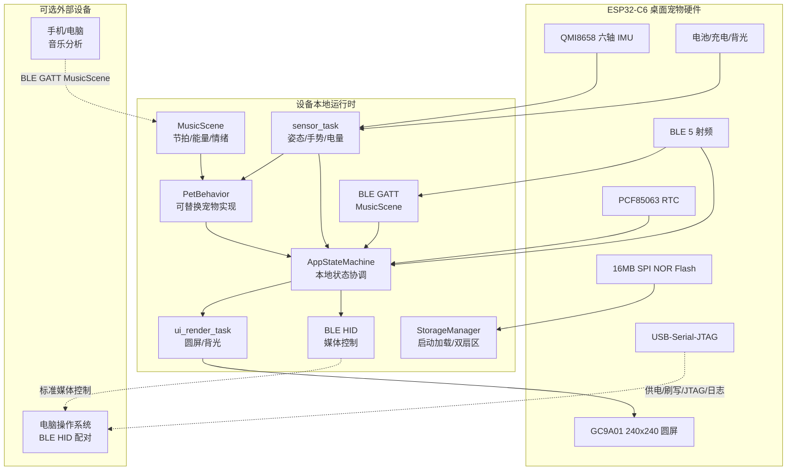

# ESP32-C6 自主桌面宠物系统架构总览

本工程面向 Waveshare **ESP32-C6-LCD-1.28**，目标是构建一个**脱离外部连接也能成立的桌面宠物**：设备自己计时、感知、渲染、陪伴和运行专注节律；手机或电脑只在需要时通过 BLE 发送音乐特征或接收 BLE HID 外设事件。

USB-C 口在当前硬件上是固定功能的 USB-Serial-JTAG 控制器，负责供电、刷写、JTAG 和调试日志，**不是可编程 USB HID 控制器**。电脑操作能力由固件内置的 BLE HID 服务提供，不需要任何宿主程序。

---

## 1. 设计原则与系统拓扑

### 1.1 产品原则

- **设备自洽**：无 USB 数据连接、无 BLE 连接、无云端时，宠物仍能完成启动、计时、专注、互动、睡眠和唤醒。
- **连接是增强而非依赖**：BLE 用于 HID、音乐特征和在席感知；断开后自动回退本地状态机。
- **本地优先**：RTC、IMU、电量、在席状态和本地 Flash 是运行时真源，不接受外部遥测覆盖核心状态。
- **可爱优先**：软萌玩偶视觉和有时间轴的动画是主界面，仪表盘只作为自检或诊断视图。
- **固定资源**：所有通信、动画和资产解码均使用有界队列与固定容量，保持 `no_std` 和零大栈帧约束。

### 1.2 目标拓扑



---

## 2. 源码目录职责

```text
digivice/
├── docs/architecture/          # 与实现同步的架构规范
├── src/
│   ├── bin/
│   │   └── main.rs             # 纯组合根 (~120行)：初始化硬件、堆、板卡、BLE栈并启动并发任务
│   ├── app/                    # 本地应用状态协调与工作流 (AppStateMachine, FocusSession, ConfigState)
│   ├── board/                  # LCD、IMU、RTC、电源与硬件引脚隔离 (BSP)
│   ├── domain/                 # 核心跨层抽象领域模型 (ViewMode, DeviceOrientation, MusicScene, HidAction, FocusPhase)
│   ├── gesture/                # 姿态滤波与敲击/倾斜手势识别引擎
│   ├── ipc.rs                  # 全局静态 Channel 与 Signal 权威总线
│   ├── pet/                    # PetBehavior 接口、滚球兽自主状态机、模块化资产 (assets/) 与零浮点弹性物理
│   ├── radio/                  # 完整 BLE 射频：在席感知 (presence)、GATT 服务 (gatt)、HID 编码 (hid)
│   ├── storage/                # 可靠存储：双扇区配置 (config)、黑匣子 (blackbox)、容灾管理 (manager)、CRC32
│   ├── tasks/                  # 异步并发任务汇集层 (sensor, rtc, radio, ui, app)
│   └── ui/                     # 纯圆形屏呈现层 (UiState 快照、主题、软萌宠物视图、自检视图)
```

连接适配器只向本地类型化通道投递有界事件；USB-Serial-JTAG 不属于应用业务通道。

---

## 3. 分模块架构索引

1. **[01. 硬件外设与板级支持包](./01-hardware-and-bsp.md)**
   - 板载资源、引脚隔离、带缓冲显示和低功耗约束。
2. **[02. 物理姿态解算与手势识别](./02-gestures-and-physics.md)**
   - 重力滤波、敲击、倾斜、扣放和取消安全性。
3. **[03. BLE/USB 外设边界](./03-protocol-and-host.md)**
   - BLE HID、MusicScene GATT、BLE 在席和 USB-Serial-JTAG 的边界。
4. **[04. 宠物视觉与混合渲染](./04-ui-and-graphics.md)**
   - 软萌玩偶美术、精灵资产、关键帧、图层和脏区域刷新。
5. **[05. BLE 在席、HID 与音乐联动](./05-radio-sensing.md)**
   - 在席感知、HID 外设和 MusicScene 特征输入。
6. **[06. 并发、状态与可靠存储](./06-concurrency-and-storage.md)**
   - FocusSession、本地状态时钟、固定容量队列和 Flash 双缓冲。
7. **[07. 可替换宠物与交互扩展](./07-pet-and-interaction.md)**
   - PetBehavior/PetEvent 契约、自定义宠物接入和交互层边界。

---

## 4. 强制架构同步边界

涉及以下任一项时，必须同时更新本目录中相应文档和路线图：

- BLE 服务、HID 报告、音乐特征格式或 USB 调试边界；
- 宠物视图、动画状态、精灵资产格式或刷新策略；
- FocusSession、任务拓扑、静态通道或 Flash 存储布局；
- 板级引脚、显示带缓冲、BLE 在席阈值和功耗策略。
