# ESP32-C6 桌面灵动岛系统架构总览

本工程是基于 Espressif **ESP32-C6**（微雪 Waveshare ESP32-C6-LCD-1.28 开发板）构建的纯 Rust、`#![no_std]`、异步高可靠性桌面级智能交互终端固件与电脑守护服务。

---

## 1. 架构设计哲学与系统拓扑

整个系统采用基于 **Embassy 异步并发运行时** 的多任务协作式架构。硬件外设层、板级支持包（BSP）、算法过滤层、中央应用状态机与 UI 渲染管线各司其职，通过类型安全的静态 `Channel` 与 `Signal` 解耦。

```mermaid
flowchart TD
    subgraph Hardware["硬件设备层 (Waveshare ESP32-C6-LCD-1.28)"]
        GC9A01["GC9A01 1.28寸圆屏 (SPI2)"]
        QMI8658["QMI8658 6轴IMU (I2C0)"]
        PCF85063["PCF85063 RTC (I2C0)"]
        LEDC_PWM["背光PWM (GPIO7 / LEDC)"]
        ADC_KEY["供电ADC (GPIO0) / BOOT按键 (GPIO9)"]
        USB_JTAG["原生 USB-Serial-JTAG (GPIO12/13)"]
        RADIO_PHY["2.4GHz Wi-Fi 6 + BLE 5 (esp-radio)"]
        FLASH_CHIP["16MB SPI NOR Flash (片内SPI)"]
    end

    subgraph BSP["板级支持包 (src/board/)"]
        Display["BandDisplay (分带显存 9.6KB)"]
        Backlight["Backlight (LEDC 呼吸控制)"]
        ImuDriver["Qmi8658 (12B 突发采样)"]
        RtcDriver["Pcf85063 (RTC硬件/软件后备时钟)"]
        PowerKey["PowerKeyMonitor (分压采样+充电检测+BOOT硬件诊断)"]
    end

    subgraph Engine["数据处理与算法层"]
        ImuFilter["ImuFilter (低通重力分离+死区航向积分)"]
        GestureDetector["GestureDetector (Jerk敲击/左右倾斜/朝下扣放)"]
        BlePresence["BlePresenceTracker (EMA滤波+离开滞后比较)"]
        StorageMgr["StorageManager (Flash分区配置+循环黑匣子)"]
    end

    subgraph AsyncBus["Embassy 异步通信总线 (src/bin/main.rs)"]
        IMU_SIGNAL["IMU_SIGNAL"]
        POWER_SIGNAL["POWER_SIGNAL"]
        TIME_SIGNAL["TIME_SIGNAL"]
        TIME_SYNC_SIGNAL["TIME_SYNC_SIGNAL"]
        UI_STATE_SIGNAL["UI_STATE_SIGNAL"]
        GESTURE_CHANNEL["GESTURE_CHANNEL (16)"]
        HOST_PACKET_CHANNEL["HOST_PACKET_CHANNEL (16)"]
        DEVICE_EVENT_CHANNEL["DEVICE_EVENT_CHANNEL (8)"]
        RADIO_REPORT_CHANNEL["RADIO_REPORT_CHANNEL (4)"]
        BLE_ADVERTISEMENT_CHANNEL["BLE_ADVERTISEMENT_CHANNEL (32)"]
        RADIO_TARGET_SIGNAL["RADIO_TARGET_SIGNAL"]
        STORAGE_COMMAND_CHANNEL["STORAGE_COMMAND_CHANNEL (8)"]
        STORAGE_OUTCOME_CHANNEL["STORAGE_OUTCOME_CHANNEL"]
        TARGET_APPLIED_SIGNAL["TARGET_APPLIED_SIGNAL"]
    end

    subgraph Tasks["Embassy 并发协程任务集"]
        T_Sensor["sensor_task (200Hz IMU采样 + 供电/引脚诊断)"]
        T_USB_RX["usb_rx_task (串口接收流分帧与指令注入)"]
        T_USB_TX["usb_tx_task (事件独占发送与即时推送)"]
        T_RTC["rtc_power_task (RTC同步与时钟分发)"]
        T_UI["ui_render_task (33Hz分带流水线渲染)"]
        T_App["app_state_task (中央单消费者状态总控)"]
        T_BLE["ble_runner_task + ble_scan_task (Trouble HCI 与扫描会话)"]
        T_Radio["radio_presence_task (BLE 扫描消费与在席看门狗)"]
        T_Storage["storage_task (单 Flash Owner)"]
    end

    subgraph HostPC["电脑端 (Host PC)"]
        HostAgent["tools/host_agent.py (跨平台Python守护进程)"]
        HostAction["AI Agent / 编译状态推送 / 离席自动锁屏"]
    end

    %% Hardware to BSP
    GC9A01 --> Display
    LEDC_PWM --> Backlight
    QMI8658 --> ImuDriver
    PCF85063 --> RtcDriver
    ADC_KEY --> PowerKey

    %% BSP to Tasks
    ImuDriver --> T_Sensor
    PowerKey --> T_Sensor
    Display --> T_UI
    Backlight --> T_UI
    RtcDriver --> T_RTC

    %% Sensor processing
    T_Sensor --> ImuFilter --> GestureDetector --> GESTURE_CHANNEL
    T_Sensor --> IMU_SIGNAL
    T_Sensor --> POWER_SIGNAL

    %% Host Communications
    USB_JTAG --> T_USB_RX --> HOST_PACKET_CHANNEL
    DEVICE_EVENT_CHANNEL --> T_USB_TX --> USB_JTAG
    USB_JTAG <--> HostAgent <--> HostAction

    %% Coordinator
    GESTURE_CHANNEL --> T_App
    HOST_PACKET_CHANNEL --> T_App
    RADIO_REPORT_CHANNEL --> T_App
    BLE_ADVERTISEMENT_CHANNEL --> T_Radio
    T_BLE --> BLE_ADVERTISEMENT_CHANNEL
    T_Radio --> RADIO_REPORT_CHANNEL
    T_App --> RADIO_TARGET_SIGNAL --> T_Radio
    T_Radio --> TARGET_APPLIED_SIGNAL --> T_App
    STORAGE_COMMAND_CHANNEL --> T_Storage
    T_Storage --> STORAGE_OUTCOME_CHANNEL --> T_App
    T_App --> STORAGE_COMMAND_CHANNEL
    POWER_SIGNAL --> T_App
    TIME_SIGNAL --> T_App

    T_App --> TIME_SYNC_SIGNAL --> T_RTC
    T_App --> DEVICE_EVENT_CHANNEL
    T_App --> UI_STATE_SIGNAL --> T_UI
```



---

## 2. 完整源码目录结构与职责划分

```text
island/
├── .cargo/
│   └── config.toml             # 目标架构 riscv32imac-unknown-none-elf、runner 与 espflash 配置
├── Cargo.toml                  # 依赖配置（esp-hal、esp-rtos、embedded-graphics、trouble-host等）
├── docs/                       # 项目文档库
│   ├── architecture/           # [分模块架构文档专区]
│   │   ├── README.md           # [本文件] 架构总览与导航索引
│   │   ├── 01-hardware-and-bsp.md      # 板级外设、分带显存与强类型引脚封印
│   │   ├── 02-gestures-and-physics.md  # 姿态滤波、Jerk 敲击与手势状态机
│   │   ├── 03-protocol-and-host.md     # USB 双向帧协议、零堆序列化与 Python 守护服务
│   │   ├── 04-ui-and-graphics.md       # 圆屏 UI 引擎、调色板与 4 大视图渲染（灵动岛/时钟/自检/单眼桌宠）
│   │   ├── 05-radio-sensing.md         # BLE 5 近场感知与离席自动安全锁屏
│   │   └── 06-concurrency-and-storage.md # 9 大协程拓扑、Actor 单消费者与 Flash 黑匣子
│   ├── flashing.md             # 固件烧录与环境依赖说明
│   ├── hardware-esp32-c6-lcd-1.28.md   # 硬件管脚映射、供电与时钟约束规格
│   └── plan/                   # 各阶段里程碑开发计划与设计规约
├── src/
│   ├── lib.rs                  # 库入口，声明全局 #![deny(warnings)] 与子模块
│   ├── bin/
│   │   └── main.rs             # 固件入口：全局硬件装配、静态总线与 9 大协程任务生成
│   ├── app/                    # 中央应用调度中枢与业务协调器
│   │   ├── mod.rs              # AppStateMachine 有限状态机（带守卫视图流转/超时熔断/脏标记推送）
│   │   └── pet_engine.rs       # PetEngine 赛博单眼桌宠行为状态机（自然眨眼/缓动查表/抚摸喂食/重力注视）
│   ├── board/                  # 板级支持包 (BSP)
│   │   ├── mod.rs              # BoardPeripherals/Board 结构装配与 I2C0 互斥总线共享
│   │   ├── display.rs          # GC9A01 驱动与 240x20 分带缓冲区 (9.6KB RAM) 渲染引擎
│   │   ├── imu.rs              # QMI8658 6轴IMU 寄存器配置与 12 字节连续突发读取驱动
│   │   ├── power_key.rs        # ADC1 GPIO0 供电轨采样、ETA6098 充电检测与 BOOT 键读取
│   │   └── rtc.rs              # PCF85063 硬件 RTC 与软件自动 fallback 纳秒级后备时钟
│   ├── gesture/                # 物理交互与姿态融合
│   │   ├── mod.rs              # GestureEvent 事件枚举定义
│   │   ├── filter.rs           # 姿态解算器：一阶低通滤波分离重力向量与死区航向积分
│   │   └── detector.rs         # Jerk急动度敲击检测、双向倾斜死区锁定、朝下翻转免打扰与航向追踪
│   ├── proto/                  # USB 双向通信协议
│   │   ├── mod.rs              # 协议行解析器（SYS/ACT/SYNC/BLE_BIND/DUMP_LOGS）与 DeviceEvent Display 格式化
│   │   └── usb_task.rs         # UsbLink 传输驱动、环形行缓存与主机失联 10 秒看门狗
│   ├── ui/                     # 240x240 圆形人机交互界面
│   │   ├── mod.rs              # 颜色调色板、UiState 统一快照、PetUiState 与 ViewMode 视图枚举
│   │   ├── island_view.rs      # Mode A：桌面灵动岛视图（动态胶囊、进度脉冲、系统仪表弧）
│   │   ├── pet_view.rs         # Mode B：赛博单眼灵动桌宠视图（重力注视大眼/双高光/多态瞳孔/弹性眼睑）
│   │   └── selftest_view.rs    # Mode C：硬件自检仪表盘（实时传感器裸值可视化）
│   ├── radio/                  # 2.4GHz 无线射频感知
│   │   ├── mod.rs              # RadioReport 数据结构与无线通道定义
│   │   └── ble_presence.rs     # BLE 5 目标设备追踪：EMA 信号滤波与 Near/Away 滞后门限
│   └── storage/                # Flash 存储与黑匣子
│       └── mod.rs              # 16MB Flash 分区读写：版本化/CRC/提交标记配置与 64B 环形黑匣子快照
└── tools/
    └── host_agent.py           # 电脑端全功能 Python 守护脚本（遥测流送、时钟对齐、离席自动锁屏）
```

---

## 3. 分模块架构设计文档索引

点击链接可深入查阅各子系统的系统架构原理与宏观设计规约：

1. **[01. 硬件外设与板级支持包（BSP）架构](./01-hardware-and-bsp.md)**
   - 240x20 分带渲染引擎如何解决 112.5KB 全屏显存与 MCU 内存竞争；
   - QMI8658 12 字节连读突发性能优化；
   - PCF85063 硬件与软件时钟自适应回退机制；
   - 供电分压采样与 ETA6098 充电状态检测。
2. **[02. 物理姿态解算与手势识别引擎](./02-gestures-and-physics.md)**
   - 一阶低通滤波重力向量提取与零漂抑止；
   - 基于急动度（Jerk）的高精度防误触敲击检测状态机；
   - 左右倾斜滞后回差比较与死区锁定；
   - 屏幕朝下扣放（FaceDown）免打扰检测；
   - 硬件引脚隔离与纯物理空间姿态手势引擎。
3. **[03. USB 双向协议栈与电脑守护服务](./03-protocol-and-host.md)**
   - 行优先 ASCII 紧凑协议规范（`@ISLAND:`）；
   - 基于 `core::fmt::Display` 的零堆分配协议序列化；
   - 容错式键值对解析引擎；
   - 跨平台 Python 守护进程（VID:PID 自动协商、系统遥测、时区对齐与 OS 自动锁屏）。
4. **[04. 圆屏 UI 引擎与多视图渲染系统](./04-ui-and-graphics.md)**
   - 极客暗黑高对比度 RGB565 调色板；
   - 动态灵动岛胶囊状态流转（Thinking 脉冲、WaitConfirm 呼吸、Success/Error 告警）；
   - 赛博单眼灵动桌宠情绪与重力注视动力学；
   - 硬件自检仪表板。
5. **[05. BLE 5 近场感知与离席自动安全锁屏](./05-radio-sensing.md)**
   - BLE 5 目标设备追踪与 EMA 指数滑动平均滤波；
   - Near/Away 滞后迟滞比较与离席超时看门狗。
6. **[06. 异步并发模型与存储可靠性体系](./06-concurrency-and-storage.md)**
   - Embassy 9 大异步并发协程任务设计；
   - 单消费者 Actor 模式解决 MPMC 通道竞争问题；
   - 16MB Flash 分区布局与零大栈帧（Zero-Stack-Frame）硬件擦写；
   - 64 字节循环黑匣子持久化容灾机制；
   - `#![deny(warnings)]` 与全链路代码质量保证。
